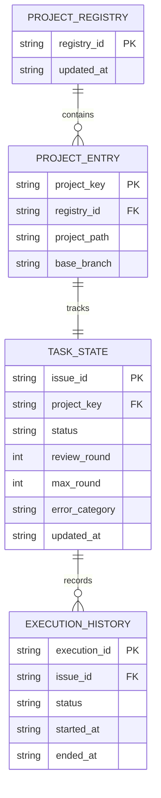

# データ構造・状態設計書（スキーマ・永続化・状態定義）
**[サブタイトル・管理データ構造と永続化仕様]**

---

## 1. 概要とデータ管理方針

### 1.1 管理対象データの目的

本設計書が規定するデータ構造、状態定義、JSONスキーマ、メタデータ構成、および永続化方針の目的を明記する。次の項目を具体化すること。

- **管理対象**: [管理するエンティティ、状態、履歴]
- **データ形式・文字コード・改行**: [JSON / DB / その他、UTF-8等、改行規則]
- **時刻の基準**: [タイムゾーン、保存形式、精度]
- **スキーマの正本形式**: [本書のフィールド表 / JSON Schema / DB定義など]
- **機密性・個人情報分類**: [保存禁止項目、マスキング、暗号化、アクセス制御]

### 1.2 データ境界 (DAO / 永続化ストレージ正本)

- **本書の正本範囲**: `persistent_data`。ファイルシステムやストレージに物理保存される永続データ、状態タクソノミー、スキーマ構造の正本とする。
- **DTOとの使い分け**: メモリ上のモジュール間パッシング用DTOについては「詳細設計書 (DD)」を参照すること。
- **DDとの関係**: モジュールの呼び出し順序、関数契約、制御フロー、状態遷移条件は詳細設計書 (DD)を正本とし、本書は保存形式と永続化契約を定義する。
- **他文書との関係**: 要求、環境、運用、テスト、ADR、レビュー文書はそれぞれの`ssot_scope`を正本とし、本書の保存仕様を上書きしない。
- **責務の対象外**: [本書で定義せず、基本設計書、詳細設計書、または他の正本へ委譲する内容]
- **矛盾時の扱い**: 文書の更新日ではなく、該当する`ssot_scope`の正本を更新し、関連文書を追従させる。

### 1.3 ファイル配置および階層構造

システム内で管理されるメタデータ・状態ファイルの配置ディレクトリ階層と命名規則を定義する。相対パス、所有者、アクセス権、保持期間、バックアップ・復旧方法を記入する。

| データ種別         | 相対パス / 命名規則   | 保持内容                             | 所有者・アクセス権 | 保持・バックアップ・復旧           |
| :----------------- | :-------------------- | :----------------------------------- | :----------------- | :--------------------------------- |
| [母艦メタデータ]   | [相対パス / パターン] | [プロジェクト定義・タスク管理データ] | [所有者・権限]     | [保持期間・バックアップ・復旧方法] |
| [状態保存ファイル] | [相対パス / パターン] | [進捗・最終ステータス・試行履歴]     | [所有者・権限]     | [保持期間・バックアップ・復旧方法] |
| [排他制御ファイル] | [相対パス / パターン] | [ロック情報]                         | [所有者・権限]     | [清掃・復旧方法]                   |

---

## 2. データ構造およびスキーマ定義 (Mermaid データモデル図)

### 2.1 エンティティ関係・データモデル構造 (Mermaid ER図)

物理保存されるデータ構造の相互関係やスキーマ構造を Mermaid 記法で記述する。図に登場する全エンティティをフィールド定義にも記載し、関係線のカーディナリティと本文の説明を一致させる。

<!-- 記入時: サンプルのエンティティ名・フィールド・関係・カーディナリティは実際のスキーマへ置換する。 -->

### 2.2 データモデル・フィールド仕様

管理するデータ構造の各フィールド名、データ型、必須性、NULL可否、既定値、許容値、制約条件、および将来の互換性を明記する。

| JSONパス / フィールド名 | データ型                                           |   必須性    |  NULL可   | デフォルト値 | 許容値・制約条件                         | 互換性・移行メモ                 |
| :---------------------- | :------------------------------------------------- | :---------: | :-------: | :----------- | :--------------------------------------- | :------------------------------- |
| [$.entity.field]        | [文字列 / 数値 / ブーリアン / 配列 / オブジェクト] | 必須 / 任意 | 可 / 不可 | [既定値]     | [役割・列挙値・範囲・一意性・サイズ上限] | [追加時の既定値・廃止・変換方法] |

---

## 3. 永続化・原子置換契約・排他制御

### 3.1 原子的書き込み契約 (Atomic Write Contract)

データ破損や中途半端な書き込みを防止するためのファイル更新手順を定義する。

1. **一時ファイル生成**: 対象ファイルと同一ディレクトリ内に一時ファイルを作成し、データを全量書き出す。命名規則と既存一時ファイルの扱いを記入する。
2. **物理書き込み保証**: ディスク同期処理を呼び出し、メモリキャッシュからディスクへの物理的な保存を完了させる。同期失敗時の扱いを記入する。
3. **原子的置換**: ファイルシステムのアトミック置換処理を用いて、一瞬で正本ファイルを更新する。置換失敗時に正本を保全する方法を記入する。
4. **一時ファイル清掃**: 正常・異常・プロセス中断時に残った一時ファイルを検出・清掃する条件と担当を記入する。
5. **復旧確認**: 再起動後に正本・一時ファイル・バックアップを検査する方法と、破損検知時の復旧元を記入する。

- **文字コード・改行・スキーマバージョン**: [保存時の形式と互換性判定]

### 3.2 排他制御仕様 (FileLock)

- **ロック対象ファイル**: [競合を防止する対象のロックファイルパス]
- **ロック識別情報**: [プロセスID、ホスト名、取得時刻、所有者など。機密情報は含めない]
- **ロック獲得待ち方針**: [ノンブロッキング / タイムアウト付き待機 / キューイング]。既定方針を変更する場合は理由と最大待機時間を明記する。
- **取得失敗時の処理**: [即時スキップ、再試行、利用者通知、エラー終了など]
- **stale lock の判定・回収**: [判定条件、回収権限、誤回収を防ぐ確認]
- **正常終了時の解放**: [解放手順、解放失敗時の扱い]
- **異常終了・強制終了時の扱い**: [OSやプロセス終了後の回収方法]

---

## 4. データライフサイクルと互換性保全

### 4.1 フォーマット移行と互換性ルール

旧形式のデータを検出した場合の変換、後方互換性、ロールバック可否を表形式で定義する。

| 移行元バージョン | 移行先バージョン | 実行契機                                 | 変換内容・保持する旧フィールド | ロールバック可否・方法 | 失敗時の扱い             |
| :--------------- | :--------------- | :--------------------------------------- | :----------------------------- | :--------------------- | :----------------------- |
| [v1]             | [v2]             | [読み込み時 / 明示コマンド / デプロイ時] | [変換内容・保持期間]           | [可 / 不可。方法]      | [正本保全、通知、復旧元] |

- **旧バージョン互換**: 旧形式のデータ構造を検出した場合の動的変換ルール
- **後方互換性維持**: 新フィールド追加時における未定義キーの安全なフォールバック処理方針

---

## 5. 作成完了チェック

- [ ] `document_role`、`ssot_scope`、`status`、`owner`をFrontmatterへ設定した。
- [ ] 管理対象、データ形式、文字コード、時刻基準、スキーマの正本形式を記入した。
- [ ] 全エンティティがER図とフィールド仕様の双方に定義され、関係・カーディナリティが一致している。
- [ ] 必須性、NULL可否、既定値、列挙値、制約、一意性、サイズ上限を記入した。
- [ ] ファイルの相対パス、所有者・アクセス権、保持期間、バックアップ・復旧を記入した。
- [ ] 原子書き込みの同期・置換・失敗・清掃・復旧契約を記入した。
- [ ] FileLockの取得、待機、stale lock、解放、異常終了時の扱いを記入した。
- [ ] バージョン移行、後方互換性、ロールバック、移行失敗時の扱いを記入した。
- [ ] Mermaidのサンプルエンティティ・フィールド・関係および未置換の `[ ... ]` が残っていない。

---

## 6. 改訂履歴 (Change Log)

| 版数    | 改訂日     | 変更者     | 変更内容・変更理由 (Why) |
| :------ | :--------- | :--------- | :----------------------- |
| Rev.1.0 | YYYY-MM-DD | [作成者名] | 新規作成（初版制定）     |
