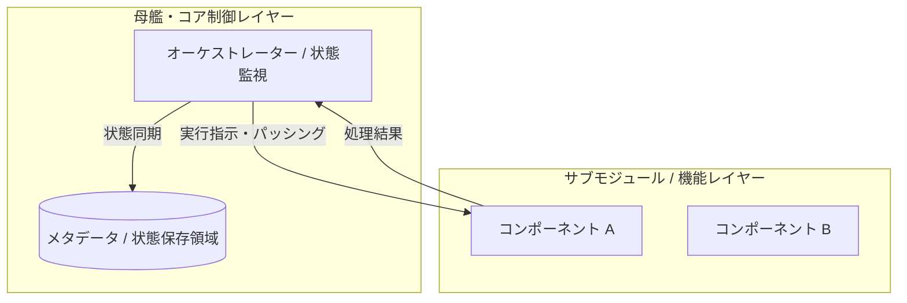

# 基本設計書（基本仕様・システム全体アーキテクチャ定義）
**[サブタイトル・アーキテクチャ概要]**

---

## 1. 概要と基本方針

### 1.1 システム目的と対象範囲

本システムおよび対象モジュール群の目的、解決するビジネス・技術的課題、および設計上の基本原則を記述する。次の項目を具体化すること。

- **対象範囲**: [この設計書で扱うシステム・機能・データ]
- **対象外範囲**: [本設計書では扱わない機能・責務]
- **利用者・外部システム**: [利用者、呼び出し元、連携先]
- **前提・制約**: [既存仕様、技術、運用、法令、性能などの制約]
- **主要な非機能要件**: [可用性、性能、セキュリティ、監査性、保守性など]

### 1.2 アーキテクチャ基本原則と課題解決

旧実装や従来方式の課題に対し、新構造・採用ツール・構成要素がどのように解決するかを対比して明記する。採用しなかった案とトレードオフも必要に応じて記録する。

| #    | 課題・ボトルネック |     優先度     | 解決方針・選定技術     | 選定理由・トレードオフ     | 担当コンポーネント     | 関連文書               |
| :--- | :----------------- | :------------: | :--------------------- | :------------------------- | :--------------------- | :--------------------- |
| 1    | [従来課題の記述]   | [高 / 中 / 低] | [解決策および選定技術] | [採用理由・代替案との比較] | [担当コンポーネント名] | [文書番号・相対リンク] |

### 1.3 本書のSSOT範囲と文書境界

- **本書の正本範囲**: `system_architecture`。システム全体の目的、アーキテクチャ、責務、境界、横断的な方針を定義する。
- **詳細設計との境界**: 関数契約、DTO、具体的な制御フロー、状態遷移条件は詳細設計書 (DD)を正本とする。
- **データ構造仕様との境界**: 永続化スキーマ、保存状態、移行、原子書き込み、排他制御はデータ構造仕様書 (DS)を正本とする。
- **他文書との関係**: 要求・環境・運用・テスト・ADR・レビュー文書は、それぞれの`ssot_scope`を正本とし、本書の方針を上書きしない。
- **全体ルール**: 文書分類、Frontmatter、ライフサイクル、矛盾時の解決は [`docs/README.md`](../../README.md)を正本とする。

---

## 2. システム全体アーキテクチャとコンポーネント分離

### 2.1 全体構造とデータフロー (Mermaid アーキテクチャ図)

システム全体のモジュール配置、呼び出し関係、データおよび制御の流れを Mermaid 記法を用いて記述する。図で表現しない境界や責務は本文で補足する。

<!-- 記入時: サンプルのノード名・ラベル・矢印は実際の構成へ置換する。 -->

### 2.2 コンポーネント責務マッピング

各コンポーネントの責務範囲、依存方向、公開インターフェース、および関連する詳細設計書を整理する。コンポーネント間の依存が循環する場合は、その理由と解消方針を記録する。

| コンポーネントID | コンポーネント名   | 担当領域・主要責務                 | 依存先・依存方向 / 公開インターフェース | 関連詳細設計書（文書番号・相対リンク） |
| :--------------- | :----------------- | :--------------------------------- | :-------------------------------------- | :------------------------------------- |
| [C-001]          | [コンポーネント名] | [担当する具体的な処理・役割の概要] | [依存先、呼び出し方向、公開I/F]         | [対象の詳細設計書]                     |

---

## 3. 動作前提およびシステム境界

### 3.1 実行前提環境

- **対応OS**: [対象OS。不要なものは削除]
- **ランタイム要件**: [言語・ランタイムのバージョン]
- **依存管理・パッケージマネージャーの正本**: [ツール名、固定方法、参照文書または設定ファイル]
- **外部依存ツール**: [連携する外部エンジンおよび必須バージョン]
- **実行エントリポイント**: [起動方法、実行ユーザー、必要な環境変数]
- **品質目標・品質ゲート**: [アーキテクチャに影響する品質目標。品質ゲートの実行条件・合格基準は環境・開発基盤仕様書を正本とし、参照先だけを記載する]

### 3.2 安全回路・システム境界方針

- **外部アクター・外部システム**: [システム境界の外側にある主体と責務]
- **入出力と信頼境界**: [入力元、出力先、信頼できない入力、データの流れ]
- **認証・認可境界**: [認証主体、認可判断箇所、権限不足時の扱い]
- **タイムアウトと再試行制御**: 無限ループ防止のためのリトライ上限、タイムアウト値、再試行可能な条件
- **排他制御・競合防止**: 同時実行時の衝突防止メカニズム、競合時の勝者・棄却方針
- **失敗時保全契約**: 異常終了時におけるデータの非破壊、自動リカバリ、利用者への通知原則
- **機密情報・監査ログ方針**: [秘匿対象、ログ出力可否、監査証跡の保持方針]

---

## 4. 基本設計における変更管理方針

- **拡張時のルール**: 新機能追加時に守るべきレイヤー構造とインターフェース設計原則
- **仕様の決定権 (SSOT)**: 基本設計方針は本書を正本とし、具象シグネチャ・状態遷移は詳細設計書、永続化スキーマはデータ構造仕様書を正本とする。文書全体の分類・ライフサイクルは [`docs/README.md`](../../README.md)を参照する。
- **変更影響の確認方法**: [影響範囲の確認手順、関連文書の更新順序、レビュー観点]

---

## 5. 作成完了チェック

- [ ] 対象範囲・対象外範囲・利用者・前提・主要な非機能要件を記入した。
- [ ] `document_role`、`ssot_scope`、`status`、`owner`をFrontmatterへ設定した。
- [ ] 課題ごとに優先度、選定理由、トレードオフ、担当、関連文書を記入した。
- [ ] Mermaid図のサンプル名・仮ラベルを実際の構成へ置換した。
- [ ] 全コンポーネントの責務、依存方向、公開インターフェース、詳細設計書リンクを記入した。
- [ ] 実行環境、依存管理の正本、品質目標と品質ゲートの参照先（環境・開発基盤仕様書）を記入した。
- [ ] 外部システム、信頼境界、認証・認可、失敗時保全を記入した。
- [ ] 未置換の `[ ... ]`、`YYYY-MM-DD`、サンプル固有名が残っていない。

---

## 6. 改訂履歴 (Change Log)

| 版数    | 改訂日     | 変更者     | 変更内容・変更理由 (Why) |
| :------ | :--------- | :--------- | :----------------------- |
| Rev.1.0 | YYYY-MM-DD | [作成者名] | 新規作成（初版制定）     |
