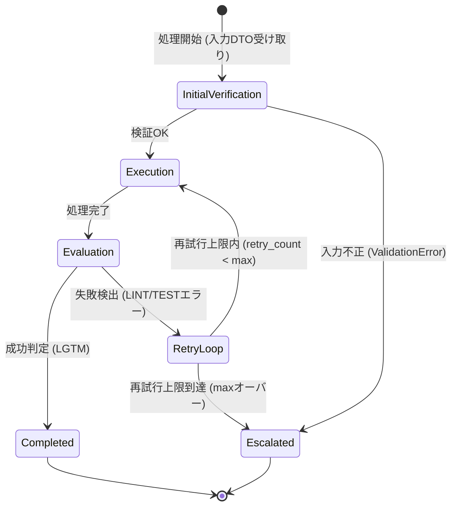
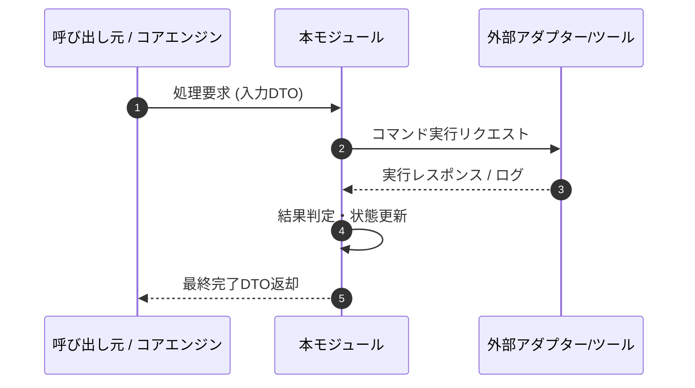

# 詳細設計書（機能・モジュール制御仕様）
**[サブタイトル・担当機能の制御仕様]**

---

## 1. 概要とSSOT境界

### 1.1 モジュールの目的

本モジュールおよび担当機能の詳細ロジック、呼び出し経路、責務範囲を明記する。

### 1.2 単一責任範囲 (SSOT) とデータ境界

- **本書の正本範囲**: `module_behavior`。関数の呼び出し順序、制御フロー、状態遷移ルーティング、エラー対処契約の正本とする。
- **データ境界 (DTO vs DAO)**: 本書はモジュール間・ノード間パッシングで使用されるDTO (Data Transfer Object) スキーマを管理する。ファイル永続化・ストレージ構造 (DAO / State正本) については「データ構造仕様書 (DS)」を参照する。
- **BDとの関係**: システム全体の目的、責務、境界、横断方針は基本設計書 (BD)を正本とし、本書はそれを機能単位へ具体化する。
- **他文書との関係**: 要求、環境、運用、テスト、ADR、レビュー文書はそれぞれの`ssot_scope`を正本とし、本書の制御仕様を上書きしない。
- **他文書へ委譲する情報**: 品質ゲート（静的解析・型検査・テストの実行条件と合格基準）は環境・開発基盤仕様書、テストケース・実行結果・証跡はテスト計画・結果報告書を正本とし、本書へ再掲しない。
- **外部公開契約**: 外部システムとの接続契約（外部API、メッセージ、認証、互換性）は、IF/API仕様書（[PROJECT_PREFIX]-IF-[NUMBER]）を作成する場合はそれを正本とし、本書は内部実装との接続だけを記載して、2.1の公開範囲を「外部公開」にしてIF-IDで対応付ける。外部公開の機能が少数でIF/API仕様書を作成しない場合は、2.2の機能契約に互換性・認証方針を記載する。
- **責務の対象外**: [本書で定義せず、基本設計書、データ構造仕様書、または他の正本へ委譲する内容]
- **矛盾時の扱い**: 文書の更新日ではなく、該当する`ssot_scope`の正本を更新し、関連文書を追従させる。

---

## 2. インターフェースと DTO (Data Transfer Object) 仕様

### 2.1 対象機能一覧

文書内で扱う機能をIDで管理し、契約・DTO・状態遷移・機能テスト要件がどの機能に属するか追跡できるようにする。

| 機能ID  | 関数・機能名       | 呼び出し元   | 主な呼び出し先 |  同期 / 非同期  |          冪等性          | 外部副作用                        |     公開範囲      |
| :------ | :----------------- | :----------- | :------------- | :-------------: | :----------------------: | :-------------------------------- | :---------------: |
| [F-001] | [処理・関数識別名] | [呼び出し元] | [呼び出し先]   | [同期 / 非同期] | [あり / なし / 条件付き] | [ファイル・DB・外部API・通知など] | [内部 / 外部公開] |

### 2.2 主要関数・機能の契約

機能ごとに以下の契約ブロックを作成する。複数機能を扱う場合は、機能IDを変えてこのブロックを複製する。

#### 機能契約（機能ID: [F-001]）

- **対象機能・関数名**: [処理・関数識別名]
- **機能概要**: [実行する具象処理の説明]
- **事前条件 (Pre-conditions)**: [処理実行前に満たされているべき条件・状態]
- **事後条件 (Post-conditions)**: [処理正常終了時に保証される状態・戻り値]
- **タイムアウト / キャンセル**: [上限時間、キャンセル方法、期限切れ時の状態]
- **ログ・メトリクス・相関ID**: [記録項目、秘匿対象、追跡に使うID]
- **外部公開時の互換性・認証**: [公開範囲が「外部公開」の場合のみ。バージョニング、後方互換、認証方式。IF/API仕様書がある場合は参照先だけを記載]

### 2.3 入力 DTO スキーマ・パラメータ仕様

対象機能IDごとに、関数の引数・メッセージパケット (DTO) のデータ構造、型、必須性、NULL可否、既定値、バリデーションルールを規定する。

- **対象機能ID**: [F-001]

| パラメータ名 / フィールド | データ型   |   必須性    |  NULL可   | デフォルト値 | バリデーションルール・入力制約     | 例・備考           |
| :------------------------ | :--------- | :---------: | :-------: | :----------- | :--------------------------------- | :----------------- |
| [DTOフィールド名]         | [データ型] | 必須 / 任意 | 可 / 不可 | [既定値]     | [許容フォーマット・文字制限・範囲] | [入力例・境界条件] |

### 2.4 出力 DTO スキーマ・戻り値仕様

対象機能IDごとに、関数の返却データ構造、型、正常時・異常時の戻り値、および再試行や追跡に必要な情報を定義する。

- **対象機能ID**: [F-001]
- **正常時の戻り値 DTO**: [返却DTOの名称、生成条件、全体の意味]

| フィールド           | データ型   |   必須性    |  NULL可   | 正常時の意味・制約       |
| :------------------- | :--------- | :---------: | :-------: | :----------------------- |
| [戻り値フィールド名] | [データ型] | 必須 / 任意 | 可 / 不可 | [値の意味・取り得る範囲] |

- **異常時の戻り値 / 例外**: [エラーコード・例外型・返却形式]
- **再試行可否**: [可 / 不可 / 条件付き。安全条件を記載]
- **相関ID・監査情報**: [呼び出しを追跡するID、監査に必要な情報]

---

## 3. 処理フロー・シーケンス・状態遷移ロジック (Mermaid 図)

### 3.1 処理フロー・シーケンス / 状態遷移図

本モジュールの制御フロー、モジュール間シーケンス対話、または状態遷移を Mermaid 記法を用いて記述する。用途に応じて状態遷移図またはシーケンス図を選択・併用し、図と状態遷移表のどちらを正本とするかを明記する。

- **図の正本**: [状態遷移図 / シーケンス図 / 状態遷移表 / 併用]
- **対象機能ID**: [F-001]

<!-- 記入時: サンプルの状態名・エラー名・閾値を実際の仕様へ置換する。 -->

#### A. 状態遷移図サンプル (State Diagram)

#### B. シーケンス図サンプル (Sequence Diagram)

### 3.2 状態遷移およびルーティングルール

状態遷移の判定条件および分岐ロジックをテーブル形式で定義する。図にないイベント、初期状態、終端状態も明記する。

- **初期状態**: [状態名と開始条件]
- **終端状態**: [正常終了・異常終了・キャンセルなど]
- **状態不変条件**: [各状態で必ず成立する条件]
- **未定義イベントの扱い**: [拒否、無視、エラー遷移など]

| 現在の状態 / ノード | 実行結果 / 評価フラグ | 次の状態 / ノード | 遷移判定条件・閾値ルール           | 副作用・ログ / メトリクス  |
| :------------------ | :-------------------- | :---------------- | :--------------------------------- | :------------------------- |
| [現在の状態]        | [成功 / エラー種別]   | [遷移先の状態]    | [再試行回数上限や判定フラグの条件] | [状態保存、通知、記録内容] |

---

## 4. エラー処理・失敗契約

### 4.1 エラー分類と対処方針

発生し得るエラーの分類、判定基準、リトライ上限、および最終到達ステータスを明記する。エラーコード・例外型と、利用者・運用者が取るべき対応を対応付ける。

| エラーコード / 例外型 | エラーカテゴリ | 発生・判定基準 | 再試行上限 | 再試行安全条件           | 終端ステータス       | 利用者・運用者対応 | 副作用・データ保持契約      |
| :-------------------- | :------------- | :------------- | :--------: | :----------------------- | :------------------- | :----------------- | :-------------------------- |
| [ERR-001 / 例外型]    | [エラー分類名] | [検出条件]     | [最大回数] | [再試行しても安全な条件] | [最終到達ステータス] | [通知・復旧手順]   | [変更保持 / ロールバック等] |

---

## 5. 機能テスト要件

機能が保証すべき振る舞いを要件として定義する。具体的なテストケース・実行結果・証跡はテスト計画・結果報告書、品質ゲート（静的解析・型検査・テストの実行条件と合格基準）は環境・開発基盤仕様書を正本とし、本書へ再掲しない。

### 5.1 機能テスト要件一覧

事後条件、状態遷移、失敗契約のうち、テストで保証すべき内容を要件IDで管理する。テスト計画・結果報告書のテストケースは、期待結果の根拠に要件IDを記載して対応付ける。

| 要件ID   | 対象機能ID | 保証すべき振る舞い・条件             | 検証観点                                   | 対応テストケース                   |
| :------- | :--------- | :----------------------------------- | :----------------------------------------- | :--------------------------------- |
| [TR-001] | [F-001]    | [事後条件・状態遷移・失敗契約の要約] | [正常 / 境界 / 異常 / 再試行 / 冪等性など] | [テスト計画・結果報告書のケースID] |

### 5.2 適用する品質ゲート

- **品質ゲートの正本**: [環境・開発基盤仕様書の文書番号・相対リンク]
- **適用するゲートID**: [QG-001、QG-003 など。すべて適用する場合は「全件」]
- 本機能だけに必要な条件がある場合は、環境・開発基盤仕様書へゲートを追加してから参照する。本書には実行コマンドや合格基準を記載しない。

---

## 6. 作成完了チェック

- [ ] `document_role`、`ssot_scope`、`status`、`owner`をFrontmatterへ設定した。
- [ ] 対象機能一覧のIDと、契約・DTO・状態遷移・機能テスト要件のIDが対応している。
- [ ] 呼び出し元・呼び出し先、同期方式、冪等性、外部副作用、公開範囲を記入した。
- [ ] 外部公開する機能は、IF/API仕様書を参照するか、機能契約に互換性・認証方針を記入した。
- [ ] 事前条件、事後条件、タイムアウト、キャンセル、ログ・相関IDを記入した。
- [ ] 入力・出力DTOの必須性、NULL可否、制約、異常時形式を記入した。
- [ ] 初期状態、終端状態、未定義イベント、状態不変条件を記入した。
- [ ] エラーコード/例外型、再試行安全条件、利用者・運用者対応、データ保持契約を記入した。
- [ ] 機能テスト要件ごとに検証観点と、テスト計画・結果報告書の対応ケースIDを記入した。
- [ ] 品質ゲートは環境・開発基盤仕様書のゲートIDを参照し、実行コマンド・合格基準・テストケースを本書へ再掲していない。
- [ ] Mermaidのサンプル状態名・エラー名・閾値および未置換の `[ ... ]` が残っていない。

---

## 7. 改訂履歴 (Change Log)

| 版数    | 改訂日     | 変更者     | 変更内容・変更理由 (Why) |
| :------ | :--------- | :--------- | :----------------------- |
| Rev.1.0 | YYYY-MM-DD | [作成者名] | 新規作成（初版制定）     |
