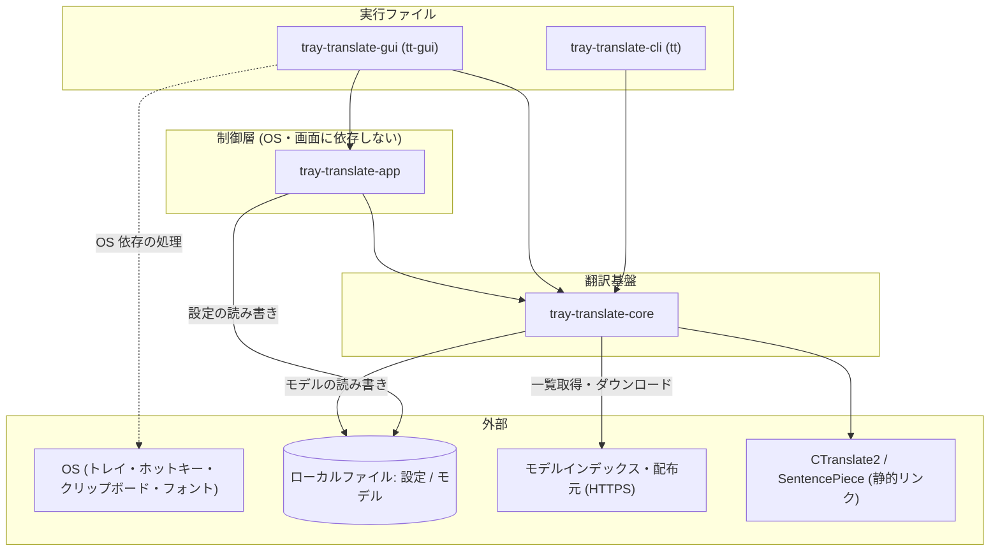
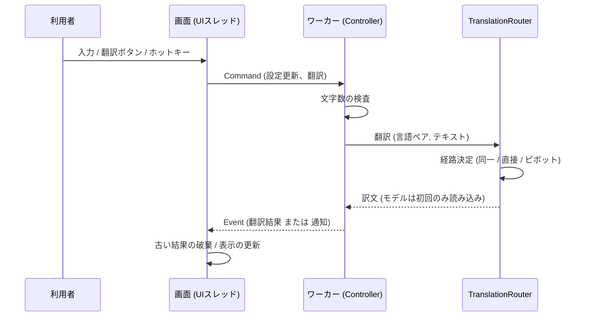
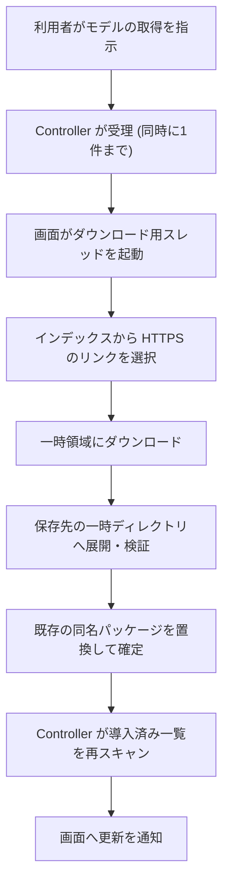

# 基本設計書（基本仕様・システム全体アーキテクチャ定義）
**tray-translate: ローカル完結の翻訳エンジンと、タスクトレイ常駐 GUI / CLI の構成**

---

## 1. 概要と基本方針

### 1.1 システム目的と対象範囲

tray-translate は、翻訳モデルをローカルで実行し、通信なしでテキストを翻訳するツールである。タスクトレイに常駐し、ホットキーやクリップボード監視から素早く翻訳を呼び出せる GUI と、同じ翻訳機能を使う CLI を提供する。

- **対象範囲**:
  - 翻訳エンジン（モデルの読み込み、文分割、翻訳、言語ペアの経路決定）
  - モデルパッケージの取得・導入・一覧
  - 常駐アプリの制御（設定、クリップボード監視、アイドル時のモデル解放、ダウンロード状態）
  - GUI（翻訳・モデル管理・設定の各画面、トレイ、グローバルホットキー）
  - CLI（`tt`）
- **対象外範囲**:
  - 翻訳モデルそのものの学習・配布。モデルは Argos 形式のパッケージを利用する。
  - GPU による推論。CPU のみを対象とする。
  - 翻訳履歴の保存。現時点で永続化するのは、設定とモデルパッケージだけである。
  - Linux 向け GUI の配布（リリース成果物は CLI のみ。根拠は 3.1）。
- **利用者・外部システム**:
  - 利用者: 翻訳を手元で行うエンドユーザー。開発者は CLI で検証や性能比較を行う。
  - 外部システム: Argos のモデルインデックス、モデルの配布元（HTTPS）。通信はユーザー操作を起点とする（3.2）。
- **前提・制約**:
  - 翻訳処理はオフラインで完結する。ネットワークを使うのはモデル一覧の取得とモデルのダウンロードだけである。
  - 翻訳の実行は CTranslate2（`ct2rs`）に依存する。ネイティブライブラリをビルドして静的にリンクする。
  - 対象プラットフォームの扱いは [ADR-002](../adr/002-target-platform-and-environment-policy.md) に従う。
  - panic 方針と言語コードの前提は [ADR-005](../adr/005-panic-policy.md) に従う。
- **主要な非機能要件**:
  - 出力の一致: Argos（Python）の出力と一致することを、[ADR-003](../adr/003-g3-acceptance-criteria.md) の基準で検証する。
  - 応答性: 重い処理で画面を止めない（1.2 課題 2）。
  - 省メモリ: 使われないモデルを自動で解放する（1.2 課題 5）。
  - 可搬性: OS 依存の処理を GUI クレートに閉じ込め、feature で切り離せる（1.2 課題 3）。
  - 安全性: 不正なアーカイブや不正な設定で既存の状態を壊さない（1.2 課題 7・8）。

### 1.2 アーキテクチャ基本原則と課題解決

| #    | 課題・ボトルネック                                                          | 優先度 | 解決方針・選定技術                                                                                                             | 選定理由・トレードオフ                                                                                                                    | 担当コンポーネント | 関連文書                                                            |
| :--- | :-------------------------------------------------------------------------- | :----: | :----------------------------------------------------------------------------------------------------------------------------- | :---------------------------------------------------------------------------------------------------------------------------------------- | :----------------- | :------------------------------------------------------------------ |
| 1    | 翻訳をローカルで実行し、Argos 形式のモデルを使う                            |   高   | CTranslate2 を `ct2rs` 経由で利用し、SentencePiece でトークン化する。生成設定は Argos の既定値に合わせる                       | 出力を Argos と揃えられる。代わりにネイティブライブラリのビルドが必要になり、環境構築の負担が増える。`ct2rs` は厳密なバージョンで固定する | C-001              | [ADR-003](../adr/003-g3-acceptance-criteria.md)                     |
| 2    | 翻訳やダウンロードで画面が固まる                                            |   高   | 制御層（`Controller`）を専用のワーカースレッドに置き、画面とは `Command` / `Event` のメッセージで通信する                      | 画面は表示と入力の受け渡しに専念できる。メッセージの順序と結果の対応づけは、画面側で管理する必要がある（課題 4）                          | C-002、C-004       | [ADR-004](../adr/004-gui-technology-selection.md)                   |
| 3    | OS 依存の処理（トレイ、ホットキー、クリップボード、フォント）が全体に広がる |   高   | OS 依存の処理を GUI クレートに閉じ込める。トレイとホットキーは Cargo feature で切り離し、無効時は同じ API のスタブに差し替える | 実装を持たない環境（Linux CI など）でも GUI をビルド・検査できる。トレイ用のトレイト抽象は設けず、ファイル単位の差し替えにとどめる        | C-004              | [ADR-007](../adr/007-gui-platform-boundary-and-window-lifecycle.md) |
| 4    | 入力を変えた後に、古い翻訳結果が表示される                                  |   中   | 発行したリクエストを追跡し、最新でない結果と、原文が一致しない結果を破棄する                                                   | 自動翻訳と手動翻訳が混在しても表示が揺れない。リクエストと結果の対応を保つ責務が画面側に残る（3.3 に懸念あり）                            | C-004              | [ADR-006](../adr/006-gui-portability-and-font-policy.md)            |
| 5    | モデルが常にメモリを占有する                                                |   中   | モデルは使用時に読み込み、最後の翻訳から設定した時間が経つと解放する                                                           | 常駐時の使用量を抑えられる。解放後の最初の翻訳は読み込み時間がかかる。0 を設定すると解放しない                                            | C-001、C-002       | —                                                                   |
| 6    | 直接のモデルがない言語ペアを翻訳したい                                      |   中   | 英語を経由する 2 段の翻訳（ピボット）を行う                                                                                    | 導入するモデルの数を抑えられる。2 回翻訳するため、時間がかかり、誤差が累積する。経由できるのは英語だけである                              | C-001              | —                                                                   |
| 7    | 不正なモデルアーカイブで、保存先の外へ書かれる、容量を使い切られる          |   高   | 展開時にパスの逸脱を拒否し、エントリ数と展開サイズに上限を設ける。一時ディレクトリに展開して検証してから置き換える             | 展開に失敗しても既存のモデルを壊さない。ダウンロードしたファイルの完全性（チェックサム、署名）は検証していない（3.3）                     | C-001              | —                                                                   |
| 8    | 不正な設定や、保存の失敗で設定を失う                                        |   中   | 保存の前後に値を検証する。一時ファイルへ書いてから置き換える                                                                   | 途中で失敗しても元のファイルが残る。排他制御は行わない（3.2）                                                                             | C-002              | —                                                                   |
| 9    | 想定外の状態でプロセスが不安定になる                                        |   中   | リリースビルドは panic でプロセスを中止する。外部入力やファイル操作は `Result` で扱う                                          | 異常時の挙動が単純になる。ワーカー内で panic すると、プロセスごと終了する                                                                 | 全体               | [ADR-005](../adr/005-panic-policy.md)                               |
| 10   | トレイの表示できない環境で、ウィンドウに戻れなくなる                        |   中   | トレイ常駐を設定項目にし、既定値は OS で変える（Linux は常駐しない）。「×」の判断は純粋関数に集約する                          | 常駐の有無を利用者が選べる。トレイの表示切り替えは再起動後に反映される                                                                    | C-004              | [ADR-007](../adr/007-gui-platform-boundary-and-window-lifecycle.md) |

### 1.3 本書のSSOT範囲と文書境界

- **本書の正本範囲**: `system_architecture`。システム全体の目的、アーキテクチャ、責務、境界、横断的な方針を定義する。
- **詳細設計との境界**: 関数契約、DTO（`Command` / `Event` の項目を含む）、具体的な制御フロー、状態遷移条件は詳細設計書 (DD) を正本とする。DD は現時点で未作成である。
- **データ構造仕様との境界**: 設定ファイルの項目・既定値・検証範囲、モデルパッケージの物理構造、保存先の決定方法、原子書き込みはデータ構造仕様書 (DS) を正本とする。DS は現時点で未作成である。
- **他文書との関係**: 要求・環境・運用・テスト・ADR・レビュー文書は、それぞれの`ssot_scope`を正本とし、本書の方針を上書きしない。ADR は判断理由の正本であり、現在の仕様の正本ではない。
- **全体ルール**: 文書分類、Frontmatter、ライフサイクル、矛盾時の解決は [`docs/README.md`](../README.md) を正本とする。

---

## 2. システム全体アーキテクチャとコンポーネント分離

### 2.1 全体構造とデータフロー (Mermaid アーキテクチャ図)

次の図は、クレート間の依存方向と、外部との接点を示す。矢印は「依存する側 → 依存される側」を表す。

- `cli` は `app` に依存しない。CLI は常駐の制御を必要としないためである。
- 依存は一方向で、循環しない。
- `app` は OS と画面に依存しない。クリップボードの読み取りは `app` がトレイト（`ClipboardSource`）で受け取り、実装は `gui` が差し込む。
- 時刻と翻訳バックエンドも、`app` がトレイト（`Clock`、`Translate`）で受け取る。これにより、制御層をテストしやすくしている。

### 2.2 コンポーネント責務マッピング

| コンポーネントID | コンポーネント名                                            | 担当領域・主要責務                                                                                                                                                                                               | 依存先・依存方向 / 公開インターフェース                                                                                                                 | 関連詳細設計書 |
| :--------------- | :---------------------------------------------------------- | :--------------------------------------------------------------------------------------------------------------------------------------------------------------------------------------------------------------- | :------------------------------------------------------------------------------------------------------------------------------------------------------ | :------------- |
| C-001            | `tray-translate-core`（`crates/core`）                      | モデルパッケージの検証・導入、文分割、翻訳の実行、言語ペアの経路決定（同一言語 / 直接 / 英語ピボット）、パイプラインの遅延読み込みと解放、モデル一覧の取得とダウンロード、モデル保存先の決定                     | 依存先: 外部クレートのみ。公開: `TranslationRouter`、`TranslatorPipeline`、`TranslationEngine`、`ModelPackage`、`ModelHub`、`RuleBasedSentenceSplitter` | 未作成         |
| C-002            | `tray-translate-app`（`crates/app`）                        | 常駐アプリの制御。`Command` を受けて `Event` を返す `Controller`、設定の型・検証・保存、翻訳前の文字数検査とアイドル時の解放、クリップボード変化の検出、ホットキー文字列の解析、導入状態とダウンロード状態の管理 | 依存先: C-001。公開: `Controller`、`Command`、`Event`、`Settings`、`Translate` / `Clock` / `ClipboardSource` トレイト、`Hotkey`、`DownloadTracker`      | 未作成         |
| C-003            | `tray-translate-cli`（`crates/cli`、実行ファイル `tt`）     | モデルの一覧・取得、翻訳、ベンチマーク（Argos との出力比較）のコマンド提供                                                                                                                                       | 依存先: C-001 のみ。公開: コマンドライン（`list` / `download` / `translate` / `bench`）                                                                 | 未作成         |
| C-004            | `tray-translate-gui`（`crates/gui`、実行ファイル `tt-gui`） | 画面の表示と入力の受け渡し、トレイとホットキーの接続、OS のクリップボード実装、日本語フォントの探索、ウィンドウの表示・終了の判断                                                                                | 依存先: C-001、C-002。公開: 実行ファイルのみ                                                                                                            | 未作成         |
| C-004a           | GUI: 画面本体（`app/`）                                     | 起動処理、`Controller` を載せたワーカーの生成、OS イベントの処理、画面状態、翻訳リクエストの追跡、タブごとの描画                                                                                                 | C-004 内部                                                                                                                                              | 未作成         |
| C-004b           | GUI: モデル管理画面（`models_view`）                        | インデックス取得とダウンロードを別スレッドで実行し、進捗を表示する                                                                                                                                               | C-004 内部。C-001 の `ModelHub` を直接利用する（3.3）                                                                                                   | 未作成         |
| C-004c           | GUI: OS アダプタ                                            | トレイ（`tray` / `tray_stub`）、ホットキー（`hotkey` / `hotkey_stub`）、クリップボード（`clipboard`）、フォント（`fonts`）、閉じる操作の判断（`lifecycle`）                                                      | C-004 内部。トレイとホットキーは feature で切り替える                                                                                                   | 未作成         |

### 2.3 主要フロー

#### 2.3.1 GUI からの翻訳

- 翻訳を呼び出す契機は 3 つある。手動の翻訳ボタン、入力後の自動翻訳（待機時間後）、クリップボードの変化の検出である。
- ホットキーが行うのは、ウィンドウを前面に出すことだけである。翻訳そのものは実行しない。
- 自動翻訳による結果は、クリップボードへ自動コピーしない（[ADR-006](../adr/006-gui-portability-and-font-policy.md)）。
- 定期的な確認（クリップボード、アイドル解放）は、一定間隔のメッセージとして同じワーカーへ送る。溜まったメッセージは 1 回分にまとめる。

#### 2.3.2 モデルの取得

- ダウンロードは `Controller` が受理してから、はじめてスレッドを起動する。同時に実行できるのは 1 件である。
- 展開の詳細（上限値、検証項目）は、DD または DS で定義する。

### 2.4 GUI の実行時構成

| 実行単位             | 役割                                                                                                          | 通信                                                     |
| :------------------- | :------------------------------------------------------------------------------------------------------------ | :------------------------------------------------------- |
| UI スレッド          | 描画、入力、OS イベント（トレイ、ホットキー、閉じる操作）の処理                                               | ワーカーへ `Command` を送り、`Event` を受け取る          |
| 翻訳ワーカー         | `Controller` を所有し、翻訳・設定保存・クリップボード確認・アイドル解放・ダウンロード状態管理を直列に処理する | メッセージキュー（標準ライブラリのチャネル）             |
| 定期通知スレッド     | 1 秒ごとに、クリップボード確認とアイドル解放確認のメッセージをワーカーへ送る                                  | ワーカーへ `Command`                                     |
| モデル管理のスレッド | インデックス取得とダウンロードを実行する（利用者の操作時のみ生成）                                            | インデックスは画面専用のチャネル、進捗と完了は `Command` |

- 状態を持つ処理（設定、モデルのキャッシュ、クリップボードの既読）は、ワーカー 1 本に集約する。そのため、ロックによる排他は不要になる。
- 画面から OS への操作（ウィンドウの表示・非表示、クリップボードへの書き込み）は UI スレッドで行う。

### 2.5 OS 依存の境界

| 領域                       | 抽象の置き場所                   | 実装の置き場所             | 切り替え方式                                                          |
| :------------------------- | :------------------------------- | :------------------------- | :-------------------------------------------------------------------- |
| トレイ                     | —                                | C-004c                     | Cargo feature `tray`。無効時は常に初期化に失敗するスタブ              |
| グローバルホットキー       | キー文字列の解析と正規化は C-002 | C-004c                     | Cargo feature `hotkey`。無効時は常に初期化に失敗するスタブ            |
| クリップボード（読み取り） | C-002 のトレイト                 | C-004c                     | feature なし（常に有効）。テキストのみ扱う                            |
| クリップボード（書き込み） | —                                | 描画ライブラリの機能を使用 | —                                                                     |
| 日本語フォント             | —                                | C-004c                     | OS ごとの探索パス。フォントは同梱せず、見つからなければ案内を表示する |
| トレイ常駐の既定値         | C-002（設定の既定値）            | —                          | OS で変える（Linux は常駐しない）                                     |

- トレイやホットキーの初期化に失敗しても、アプリは通常のウィンドウとして動作を続ける。
- 閉じる操作を「隠す」か「終了」かの判断は、OS に依存しない純粋な関数に集約する（[ADR-007](../adr/007-gui-platform-boundary-and-window-lifecycle.md)）。

---

## 3. 動作前提およびシステム境界

### 3.1 実行前提環境

- **対応OS**: プラットフォームの区分と優先度は [ADR-002](../adr/002-target-platform-and-environment-policy.md) を正本とする。リリース成果物は、Windows が CLI と GUI、Linux が CLI のみである。
- **ランタイム要件**: Rust（バージョンはリポジトリの `rust-toolchain.toml` で固定する）。実行時に別のランタイムは不要である。
- **依存管理・パッケージマネージャーの正本**: Cargo。`Cargo.lock` をリポジトリで管理し、CI では `--locked` を使う。翻訳エンジンの `ct2rs` は厳密なバージョンで固定する。依存は `[workspace.dependencies]` に集約する。
- **外部依存ツール**: CTranslate2 と SentencePiece は `ct2rs` 経由でビルドされ、静的にリンクされる（Windows では CRT も静的リンクにそろえる）。
- **実行エントリポイント**: CLI は `tt`、GUI は `tt-gui`。必要な環境変数は無い。設定とモデルの保存先は、環境変数で上書きできる。
- **ビルド対象の範囲**: ワークスペースの既定のビルド対象から GUI を外している。CI で Linux 上に GUI の依存を入れずにビルドするためである。GUI は個別に指定して検査する。`spike/` 配下は検証用でワークスペースから除外している。
- **品質目標・品質ゲート**: 出力の一致（ADR-003）、静的解析と整形とテストの通過を目標とする。ゲートの実行条件と合格基準は、環境・開発基盤仕様書を正本とする（現時点で未作成。当面は CI の設定が実体である）。

### 3.2 安全回路・システム境界方針

- **外部アクター・外部システム**:
  - 利用者（画面、ホットキー、クリップボード経由の入力）
  - Argos のモデルインデックスと、インデックスが指すモデル配布元
  - OS（トレイ、ホットキー、クリップボード、フォント、ファイルシステム）
- **入出力と信頼境界**:
  - 信頼しない入力: 翻訳するテキスト、クリップボードの内容、設定ファイル、ダウンロードしたインデックスとアーカイブ。
  - テキストは、文字数の範囲で検査してから翻訳する。範囲外は翻訳しない。
  - インデックスとダウンロードで受け付けるのは HTTPS のみである。HTTP と、その他の方式のリンクは拒否する。
  - アーカイブは、展開前にエントリ数を、展開中にパスの逸脱と展開サイズを検査する。
- **認証・認可境界**: 利用者の認証・認可は無い。ローカルの単一ユーザーが使う前提である。モデル配布元への認証も行わない。
- **タイムアウトと再試行制御**:
  - ネットワーク: 接続 10 秒、読み取り 30 秒のタイムアウトを設定している。全体のタイムアウト、キャンセル、自動再試行は無い。
  - プロキシは環境変数に従い、TLS の信頼ルートは OS の証明書ストアを使う。
- **排他制御・競合防止**:
  - ダウンロードの同時実行は 1 件までとする。
  - 状態を持つ処理はワーカーに直列化している（2.4）。
  - 設定ファイルのロック、アプリの多重起動の防止は行っていない（3.3）。
- **失敗時保全契約**:
  - 設定の保存は、検証してから一時ファイルへ書き、置き換える。失敗した場合は一時ファイルを残さず、元のファイルを変えない。
  - モデルの導入は、保存先の一時ディレクトリへ展開して検証してから確定する。展開や検証に失敗しても、既存のモデルは変えない。
  - 利用者への通知: エラーは `Event` で画面に伝え、フッターに表示する。トレイやホットキーの初期化失敗は、標準エラー出力に残して継続する。
- **機密情報・監査ログ方針**:
  - 扱う機密情報は無い。認証情報、翻訳履歴、利用状況の送信（テレメトリ）、更新確認の自動通信は行わない。
  - 翻訳するテキストは外部に送信しない。
  - CLI のログは `tracing` で、環境変数 `RUST_LOG` に従って出力する。GUI はログ基盤を初期化せず、標準エラー出力へ出すのみである（3.3）。

### 3.3 既知の制約・未解決事項

実装を読んで確認した事項と、確認できていない事項を区別して記録する。「推論」は、コードの読み取りに基づく見立てであり、動作は未確認である。解消方針は、必要に応じて ADR または Issue で決める。

| #    | 事項                                                                               | 確認状況                                                              | 影響                                                                                          |
| :--- | :--------------------------------------------------------------------------------- | :-------------------------------------------------------------------- | :-------------------------------------------------------------------------------------------- |
| 1    | ダウンロードしたアーカイブのチェックサム・署名検証が無い                           | コード検索で該当なし                                                  | 配布元や経路で改ざんされた場合に検出できない。HTTPS と OS の証明書検証のみが防御である        |
| 2    | ダウンロードにキャンセル、全体のタイムアウト、サイズ上限が無い                     | コードで確認                                                          | 回線が遅いと待ち続ける。展開サイズの上限（宣言サイズの合計）はある                            |
| 3    | アプリの多重起動を防止していない                                                   | 実装が見つからない                                                    | 2 つ目のプロセスが同じ設定ファイルを書き換える可能性がある                                    |
| 4    | GUI にログ基盤が無い                                                               | コードで確認                                                          | リリースビルドは Windows でコンソールを表示しないため、標準エラー出力の内容を見られない       |
| 5    | ADR-002 の環境変数 `TT_LOG_LEVEL` と `TT_COMPUTE_TYPE` が未実装                    | コード検索で該当なし                                                  | ADR の記述と実装が食い違う。ログは `RUST_LOG`、計算精度は固定である                           |
| 6    | Windows のモデル保存先が、ADR-002 の記述と一致しない可能性                         | 実装は OS 標準のデータ領域を使う。実機では未確認                      | ADR は `%LOCALAPPDATA%`、実装は `%APPDATA%` 配下になる可能性がある                            |
| 7    | 壊れた設定ファイルがあると、GUI が起動しない                                       | コードで確認（読み込み失敗で起動を中止する）                          | 利用者が設定ファイルを直すか削除する必要がある                                                |
| 8    | モデルの置換時に、既存を削除してから確定するため、短時間だけ欠落する               | コードで確認                                                          | 処理中に異常終了すると、そのペアのモデルが無い状態になりうる                                  |
| 9    | 同じペアを再導入しても、読み込み済みのパイプラインが残る可能性                     | 推論（未確認）                                                        | 解放または再起動まで、古いモデルが使われる可能性がある                                        |
| 10   | 翻訳リクエストの追跡で、結果が返らなかった要求（範囲外の無視、エラー）が残る可能性 | 推論（未確認）                                                        | 次の翻訳結果が古い要求と照合され、破棄される可能性がある。再現手順を確認し、DD で契約を定める |
| 11   | GUI のモデル管理画面が、`app` を経由せず `core` の `ModelHub` を直接使う           | コードで確認                                                          | 層の貫通。取得処理の窓口を `app` に寄せるかは未決定である                                     |
| 12   | ワーカー内で panic すると、リリースビルドではプロセスごと終了する                  | ADR-005 の方針どおり。ワーカー内の panic 経路の棚卸しは未完了の可能性 | 異常時にデータは保存されない（設定は保存の都度、書き込み済み）                                |

---

## 4. 基本設計における変更管理方針

- **拡張時のルール**:
  - 依存方向を保つ。`core` は他のワークスペースのクレートに依存しない。`app` は OS と画面に依存しない。OS 依存の処理は `gui` だけに置く。
  - OS 依存の機能を追加するときは、feature と同じ API のスタブを用意し、`--no-default-features` でもビルドできる状態を保つ（[ADR-007](../adr/007-gui-platform-boundary-and-window-lifecycle.md)）。
  - 画面から制御層への指示は `Command`、制御層から画面への通知は `Event` で行う。画面が制御層の内部状態を直接変更しない。
  - 外部入力やファイル操作の失敗は `Result` で返す（[ADR-005](../adr/005-panic-policy.md)）。
  - 言語コードに `_` を使わない。ペアキー（`<翻訳元>_<翻訳先>`）の区切りに使うためである。
- **仕様の決定権 (SSOT)**: 基本設計方針は本書を正本とし、具象シグネチャ・状態遷移は詳細設計書、永続化スキーマはデータ構造仕様書を正本とする。文書全体の分類・ライフサイクルは [`docs/README.md`](../README.md) を参照する。
- **変更影響の確認方法**:
  - 構成（クレートの追加、依存方向、スレッド構成、OS 依存の境界）を変えるときは、本書を先に更新する。判断の理由は ADR に記録する。
  - 設定項目や保存形式を変えるときは、DS を更新してから本書の該当箇所を確認する。
  - 更新順は、ADR（理由）、本書（方針）、DD / DS（詳細）、手順書とテスト文書の順とする。
  - レビューでは、依存方向が崩れていないこと、OS 依存の処理が `gui` の外へ漏れていないことを確認する。
- **今後作成する文書**: DD（`Controller` の契約、`Command` / `Event`、翻訳パイプライン）、DS（設定ファイル、モデルパッケージ）、環境・開発基盤仕様書。作成後に、2.2 の関連詳細設計書と本書の `related_documents` を更新する。

---

## 5. 作成完了チェック

- [x] 対象範囲・対象外範囲・利用者・前提・主要な非機能要件を記入した。
- [x] `document_role`、`ssot_scope`、`status`、`owner`をFrontmatterへ設定した。
- [x] 課題ごとに優先度、選定理由、トレードオフ、担当、関連文書を記入した。
- [x] Mermaid図のサンプル名・仮ラベルを実際の構成へ置換した。
- [ ] 全コンポーネントの責務、依存方向、公開インターフェース、詳細設計書リンクを記入した。（詳細設計書は未作成のため、リンクは「未作成」としている）
- [ ] 実行環境、依存管理の正本、品質目標と品質ゲートの参照先（環境・開発基盤仕様書）を記入した。（環境・開発基盤仕様書は未作成のため、参照先は CI 設定としている）
- [x] 外部システム、信頼境界、認証・認可、失敗時保全を記入した。
- [x] 未置換の `[ ... ]`、`YYYY-MM-DD`、サンプル固有名が残っていない。

---

## 6. 改訂履歴 (Change Log)

| 版数    | 改訂日     | 変更者 | 変更内容・変更理由 (Why)                                                          |
| :------ | :--------- | :----- | :-------------------------------------------------------------------------------- |
| Rev.1.0 | 2026-10-27 | xzyozi | 新規作成（初版制定）。構成の正本が無かったため、実装を読んで現状を整理した（#90） |
