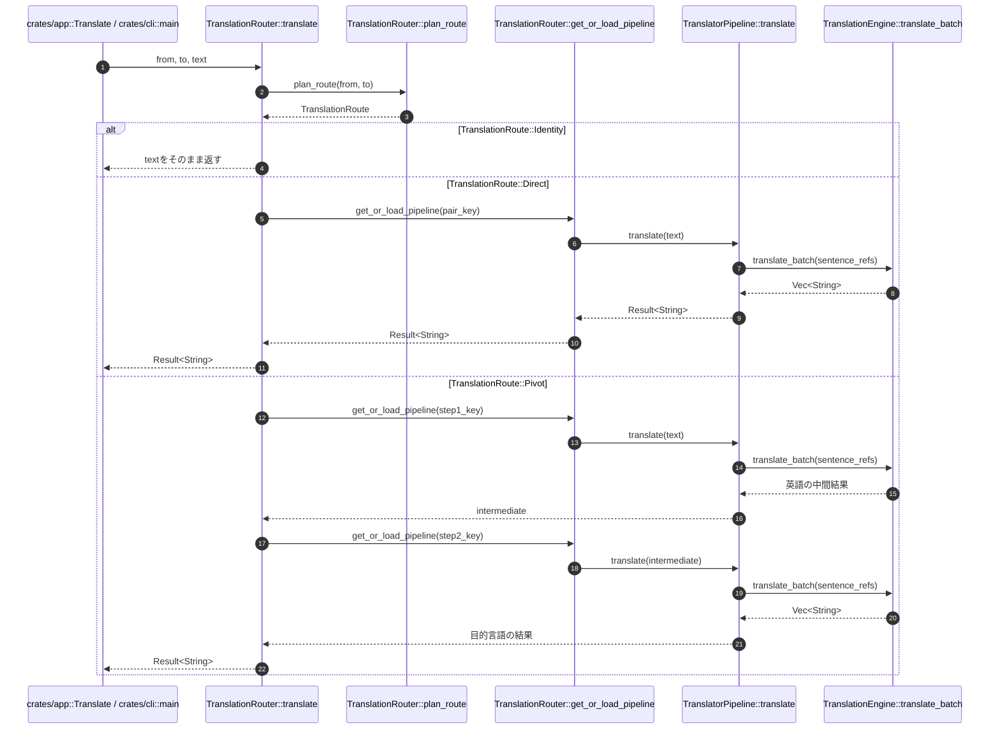
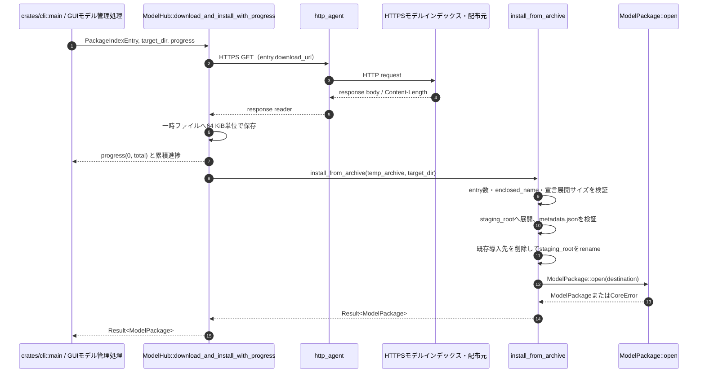

# 詳細設計書（機能・モジュール制御仕様）
**tray-translate coreクレート: 翻訳経路、推論、モデルパッケージ、モデル取得の契約**

---

## 1. 概要とSSOT境界

### 1.1 モジュールの目的

本書は `crates/core`（crate名 `tray-translate-core`）が提供する翻訳基盤の関数契約、DTO、制御フロー、状態遷移、エラー処理を定義する。対象はローカルモデルの探索・ロード・推論と、利用者の明示操作から起動するモデルインデックス取得・ダウンロードである。

対象機能は次の10機能とする。

- **F-001** `TranslationRouter::plan_route`: 同一言語、直接ペア、英語経由ピボットの経路判定
- **F-002** `TranslationRouter::translate`: 経路に従う翻訳、パイプライン遅延ロード、キャッシュ利用
- **F-003** `TranslationRouter::refresh_available_packages`: モデル保存先直下のパッケージ走査と利用可能ペア更新
- **F-004** `TranslationRouter::loaded_count` / `TranslationRouter::unload_all`: パイプラインキャッシュの計数と解放
- **F-005** `TranslatorPipeline::translate`: 入力の整形、文分割、バッチ推論、行構造の再構築
- **F-006** `RuleBasedSentenceSplitter::split`: ルールベース文境界検出
- **F-007** `TranslationEngine::load` / `load_with_config` / `translate_batch`: SentencePieceとCTranslate2による推論
- **F-008** `ModelPackage::open` / `PackageMetadata::load_from_file`: 展開済みモデルパッケージの検証とメタデータ利用
- **F-009** `install_from_archive`: `.argosmodel` ZIPの安全な展開・検証・導入
- **F-010** `ModelHub::fetch_index` / `download_and_install`: HTTPSによるインデックス取得とモデルダウンロード

本書は実装済みコードを逐語的に掲載せず、実装から確認できる振る舞いを表・図・契約として記載する。対象実装は `crates/core/src/engine.rs`、`error.rs`、`hub.rs`、`package.rs`、`pipeline.rs`、`router.rs`、`sbd.rs` および `lib.rs` である。

### 1.2 単一責任範囲（SSOT）とデータ境界

- **本書の正本範囲**: `module_behavior`。coreの関数呼出し順序、内部DTO、状態遷移、経路判定、失敗時の戻り方を正本とする。
- **対象モジュール**: `TranslationRouter`、`TranslatorPipeline`、`RuleBasedSentenceSplitter`、`TranslationEngine`、`ModelPackage`、`PackageMetadata`、`ModelHub`、`CoreError`。
- **永続化データとの境界**: `metadata.json`、`sentencepiece.model`、`model/`、モデル保存先、展開ステージ、一時ファイル、置換・排他の物理契約は [TT-DS-001 データ構造仕様書](./TT-DS-001_データ構造仕様書.md) を正本とする。本書は関数がそれらを読む・検証する・置き換える順序だけを定義し、保存スキーマを重複記載しない。
- **DTOとの境界**: 本書は関数引数、戻り値、`TranslationRoute`、`TranslationConfig`、`PackageIndexEntry`、`PackageMetadata` の受け渡し条件を定義する。ディスク上のJSONフィールド定義はTT-DS-001を参照する。
- **基本設計との関係**: coreの責務、依存方向、翻訳推論のオフライン方針、明示操作時だけのモデル通信、英語ピボットの全体方針は [TT-BD-001 基本設計書](./TT-BD-001_基本設計書.md) を正本とする。
- **品質ゲートとの関係**: Rustの整形、clippy、テスト、Mermaid検証の実行条件と合格基準は [TT-ENV-001 環境・開発基盤仕様書](../setup/TT-ENV-001_環境・開発基盤仕様書.md) のQG-001〜QG-006を参照する。本書へコマンドや合格基準を再掲しない。
- **外部通信の扱い**: 独立した外部API仕様書は作成しない。`ModelHub` が行うインデックス・モデル配布元とのHTTPS通信は、外部公開APIではなくcore内部機能の副作用としてF-010の契約へ記載する。認証、外部向けバージョニング、外部利用者向け互換性契約は持たない。
- **呼出元との境界**: `crates/app` は `TranslationRouter` を `Translate` アダプターとして利用し、`crates/cli` は `TranslationRouter`、`TranslatorPipeline`、`ModelHub` を直接利用する。coreはapp、GUI、CLIの制御状態や画面表示を持たない。
- **責務の対象外**: 設定・履歴の保存スキーマ、GUIの表示・非同期ワーカー、モデル取得画面、外部配布元との認証、テスト計画・実行結果、モデルのライセンス内容、checksum・署名を追加する将来仕様は本書で定義しない。
- **未実装・未検証事項の扱い**: 本書は現行実装の契約を定義する。checksum・署名検証、ダウンロードキャンセル、全体ダウンロードタイムアウト、自動再試行、モデル置換のロールバックは現行契約に含めない。実モデルを用いた推論一致はADR-003および後続のテスト証跡で確認する。
- **矛盾時の扱い**: 関数の制御仕様は本書、永続化仕様はTT-DS-001、システム方針はTT-BD-001、環境と品質ゲートはTT-ENV-001を更新して整合させる。文書の更新日だけで優先順位を決めない。

---

## 2. インターフェースとDTO（Data Transfer Object）仕様

### 2.1 対象機能一覧

| 機能ID | 関数・機能名                                                              | 呼び出し元                                                                                        | 主な呼び出し先                                                                         |     同期 / 非同期      |                  冪等性                  | 外部副作用                                           | 公開範囲 |
| :----- | :------------------------------------------------------------------------ | :------------------------------------------------------------------------------------------------ | :------------------------------------------------------------------------------------- | :--------------------: | :--------------------------------------: | :--------------------------------------------------- | :------: |
| F-001  | `TranslationRouter::plan_route`                                           | `TranslationRouter::translate`、router単体テスト                                                  | `TranslationRoute`、`CoreError::UnsupportedLanguagePair`                               |          同期          |                   あり                   | なし                                                 |   内部   |
| F-002  | `TranslationRouter::translate`                                            | `crates/app` の `Translate`、`crates/cli` の `main` / `handle_bench`                              | `plan_route`、`get_or_load_pipeline`、`TranslatorPipeline::translate`                  |          同期          |                 条件付き                 | モデルロード、ローカル推論、tracingログ              |   内部   |
| F-003  | `TranslationRouter::refresh_available_packages`                           | `TranslationRouter::new` / `with_packages_dir`、`crates/app` の `Translate::refresh`              | `std::fs::read_dir`、`ModelPackage::open`、`warn!`                                     |          同期          |            あり（同一走査時）            | ファイルシステム走査、利用可能ペア一覧更新、警告ログ |   内部   |
| F-004  | `TranslationRouter::loaded_count` / `unload_all`                          | `crates/app` の `TranslationService::unload_if_idle`、ルーター管理呼出し元                        | `pipeline_cache.len`、`HashMap::clear`、`info!`                                        |          同期          | `loaded_count`はあり、`unload_all`はあり | CTranslate2パイプラインの破棄、解放ログ              |   内部   |
| F-005  | `TranslatorPipeline::translate`                                           | `TranslationRouter::translate`、`crates/cli` の既存ディレクトリ翻訳                               | `RuleBasedSentenceSplitter::split`、`TranslationEngine::translate` / `translate_batch` |          同期          |                 推論依存                 | ローカルモデル推論                                   |   内部   |
| F-006  | `RuleBasedSentenceSplitter::split`                                        | `TranslatorPipeline::translate`、sbd単体テスト                                                    | `is_abbreviation_or_number`、句読点判定                                                |          同期          |                   あり                   | なし                                                 |   内部   |
| F-007  | `TranslationEngine::load` / `load_with_config` / `translate_batch`        | `TranslatorPipeline::new`、`TranslationEngine::translate`、エンジン利用者                         | `SpmTokenizer`、`ct2rs::Translator`、`TranslationOptions`                              |          同期          |     ロードは条件付き、推論は入力依存     | ローカルモデル読込、CPU推論                          |   内部   |
| F-008  | `ModelPackage::open` / `PackageMetadata::load_from_file`                  | `TranslationRouter::refresh_available_packages`、`get_or_load_pipeline`、`ModelHub`、`crates/cli` | `metadata.json`読込、必須パス検証、`ModelPackage` getter                               |          同期          |       あり（ファイルが不変の場合）       | ローカルファイル読込                                 |   内部   |
| F-009  | `install_from_archive`                                                    | `ModelHub::download_and_install_with_progress`、core integration test                             | `ZipArchive`、`tempfile`、`PackageMetadata::load_from_file`、`ModelPackage::open`      |          同期          |     条件付き。既存導入先の削除を伴う     | ZIP読込、展開、既存ディレクトリ削除、rename          |   内部   |
| F-010  | `ModelHub::fetch_index` / `fetch_index_from_url` / `download_and_install` | `crates/cli` の `list` / `download`、GUIモデル管理処理                                            | `http_agent`、`PackageIndexEntry::download_url`、`install_from_archive`                | 同期（HTTP待機を伴う） |      取得は条件付き、導入は条件付き      | HTTPS通信、一時ダウンロード、モデル導入、進捗通知    |   内部   |

### 2.2 主要関数・機能の契約

#### 機能契約（機能ID: F-001）

- **対象機能・関数名**: `TranslationRouter::plan_route(from: &str, to: &str) -> Result<TranslationRoute>`
- **機能概要**: 入力言語と出力言語をASCII小文字化し、`Identity`、利用可能な直接ペア、英語を中継する`Pivot`の順に経路を判定する。
- **事前条件**: `from` と `to` はUTF-8文字列として受け取る。モデルペアの有無は `available_pairs` に反映済みである。言語コードの前後空白は本関数では除去しない。
- **事後条件**: 小文字化後の言語コードが同じなら `TranslationRoute::Identity` を返す。異なる場合、`from_to` が登録済みなら `TranslationRoute::Direct` を返す。直接ペアが無く、両言語が `en` でない場合に `from_en` と `en_to` がともに登録済みなら `TranslationRoute::Pivot` を返す。
- **失敗時契約**: 上記のいずれにも該当しない場合、lowercase後の言語コードを保持した `CoreError::UnsupportedLanguagePair` を返す。ファイルI/O、ロード、ネットワークは行わない。
- **タイムアウト / キャンセル**: タイムアウト、キャンセル、自動再試行はない。
- **ログ・メトリクス・相関ID**: ログ、メトリクス、相関IDを生成しない。
- **外部公開時の互換性・認証**: 外部公開しない内部機能のため該当しない。

#### 機能契約（機能ID: F-002）

- **対象機能・関数名**: `TranslationRouter::translate(from: &str, to: &str, text: &str) -> Result<String>`
- **機能概要**: F-001で決定した経路に従って、同一言語は入力を返し、直接経路は1本のパイプラインで翻訳し、ピボット経路は英語を中間言語として2本のパイプラインを順番に実行する。
- **事前条件**: `available_pairs` が経路判定に必要なキーを保持している。直接またはピボットの場合、対象パッケージのディレクトリが `ModelPackage::open` と `TranslatorPipeline::new` を通過できる状態であることが望ましい。
- **事後条件**: `Identity` では `text` を変更せず返す。`Direct` では対象ペアの `TranslatorPipeline::translate` の結果を返す。`Pivot` では第1段の結果を第2段へ入力し、第2段の結果を返す。初回利用時だけパイプラインをロードして `pipeline_cache` へ保存する。
- **キャッシュ契約**: キャッシュキーは経路のペアキー文字列である。同じキーの2回目以降は既存の `TranslatorPipeline` を利用する。`refresh_available_packages` や `register_package` は利用可能パスを更新するが、既存の `pipeline_cache` を無効化しない。
- **失敗時契約**: F-001の `UnsupportedLanguagePair`、未登録キーの `UnknownPairKey`、パッケージ検証・エンジンロード・文分割・CTranslate2推論に由来する `CoreError` を途中で返す。第1段の失敗時は第2段を実行しない。
- **タイムアウト / キャンセル**: ローカルモデルロード・推論のタイムアウト、キャンセル、自動再試行はない。
- **ログ・メトリクス・相関ID**: パイプラインロードとピボット実行は `tracing::info` を出す。相関IDや入力全文の専用メトリクスはない。
- **外部公開時の互換性・認証**: 外部公開しない内部機能のため該当しない。

#### 機能契約（機能ID: F-003）

- **対象機能・関数名**: `TranslationRouter::refresh_available_packages(&mut self) -> Result<()>`
- **機能概要**: `packages_dir` の直下を読み取り、パス順に並べ、検証に成功した展開済みモデルパッケージだけを `available_pairs` へ登録する。
- **事前条件**: `packages_dir` がルーターに設定されている。存在しない保存先はエラーではなく、利用可能ペアが空の状態として扱う。
- **処理条件**: 開始時に `available_pairs` を全消去する。`read_dir` の結果を `PathBuf` の順序でソートする。直下のディレクトリだけを対象とし、各ディレクトリで `ModelPackage::open` を実行する。
- **事後条件**: `ModelPackage::open` が成功したパッケージのメタデータから `<from_code>_<to_code>` を作り、ペアキーとパスを登録する。同じペアが複数ある場合、ソート後に後から処理したパスが採用される。
- **失敗時契約**: `read_dir` やエントリ列挙そのもののI/Oエラーは `CoreError::Io` として返す。個別ディレクトリのメタデータ不正、必須モデル欠落などは `warn!` を出してスキップし、全体処理は継続する。
- **注意事項**: 再スキャン後も `pipeline_cache` は消去されない。保存先の同一ペアを差し替えた後に古いパイプラインを使う可能性があるため、必要な呼出側はF-004で明示的に解放する。
- **タイムアウト / キャンセル**: ファイル走査単位のタイムアウト、キャンセル、自動再試行はない。
- **ログ・メトリクス・相関ID**: 壊れたディレクトリと重複ペアは `tracing::warn`、通常の走査完了メトリクスと相関IDはない。
- **外部公開時の互換性・認証**: 外部公開しない内部機能のため該当しない。

#### 機能契約（機能ID: F-004）

- **対象機能・関数名**: `TranslationRouter::loaded_count(&self) -> usize`、`TranslationRouter::unload_all(&mut self)`
- **機能概要**: `pipeline_cache` に保持するパイプライン数を返し、要求時にはキャッシュ全体をクリアして保持中のパイプラインを破棄する。
- **事前条件**: ルーターが生成済みであること。`loaded_count` は共有参照、`unload_all` は可変参照を要求する。
- **事後条件**: `loaded_count` は呼出し時点の `pipeline_cache.len()` を返す。`unload_all` 完了後、`loaded_count` は0になる。空キャッシュへの `unload_all` は何もせず正常終了する。
- **失敗時契約**: 戻り値にエラー型を持たず、キャッシュのクリア処理自体は失敗を返さない。パイプラインの破棄はRustの所有権とデストラクタへ委譲する。
- **タイムアウト / キャンセル**: タイムアウト、キャンセル、自動再試行はない。
- **ログ・メトリクス・相関ID**: 非空キャッシュを解放するときだけ解放数を `tracing::info` に出す。相関IDはない。
- **外部公開時の互換性・認証**: 外部公開しない内部機能のため該当しない。

#### 機能契約（機能ID: F-005）

- **対象機能・関数名**: `TranslatorPipeline::translate(&self, text: &str) -> Result<String>`
- **機能概要**: 入力をtrimし、文分割の設定に応じて単一推論または行単位の文分割・一括推論を実行する。行構造と空行を保持して訳文を再構築する。
- **事前条件**: `TranslatorPipeline::new` が成功し、`TranslationEngine` と訳先言語が設定済みである。`with_sentence_splitting` で文分割を変更でき、`with_target_lang` で結合子判定用の訳先言語を上書きできる。
- **空入力契約**: `text.trim()` が空なら推論せず `Ok(String::new())` を返す。文分割を無効にした場合も、推論へ渡す値はtrim済みの全文である。
- **文分割有効時の事後条件**: 改行で入力を行へ分け、各行をtrimする。空行は空の訳文行として保持する。非空行を `RuleBasedSentenceSplitter::split` へ渡し、全行の文を1つの配列へ集め、`TranslationEngine::translate_batch` を1回呼び出す。
- **結合契約**: 訳先言語が `ja`、`ja_`、`ja-`、`zh`、`zh_`、`zh-` に該当する場合、同一行の文を空文字で結合する。それ以外は半角スペースで結合する。行と行の間は改行で結合する。
- **失敗時契約**: バッチ推論の `CoreError` はそのまま返す。実装上、戻り値の文数が入力文数より少ない場合は不足分をエラーにせず `filter_map` 相当で落として再構築する。
- **タイムアウト / キャンセル**: 文分割・推論のタイムアウト、キャンセル、自動再試行はない。
- **ログ・メトリクス・相関ID**: 本機能独自のログ、メトリクス、相関IDは生成しない。
- **外部公開時の互換性・認証**: 外部公開しない内部機能のため該当しない。

#### 機能契約（機能ID: F-006）

- **対象機能・関数名**: `RuleBasedSentenceSplitter::split(text: &str) -> Vec<String>`
- **機能概要**: 軽量なルールベース処理で、英語・日本語・中国語などの句読点と改行から文境界を検出する。
- **事前条件**: UTF-8文字列を受け取る。前後空白の除去後に空になる入力は有効な入力だが、空配列を返す。
- **境界判定**: `。`、`！`、`？`、改行は境界とする。ASCIIの `!` と `?` は、次の文字が空白・閉じ括弧である場合、または入力終端の場合だけ境界とする。ASCIIの `.` は、次の文字が数字の場合、小数点として境界にしない。登録済み略語の末尾ピリオドも境界にしない。それ以外の `.` は、次の文字が空白・閉じ括弧である場合、または終端の場合に境界とする。
- **境界への包含**: 境界を検出した後、連続する `。`、`！`、`？`、`.`、`!`、`?`、`…` と、閉じ引用符・閉じ括弧を同じ文へ含める。各文はtrimして配列へ追加する。
- **略語判定**: 現行実装の固定リストは `mr.`、`mrs.`、`ms.`、`dr.`、`prof.`、`sr.`、`jr.`、`vs.`、`etc.`、`e.g.`、`i.e.`、`u.s.`、`u.k.`、`st.`、`no.` である。URL、ファイル拡張子、その他の略語を網羅する一般目的パーサーではない。
- **事後条件**: 入力順を保った文文字列の `Vec<String>` を返す。最後に境界がない残りの文字列も1文として追加する。
- **失敗時契約**: エラー型はなく、メモリ上の配列を返す。外部通信、ファイルI/O、キャッシュは行わない。
- **タイムアウト / キャンセル**: タイムアウト、キャンセル、自動再試行はない。
- **ログ・メトリクス・相関ID**: ログ、メトリクス、相関IDは生成しない。
- **外部公開時の互換性・認証**: 外部公開しない内部機能のため該当しない。

#### 機能契約（機能ID: F-007）

- **対象機能・関数名**: `TranslationEngine::load(package: &ModelPackage)`、`TranslationEngine::load_with_config(package: &ModelPackage, config: TranslationConfig)`、`TranslationEngine::translate_batch(&self, texts: &[&str]) -> Result<Vec<String>>`
- **機能概要**: `ModelPackage` が示す `model/` と `sentencepiece.model` を使ってSentencePiece tokenizerとCTranslate2 translatorを初期化し、Argos互換の推論オプションでバッチ翻訳する。
- **既定設定契約**: `TranslationConfig::default()` は `beam_size = 4`、`length_penalty = 0.2`、`replace_unknowns = true` とする。`load` はこの既定設定で `load_with_config` を呼ぶ。`ct2rs::Config` 自体は `Config::default()` を使用し、Argos互換の生成条件は `TranslationOptions` へ設定する。設定値の範囲検証は行わない。
- **SentencePiece契約**: `SpmTokenizer::from_file` で同一のSentencePieceファイルを読み書き側の指定として初期化し、`ArgosTokenizer` がラップする。encode結果の末尾がちょうど `</s>` の場合だけ、そのトークンを1個削除する。decodeは内部tokenizerへ委譲する。
- **推論契約**: `translate_batch` は `TranslationConfig` から `TranslationOptions` を作り、CTranslate2のバッチ結果から訳文文字列部分だけを順序どおり返す。`translate` は1件のバッチとして呼び、結果が空なら空文字を返す。
- **事後条件**: 成功したロードはtranslatorと設定を保持する `TranslationEngine` を返す。成功したバッチ推論は入力順に対応する訳文配列を返す。
- **失敗時契約**: SentencePiece読込、CTranslate2初期化、バッチ推論の失敗は `CoreError::Ct2` または依存処理から変換された `CoreError` として返す。ロード失敗時に部分的なEngineを返さない。
- **タイムアウト / キャンセル**: モデルロード・推論のタイムアウト、キャンセル、自動再試行はない。
- **ログ・メトリクス・相関ID**: ロード時にモデルディレクトリとSentencePieceパスを `tracing::info` に出す。入力全文、相関ID、推論時間メトリクスは出さない。
- **外部公開時の互換性・認証**: 外部公開しない内部機能のため該当しない。

#### 機能契約（機能ID: F-008）

- **対象機能・関数名**: `PackageMetadata::load_from_file(path: impl AsRef<Path>) -> Result<PackageMetadata>`、`ModelPackage::open(path: impl AsRef<Path>) -> Result<ModelPackage>` および `ModelPackage` のgetter群
- **機能概要**: 展開済みパッケージのルートからメタデータを読み込み、SentencePieceファイルとモデルディレクトリの存在を確認して、以降のロード処理へ渡せる `ModelPackage` を生成する。
- **事前条件**: `path` は展開済みパッケージのルートディレクトリを指す。metadataの保存フィールドと物理配置は [TT-DS-001](./TT-DS-001_データ構造仕様書.md) に従う。
- **メタデータ契約**: `PackageMetadata::load_from_file` は指定パスを読み、JSONを `PackageMetadata` へデシリアライズする。ファイル読込失敗とJSONパース失敗は詳細を分けず `CoreError::InvalidMetadata(path)` へ統一する。メタデータの保存フィールドは本書で再定義しない。
- **構造検証契約**: `ModelPackage::open` は `metadata.json` の読込後、ルート直下の `sentencepiece.model` と `model/` の存在を確認する。`exists` 判定であり、通常ファイル・ディレクトリの種類やモデル内部ファイルの妥当性までは検証しない。
- **事後条件**: 成功時の `ModelPackage` はルートパスと読み込み済みメタデータを保持する。`root_dir()`、`metadata()`、`model_dir()`、`sentencepiece_path()`、`pair_key()` が同じルートを基準に値を返す。`pair_key()` はメタデータの `from_code` と `to_code` を `_` で連結し、ここでは小文字化しない。
- **失敗時契約**: metadataの不在・不正は `InvalidMetadata`、必須パスの不在は `MissingModelFile` とする。外部通信、書き込み、キャッシュは行わない。
- **タイムアウト / キャンセル**: タイムアウト、キャンセル、自動再試行はない。
- **ログ・メトリクス・相関ID**: 本機能独自のログ、メトリクス、相関IDは生成しない。呼出し側が警告またはロードログを出す。
- **外部公開時の互換性・認証**: 外部公開しない内部機能のため該当しない。

#### 機能契約（機能ID: F-009）

- **対象機能・関数名**: `install_from_archive(archive_path: impl AsRef<Path>, target_dir: impl AsRef<Path>) -> Result<ModelPackage>`
- **機能概要**: `.argosmodel` ZIPを同一target_dir内の一時ディレクトリへ展開し、パス逸脱、エントリ数、宣言展開サイズ、metadata、必須モデル構造を確認した後、導入先へ移す。
- **事前条件**: `archive_path` が読み取り可能なZIPである。`target_dir` は作成可能なディレクトリである。保存形式・導入先命名・一時ステージの永続化契約はTT-DS-001を参照する。
- **安全検証契約**: ZIPエントリ数は最大1000、ファイルエントリの宣言非圧縮サイズ合計は最大2 GiBとする。各エントリの `enclosed_name()` が失敗するパスはZip Slipの可能性として拒否する。先頭エントリにパス区切りがある場合、その先頭ディレクトリ名を剥がしてステージへ展開する。
- **処理順序**: target_dirを作成し、`.tmp_pkg_*` 一時ディレクトリを作る。エントリを順次展開し、ステージ直下の `metadata.json` を検証する。トップディレクトリ名がある場合はその名前、ない場合はメタデータの言語コードから導入先名を決める。
- **置換契約**: 同名の導入先が存在する場合、`fs::remove_dir_all` で先に削除する。その後、ステージディレクトリを `fs::rename` して導入先を確定し、`ModelPackage::open` で最終検証する。
- **完全なatomic性に関する明記**: 最後のrenameは同一target_dir内のステージから導入先への移動だが、既存導入先を先に削除するため、既存モデルを保持したままのatomic swapではない。既存削除後にrenameまたは最終検証が失敗しても旧モデルへロールバックしない。したがって本機能を完全なatomic置換とは扱わない。
- **失敗時契約**: ZIP読込、展開、上限超過、パス検証、metadata検証、既存削除、rename、最終 `ModelPackage::open` のいずれかが失敗すると `CoreError` を返す。TempDirの破棄により途中のステージは削除を試みるが、既存導入先をバックアップしない。checksum、license、署名は検証しない。
- **タイムアウト / キャンセル**: 展開のタイムアウト、キャンセル、自動再試行はない。
- **ログ・メトリクス・相関ID**: archive_pathとtarget_dirを含む導入開始・完了ログを `tracing::info` に出す。相関IDはない。
- **外部公開時の互換性・認証**: 外部公開しない内部機能のため該当しない。

#### 機能契約（機能ID: F-010）

- **対象機能・関数名**: `ModelHub::fetch_index()`、`ModelHub::fetch_index_from_url(url: &str)`、`PackageIndexEntry::download_url()`、`ModelHub::download_and_install(entry: &PackageIndexEntry, target_dir: impl AsRef<Path>)`、`ModelHub::download_and_install_with_progress`
- **機能概要**: ArgosモデルインデックスをHTTPSで取得し、エントリから最初のHTTPSリンクを選び、アーカイブを一時ファイルへ保存してF-009へ渡す。通信はCLIやGUIの明示操作から同期的に起動される。
- **事前条件**: インデックスURLとダウンロードリンクが `https://` で始まる。`PackageIndexEntry` はJSONからデシリアライズ可能で、導入先ディレクトリを作成できる。
- **HTTPS・HTTPエージェント契約**: `fetch_index_from_url` はHTTPSで始まらないURLを拒否する。HTTPエージェントは接続タイムアウト10秒、読取タイムアウト30秒、環境プロキシ設定、OS証明書ストアを使用し、TLS検証を無効化しない。URLの完全な構文、ホスト許可リスト、認証は別途検証しない。
- **インデックス契約**: HTTPレスポンスをJSON配列として読み、`Vec<PackageIndexEntry>` を返す。`find_package` はfrom/toをASCII大小文字の違いを無視して比較し、入力順で最初に一致したエントリを返す。前後空白は除去しない。
- **リンク契約**: `download_url` は `links` の先頭から、文字列が `https://` で始まる最初のリンクだけを返す。該当リンクがない場合は `CoreError::NoDownloadLink` とする。HTTP、IPFSなどのリンクは採用しない。
- **ダウンロード契約**: `Content-Length` をu64へ変換できれば総量として進捗コールバックへ渡し、無い・不正な場合は `None` とする。開始時に `(0, total)` を通知し、64 KiBバッファで受信するたびに累積バイト数を通知する。`download_and_install` は通知を捨てるno-opコールバックを利用する。
- **一時ファイル契約**: OS一時ディレクトリに `model.argosmodel` を作り、ダウンロード完了後にF-009へ渡す。導入完了または失敗後に一時ディレクトリの破棄を試みる。永続的なダウンロードキャッシュは作らない。
- **失敗時契約**: URL不正、HTTP、JSON、ファイル書込など呼出し中のエラー、F-009由来のエラーを `CoreError` として返す。通信の自動再試行、再開、キャンセル、全体ダウンロードタイムアウト、ダウンロード前のファイルサイズ上限はない。ダウンロード物のlicense、checksum、署名は検証しない。
- **タイムアウト / キャンセル**: 接続10秒、読取30秒の個別タイムアウトはあるが、全体処理の期限、キャンセル、自動再試行はない。
- **ログ・メトリクス・相関ID**: URL、言語ペア、保存先、一時ファイルに関する処理ログを `tracing::info` に出す。相関ID、通信速度メトリクス、監査IDはない。
- **外部公開時の互換性・認証**: core内部の明示操作機能であり、外部公開APIの認証・バージョニング契約は持たない。

### 2.3 入力DTO・引数仕様

永続化フィールドのスキーマはTT-DS-001を正本とする。本節では、core関数が受け取る引数と、関数間で渡す値の制約だけを定義する。

| 対象機能ID | 引数 / DTO                               | データ型                                                                    | 必須性・NULL可否                                   | デフォルト値                                                     | 入力制約・検証                                                                              | 備考                                                  |
| :--------- | :--------------------------------------- | :-------------------------------------------------------------------------- | :------------------------------------------------- | :--------------------------------------------------------------- | :------------------------------------------------------------------------------------------ | :---------------------------------------------------- |
| F-001      | `from`、`to`                             | `&str`                                                                      | 必須 / NULL不可                                    | なし                                                             | ASCII小文字化する。trimしない。空文字も型上は受理するが、通常は言語コード検証済み入力を渡す | ペアキー生成に使用                                    |
| F-002      | `from`、`to`、`text`                     | `&str`、`&str`、`&str`                                                      | 必須 / NULL不可                                    | なし                                                             | 経路判定はF-001、入力本文のtrimは下流のF-005が行う。Identityは本文を変更しない              | `&mut self`で呼び出す                                 |
| F-003      | `packages_dir`、走査対象                 | `impl AsRef<Path>`、直下のfilesystem entry                                  | 必須 / NULL不可                                    | `get_model_dir()`由来の保存先                                    | `with_packages_dir`で保持。存在しない保存先は空一覧。直下ディレクトリのみ処理               | `read_dir`自体のI/O失敗は返却                         |
| F-004      | `self`                                   | `&self`または`&mut self`                                                    | 必須 / NULL不可                                    | なし                                                             | `loaded_count`は共有参照、`unload_all`は可変参照                                            | 引数DTOなし                                           |
| F-005      | `text`、`split_sentences`、`target_lang` | `&str`、`bool`、`String`相当                                                | `text`は必須 / NULL不可。設定値はbuilderで任意変更 | 分割有効、package metadataの訳先言語                             | `text.trim()`後が空なら推論しない。target言語判定はtrim後ASCII小文字                        | `with_sentence_splitting`、`with_target_lang`が設定面 |
| F-006      | `text`                                   | `&str`                                                                      | 必須 / NULL不可                                    | なし                                                             | 前後空白を除去して判定。UTF-8文字列として処理                                               | 空入力は空配列                                        |
| F-007      | `package`、`config`、`texts`             | `&ModelPackage`、`TranslationConfig`、`&[&str]`                             | 必須 / NULL不可                                    | `TranslationConfig::default()`                                   | 設定値はbeam 4等を既定とし、明示設定の範囲検証はない。textsは空配列も型上は受理             | SentencePiece/CTranslate2へ渡す                       |
| F-008      | `path`                                   | `impl AsRef<Path>`                                                          | 必須 / NULL不可                                    | なし                                                             | metadata.json、sentencepiece.model、modelの相対位置をルート基準で解決                       | 保存フィールドはTT-DS-001参照                         |
| F-009      | `archive_path`、`target_dir`             | `impl AsRef<Path>`、`impl AsRef<Path>`                                      | 必須 / NULL不可                                    | なし                                                             | 読込可能ZIP、作成可能target_dir。エントリ数・宣言展開サイズ・enclosed_nameを検証            | ZIP内容は信頼しない                                   |
| F-010      | `url`、`entry`、`target_dir`、`progress` | `&str`、`&PackageIndexEntry`、`impl AsRef<Path>`、`FnMut(u64, Option<u64>)` | URL/entry/target_dirは必須。progressは必須         | `fetch_index`は`DEFAULT_INDEX_URL`、通常downloadはno-op progress | index URLとlinkはHTTPS開始。progressのtotalは不明可。受信量は累積値                         | 同期HTTP処理                                          |

#### F-007 `TranslationConfig` DTO

| フィールド         | データ型 | 必須性 | NULL可 | 既定値 | 機能上の意味              |
| :----------------- | :------- | :----: | :----: | :----- | :------------------------ |
| `beam_size`        | `usize`  |  必須  |  不可  | `4`    | CTranslate2のbeam size    |
| `length_penalty`   | `f32`    |  必須  |  不可  | `0.2`  | 出力長の評価係数          |
| `replace_unknowns` | `bool`   |  必須  |  不可  | `true` | unknown token置換の有効化 |

`TranslationConfig`の既定値以外の永続化や設定ファイル連携は本書の対象外であり、現行実装では呼出し側から明示的に渡す値の範囲検証を行わない。

#### F-010 `PackageIndexEntry` DTO

`PackageIndexEntry` は外部HTTPSレスポンスからcore内部へ渡す入力DTOである。外部公開用のAPI仕様ではない。`package_version`、`argos_version`、`from_code`、`from_name`、`to_code`、`to_name`、`links: Vec<String>`、`description: Option<String>` を持ち、`links` と `description` はJSON欠落時にそれぞれ空配列と `None` で補完する。モデルパッケージの保存スキーマはTT-DS-001へ委譲する。

### 2.4 出力DTO・戻り値仕様

| 対象機能ID | 関数                                                     | 正常時の戻り値                                                             | 異常時の戻り値 / 状態                                                                           | 再試行・追跡情報                                             |
| :--------- | :------------------------------------------------------- | :------------------------------------------------------------------------- | :---------------------------------------------------------------------------------------------- | :----------------------------------------------------------- |
| F-001      | `TranslationRouter::plan_route`                          | `Ok(TranslationRoute::Identity / Direct / Pivot)`                          | `Err(CoreError::UnsupportedLanguagePair(lowercase_from, lowercase_to))`                         | 自動再試行なし。導入後に再計画                               |
| F-002      | `TranslationRouter::translate`                           | `Ok(String)`。Identityは入力、Direct/Pivotは推論結果                       | `Err(CoreError)`。第1段失敗時は第2段未実行                                                      | 自動再試行なし。キャッシュは成功ロード後だけ登録             |
| F-003      | `refresh_available_packages`                             | `Ok(())`。成功パッケージだけが一覧に残る                                   | root走査I/Oは`Err(CoreError::Io)`。個別不正はwarn後skip                                         | 同じ保存先で明示再走査可能。相関IDなし                       |
| F-004      | `loaded_count` / `unload_all`                            | 現在の`usize` / `()`。解放後の件数は0                                      | エラー戻り値なし                                                                                | 解放後の再呼出しは無操作                                     |
| F-005      | `TranslatorPipeline::translate`                          | `Ok(String)`。trim、文分割、batch、改行再構築後の訳文                      | `Err(CoreError)`。空入力はエラーではない                                                        | 自動再試行なし。結果不足はエラーにせず不足文を落とす         |
| F-006      | `RuleBasedSentenceSplitter::split`                       | 文順を保った`Vec<String>`。空入力は空配列                                  | エラー戻り値なし                                                                                | 同一入力に対してメモリ上の同じ規則を適用                     |
| F-007      | `load` / `load_with_config` / `translate_batch`          | `TranslationEngine` / `Vec<String>`。単体translateは最初の訳文または空文字 | `CoreError::Ct2`等。部分Engineは返さない                                                        | 自動再試行なし。推論結果キャッシュなし                       |
| F-008      | `PackageMetadata::load_from_file` / `ModelPackage::open` | 読込済み`PackageMetadata` / 検証済み`ModelPackage`                         | `InvalidMetadata`、`MissingModelFile`。metadataの読込失敗はInvalidMetadataへ統一                | ファイル修正後に明示再試行。metadataの詳細エラーは保持しない |
| F-009      | `install_from_archive`                                   | 導入先を指す検証済み`ModelPackage`                                         | `Zip`、`InvalidPackage`、`InvalidMetadata`、`MissingModelFile`、I/O等。削除後の旧モデル復旧なし | 自動再試行なし。安全な再導入は利用者操作で行う               |
| F-010      | `fetch_index` / `find_package` / `download_and_install`  | `Vec<PackageIndexEntry>`、一致エントリ、導入済み`ModelPackage`             | `Http`、`Json`、`PackageNotFound`、`NoDownloadLink`、F-009由来エラー                            | 自動再試行・resumeなし。progressは監視用で状態保存しない     |

#### `TranslationRoute` DTO

| variant    | フィールド                               | 生成条件                                              | 次の処理                                     |
| :--------- | :--------------------------------------- | :---------------------------------------------------- | :------------------------------------------- |
| `Identity` | なし                                     | lower後のfromとtoが同じ                               | F-002が入力textをそのまま返す                |
| `Direct`   | `pair_key: String`                       | `from_to`が利用可能                                   | 1本の`TranslatorPipeline`を取得して翻訳      |
| `Pivot`    | `step1_key: String`、`step2_key: String` | `from_en`と`en_to`が利用可能、from/toはともに`en`以外 | 1段目を英語、2段目を目的言語として順番に翻訳 |

#### `ModelPackage`の公開参照値

`ModelPackage` はルートパスと `PackageMetadata` を内部に保持し、`root_dir()`、`metadata()`、`model_dir()`、`sentencepiece_path()`、`pair_key()` を提供する。保存フィールドと物理配置の正本はTT-DS-001であり、本節は関数間で利用する参照値の意味だけを定義する。

---

## 3. 処理フロー・シーケンス・状態遷移ロジック（Mermaid図）

### 3.1 処理フロー・シーケンス / 状態遷移図

- **図の正本**: 3.2の状態遷移表と併用する。図は呼出し順序の可視化、表は分岐条件と失敗契約の正本とする。
- **対象機能ID**: F-001〜F-010。

#### A. `TranslationRouter::translate` の経路実行シーケンス



#### B. `ModelHub::download_and_install_with_progress` のモデル導入シーケンス



#### C. `TranslationRouter::plan_route` の状態図

```mermaid
stateDiagram-v2
    state "TranslationRouter::plan_route" as PlanRoute
    state "TranslationRoute::Identity" as Identity
    state "TranslationRoute::Direct" as Direct
    state "TranslationRoute::Pivot" as Pivot
    state "CoreError::UnsupportedLanguagePair" as Unsupported
    state "TranslationRouter::translate" as Translate

    [*] --> PlanRoute: from/to受信
    PlanRoute --> Identity: lower後from == to
    PlanRoute --> Direct: pair_keyがavailable_pairsに存在
    PlanRoute --> Pivot: from/toがen以外で2つのpair_keyが存在
    PlanRoute --> Unsupported: 上記以外
    Identity --> Translate: 入力textを返す
    Direct --> Translate: pair_keyを取得
    Pivot --> Translate: step1_key/step2_keyを取得
    Translate --> [*]: Result<String>またはCoreError
    Unsupported --> [*]: Err(CoreError::UnsupportedLanguagePair)
```

### 3.2 状態遷移およびルーティングルール

#### F-001 `TranslationRouter::plan_route`

- **初期状態**: `available_pairs` が現在のモデル保存先を反映した状態で、`from` と `to` を受信した状態。
- **終端状態**: `TranslationRoute::Identity`、`TranslationRoute::Direct`、`TranslationRoute::Pivot` のいずれか、または `CoreError::UnsupportedLanguagePair`。
- **状態不変条件**: 本関数は `available_pairs`、ファイルシステム、キャッシュを変更しない。比較に使う言語コードはASCII小文字化後の値である。
- **未定義入力の扱い**: 空文字や前後空白の扱いは別途正規化せず、登録キーと一致しなければ未対応エラーへ進む。

| 現在の状態 / ノード             | 実行結果 / 評価フラグ   | 次の状態 / ノード                    | 遷移判定条件・閾値ルール                                | 副作用・ログ / メトリクス |
| :------------------------------ | :---------------------- | :----------------------------------- | :------------------------------------------------------ | :------------------------ |
| `TranslationRouter::plan_route` | lower後のfromとtoが同じ | `TranslationRoute::Identity`         | 同一言語を最優先                                        | なし                      |
| `TranslationRouter::plan_route` | 直接キーあり            | `TranslationRoute::Direct`           | `from_to` が登録済み                                    | なし                      |
| `TranslationRouter::plan_route` | 英語pivot成立           | `TranslationRoute::Pivot`            | from/toが`en`以外で、`from_en`と`en_to`がともに登録済み | なし                      |
| `TranslationRouter::plan_route` | 経路なし                | `CoreError::UnsupportedLanguagePair` | Identity、Direct、Pivotのいずれにも該当しない           | なし                      |

#### F-002 `TranslationRouter::translate`

- **初期状態**: F-001の経路判定前で、`pipeline_cache` は0個以上のパイプラインを保持している。
- **終端状態**: 入力text、直接訳文、または2段目の訳文を返す。途中でCoreErrorが発生した場合はエラー終端となる。
- **状態不変条件**: cacheへの登録はロード成功後だけ行う。ピボットでは第1段が成功するまで第2段を呼ばない。
- **未定義イベントの扱い**: plan_routeが返す以外の経路値はなく、未知のpair_keyは`CoreError::UnknownPairKey`として拒否する。

| 現在の状態 / ノード                       | 実行結果 / 評価フラグ  | 次の状態 / ノード                         | 遷移判定条件・閾値ルール                          | 副作用・ログ / メトリクス |
| :---------------------------------------- | :--------------------- | :---------------------------------------- | :------------------------------------------------ | :------------------------ |
| `TranslationRouter::translate`            | Identity               | 終端 `Ok(text)`                           | 同一言語                                          | なし                      |
| `TranslationRouter::translate`            | Direct                 | `TranslationRouter::get_or_load_pipeline` | direct pair_keyを使用                             | cache missならinfoログ    |
| `TranslationRouter::get_or_load_pipeline` | cache hit              | `TranslatorPipeline::translate`           | pair_keyがcacheに存在                             | 新規ロードなし            |
| `TranslationRouter::get_or_load_pipeline` | cache miss・ロード成功 | `TranslatorPipeline::translate`           | ModelPackage::openとTranslatorPipeline::newが成功 | cache登録、infoログ       |
| `TranslationRouter::translate`            | Pivot第1段成功         | `TranslationRouter::get_or_load_pipeline` | step1_keyの結果を第2段へ渡す                      | pivot実行infoログ         |
| いずれかの処理                            | CoreError              | 終端 `Err(CoreError)`                     | load、split、推論などが失敗                       | 失敗を呼出元へ返す        |

#### F-003 `TranslationRouter::refresh_available_packages`

- **初期状態**: `packages_dir` が設定され、`available_pairs` は既存一覧を保持している。
- **終端状態**: 成功したパッケージだけを持つ新しい一覧、またはroot走査I/Oエラー。
- **状態不変条件**: 走査の採用順はソート済みパス順である。個別パッケージの失敗は全体走査を中断しない。
- **未定義イベントの扱い**: ファイルではなくディレクトリでない直下エントリは無視する。壊れたディレクトリは警告後に無視する。

| 現在の状態 / ノード                             | 実行結果 / 評価フラグ    | 次の状態 / ノード           | 遷移判定条件・閾値ルール           | 副作用・ログ / メトリクス |
| :---------------------------------------------- | :----------------------- | :-------------------------- | :--------------------------------- | :------------------------ |
| `TranslationRouter::refresh_available_packages` | 開始                     | `available_pairs.clear`     | 毎回既存一覧を消去                 | なし                      |
| `available_pairs.clear`                         | packages_dir不存在       | 終端 `Ok(())`               | 未存在は空一覧として扱う           | なし                      |
| `available_pairs.clear`                         | read_dir成功             | path sort後のパッケージ判定 | 直下エントリを収集しパス順にソート | なし                      |
| パッケージ判定                                  | `ModelPackage::open`成功 | `available_pairs`へ登録     | metadataからpair_keyを生成         | 重複時は後勝ちwarn        |
| パッケージ判定                                  | `ModelPackage::open`失敗 | 次のエントリ                | 個別エラーはスキップ               | pathとerrorをwarn         |
| read_dir / entry取得                            | I/O失敗                  | 終端 `Err(CoreError::Io)`   | 列挙自体を継続できない             | 呼出元へ返す              |

#### F-004 `TranslationRouter::loaded_count` / `unload_all`

- **初期状態**: `pipeline_cache` が0個以上の `TranslatorPipeline` を保持している。
- **終端状態**: `loaded_count` は件数を返す。`unload_all` 後はcacheが空になる。
- **状態不変条件**: `pipeline_cache` 外の `available_pairs` とpackages_dirは変更しない。解放処理は全件または0件である。
- **未定義イベントの扱い**: 空cacheへの解放要求は無視して正常終了する。

| 現在の状態 / ノード               | 実行結果 / 評価フラグ | 次の状態 / ノード      | 遷移判定条件・閾値ルール | 副作用・ログ / メトリクス |
| :-------------------------------- | :-------------------- | :--------------------- | :----------------------- | :------------------------ |
| `TranslationRouter::loaded_count` | cache件数を取得       | 終端 `usize`           | 呼出し時点のHashMap件数  | なし                      |
| `TranslationRouter::unload_all`   | cache非空             | `pipeline_cache.clear` | 保持中の全pipelineを対象 | 件数をinfoログ            |
| `TranslationRouter::unload_all`   | cache空               | 終端 `()`              | 解放対象なし             | ログなし                  |
| `pipeline_cache.clear`            | 完了                  | 終端 `()`              | 破棄処理を所有権へ委譲   | cache件数は0              |

#### F-005 `TranslatorPipeline::translate`

- **初期状態**: `TranslatorPipeline` がエンジン、文分割設定、訳先言語を保持している。
- **終端状態**: 空文字、単一推論結果、行構造を再構築したバッチ結果、またはCoreError。
- **状態不変条件**: 入力の行順と空行の個数を再構築時に保持する。非空行の文は入力順に1つのバッチへ集約する。
- **未定義イベントの扱い**: 翻訳結果が入力文数より少ない場合、現行実装は不足分をエラー化せず除外して続行する。

| 現在の状態 / ノード             | 実行結果 / 評価フラグ | 次の状態 / ノード                    | 遷移判定条件・閾値ルール          | 副作用・ログ / メトリクス |
| :------------------------------ | :-------------------- | :----------------------------------- | :-------------------------------- | :------------------------ |
| `TranslatorPipeline::translate` | trim後空              | 終端 `Ok(String::new())`             | 空白のみを含む                    | 推論なし                  |
| `TranslatorPipeline::translate` | 文分割無効            | `TranslationEngine::translate`       | `split_sentences == false`        | trim済み全文を推論        |
| `TranslatorPipeline::translate` | 文分割有効・空行      | 行状態保持                           | `line.trim()`が空                 | 空行を訳文行として保持    |
| 行状態保持                      | 非空行                | `RuleBasedSentenceSplitter::split`   | 行ごとに文分割                    | メモリ上の配列生成        |
| 文配列集約                      | 全文空                | 終端 `Ok(String::new())`             | 有効な文が0件                     | 推論なし                  |
| 文配列集約                      | 文あり                | `TranslationEngine::translate_batch` | 全文を1バッチで渡す               | ローカル推論              |
| batch結果                       | 成功                  | 訳先言語の結合子で行再構築           | ja/zh系は空文字、その他は半角空白 | 改行を復元                |
| batch結果                       | CoreError             | 終端 `Err(CoreError)`                | 推論失敗                          | 呼出元へ返す              |

#### F-006 `RuleBasedSentenceSplitter::split`

- **初期状態**: trim済み文字列を先頭から走査する。
- **終端状態**: 入力順の文配列。残余文字列があれば最後の文として追加する。
- **状態不変条件**: 境界文字、連続句読点、閉じ括弧の入力順を保つ。略語と小数点のピリオドでは境界を作らない。
- **未定義イベントの扱い**: 登録されていない略語、URL、拡張子などは一般化して判定せず、現在の文字列と固定ルールに従う。

| 現在の状態 / ノード                | 実行結果 / 評価フラグ      | 次の状態 / ノード              | 遷移判定条件・閾値ルール                                  | 副作用・ログ / メトリクス   |
| :--------------------------------- | :------------------------- | :----------------------------- | :-------------------------------------------------------- | :-------------------------- |
| `RuleBasedSentenceSplitter::split` | trim後空                   | 終端 `Vec<String>::new()`      | 入力が空白のみ                                            | なし                        |
| 文字走査                           | `。`、`！`、`？`または改行 | 句読点・閉じ括弧収集           | 全角境界または改行                                        | 文境界確定                  |
| 文字走査                           | `!` / `?`                  | 句読点・閉じ括弧収集または継続 | 次が空白・閉じ括弧・終端なら境界                          | 境界でなければcurrentへ保持 |
| 文字走査                           | `.`                        | 句読点・閉じ括弧収集または継続 | 小数点、固定略語、境界条件を順に判定                      | 境界でなければcurrentへ保持 |
| 句読点・閉じ括弧収集               | currentが非空              | `sentences`へ追加              | `is_punctuation` / `is_closing_bracket`に該当する限り収集 | なし                        |
| 文字走査終了                       | currentが非空              | 終端 `Vec<String>`             | 最後の未確定文をtrimして追加                              | なし                        |

#### F-007 `TranslationEngine::load` / `load_with_config` / `translate_batch`

- **初期状態**: `ModelPackage`からモデルディレクトリとSentencePieceパスを取得できる。
- **終端状態**: translatorを保持するEngine、訳文バッチ、またはCoreError。
- **状態不変条件**: EOS除去はArgosTokenizerのencode結果末尾に対してだけ適用する。推論オプションはEngineの設定から毎回生成する。
- **未定義イベントの扱い**: 設定値の範囲外を独自エラーにする遷移はなく、依存ライブラリへ渡す。

| 現在の状態 / ノード                   | 実行結果 / 評価フラグ | 次の状態 / ノード                     | 遷移判定条件・閾値ルール    | 副作用・ログ / メトリクス |
| :------------------------------------ | :-------------------- | :------------------------------------ | :-------------------------- | :------------------------ |
| `TranslationEngine::load`             | 既定設定生成          | `TranslationEngine::load_with_config` | Argos互換既定値             | なし                      |
| `TranslationEngine::load_with_config` | tokenizer成功         | translator初期化                      | `sentencepiece.model`を使用 | model/spm pathをinfoログ  |
| translator初期化                      | 成功                  | 終端 `TranslationEngine`              | `ct2rs::Translator`生成成功 | translatorを保持          |
| translator初期化 / tokenizer          | 失敗                  | 終端 `Err(CoreError)`                 | Ct2またはI/O等              | 部分Engineなし            |
| `TranslationEngine::translate_batch`  | batch成功             | 終端 `Vec<String>`                    | raw resultのtextを抽出      | ローカルCPU推論           |
| `TranslationEngine::translate_batch`  | Ct2失敗               | 終端 `Err(CoreError::Ct2)`            | translatorの推論エラー      | 呼出元へ返す              |

#### F-008 `ModelPackage::open` / `PackageMetadata::load_from_file`

- **初期状態**: パッケージルート候補のPathを受信する。
- **終端状態**: `PackageMetadata`、検証済み`ModelPackage`、または構造エラー。
- **状態不変条件**: 検証処理は読み取り専用で、パッケージのファイルを変更しない。保存フィールドの意味はTT-DS-001と一致させる。
- **未定義イベントの扱い**: metadataの未知JSONキーはserde_json既定動作により拒否しない。パスの存在だけを確認し、種類までは判定しない。

| 現在の状態 / ノード               | 実行結果 / 評価フラグ | 次の状態 / ノード         | 遷移判定条件・閾値ルール       | 副作用・ログ / メトリクス |
| :-------------------------------- | :-------------------- | :------------------------ | :----------------------------- | :------------------------ |
| `ModelPackage::open`              | metadata読込成功      | `sentencepiece.model`検証 | metadata.jsonが読込・parse成功 | なし                      |
| `PackageMetadata::load_from_file` | 読込またはparse失敗   | 終端 `InvalidMetadata`    | I/O詳細とJSON詳細を統一        | なし                      |
| `ModelPackage::open`              | sentencepieceなし     | 終端 `MissingModelFile`   | root直下の存在確認失敗         | なし                      |
| `ModelPackage::open`              | modelなし             | 終端 `MissingModelFile`   | root直下の存在確認失敗         | なし                      |
| 必須構造検証                      | 成功                  | 終端 `ModelPackage`       | ルートとmetadataを保持         | なし                      |

#### F-009 `install_from_archive`

- **初期状態**: ZIPを開く前で、既存導入先は変更されていない。
- **終端状態**: 検証済み`ModelPackage`、または一時ステージを破棄して返すCoreError。既存導入先を削除した後の失敗では、旧モデルなしの状態が残り得る。
- **状態不変条件**: 展開先はtarget_dir内のTempDirであり、`enclosed_name`検証を通過しないエントリは書き出さない。宣言展開サイズ合計は2 GiBを超えない。
- **未定義イベントの扱い**: 空アーカイブやトップディレクトリ構造が想定と異なる場合、専用補正はせず、後続のmetadataまたは構造検証エラーへ進む。

| 現在の状態 / ノード    | 実行結果 / 評価フラグ | 次の状態 / ノード     | 遷移判定条件・閾値ルール               | 副作用・ログ / メトリクス |
| :--------------------- | :-------------------- | :-------------------- | :------------------------------------- | :------------------------ |
| `install_from_archive` | ZIP open成功          | アーカイブ上限検証    | 読込可能ZIP                            | 導入開始infoログ          |
| アーカイブ上限検証     | entry数超過           | 終端 `InvalidPackage` | 1000件超                               | 既存導入先は未変更        |
| アーカイブ上限検証     | 上限内                | staging_root作成      | target_dir内TempDir                    | 一時ディレクトリ作成      |
| entry展開              | enclosed_name失敗     | 終端 `InvalidPackage` | Zip Slip等の安全でないパス             | ステージを破棄試行        |
| entry展開              | 宣言サイズ超過        | 終端 `InvalidPackage` | 合計2 GiB超                            | ステージを破棄試行        |
| entry展開              | 全件成功              | staging metadata検証  | metadata.jsonを読込                    | ステージ内のみ変更        |
| metadata検証           | 成功                  | 既存導入先処理        | top_prefixまたはmetadataから宛先名決定 | なし                      |
| 既存導入先処理         | 既存あり              | `remove_dir_all`      | 先に旧ディレクトリを削除               | 旧モデル保全なし          |
| 既存導入先処理         | 削除後                | `fs::rename`          | staging_rootをdestinationへ移動        | 完全atomic swapではない   |
| `fs::rename`           | 成功                  | `ModelPackage::open`  | 最終構造を再検証                       | 導入先確定                |
| いずれかの処理         | CoreError             | 終端エラー            | 自動ロールバックなし                   | TempDir破棄を試行         |

#### F-010 `ModelHub::fetch_index` / `download_and_install`

- **初期状態**: 利用者の明示操作から、既定または指定HTTPS URL、またはインデックスエントリを受信する。
- **終端状態**: インデックス配列、指定エントリ、導入済みModelPackage、またはHTTP・JSON・導入エラー。
- **状態不変条件**: HTTPS以外のURLとリンクを採用しない。翻訳推論そのものからF-010を自動起動しない。ダウンロード本文は一時ファイルへ置き、F-009が検証してから導入する。
- **未定義イベントの扱い**: Content-Lengthが無い場合は総量不明として進捗を継続する。複数のHTTPSリンクは先頭だけ採用する。

| 現在の状態 / ノード                  | 実行結果 / 評価フラグ | 次の状態 / ノード                | 遷移判定条件・閾値ルール           | 副作用・ログ / メトリクス |
| :----------------------------------- | :-------------------- | :------------------------------- | :--------------------------------- | :------------------------ |
| `ModelHub::fetch_index`              | 既定URL選択           | `ModelHub::fetch_index_from_url` | `DEFAULT_INDEX_URL`を使用          | なし                      |
| `ModelHub::fetch_index_from_url`     | HTTPS判定失敗         | 終端 `InvalidPackage`            | `https://`で始まらない             | 通信なし                  |
| `ModelHub::fetch_index_from_url`     | HTTP成功・JSON成功    | 終端 `Vec<PackageIndexEntry>`    | responseをJSON配列へ変換           | fetch infoログ            |
| `PackageIndexEntry::download_url`    | 先頭HTTPSリンクあり   | download処理                     | linksの入力順で最初を採用          | なし                      |
| `PackageIndexEntry::download_url`    | HTTPSリンクなし       | 終端 `NoDownloadLink`            | HTTP/IPFS等のみ、または空          | 通信なし                  |
| `download_and_install_with_progress` | response成功          | 一時ファイル保存                 | connect 10秒/read 30秒、64 KiB読込 | 開始・進捗通知            |
| 一時ファイル保存                     | 読込完了              | `install_from_archive`           | temp archiveを入力                 | 完了infoログ              |
| HTTP / JSON / 導入処理               | 失敗                  | 終端 `Err(CoreError)`            | 自動再試行なし                     | temp破棄を試行            |

---

## 4. エラー処理・失敗契約

### 4.1 エラー分類と対処方針

`CoreError` はcore内部の失敗を分類する。F-003の個別パッケージ不良と、F-009/F-010の入力・通信・導入失敗は処理境界が異なるため、同じエラー文字列へ統合せず、呼出元が機能IDとエラー型を確認できる状態で返す。

| エラーコード / 例外型                | 対象機能            | エラーカテゴリ           | 発生・判定基準                                                                      | 再試行上限 | 再試行安全条件                                                 | 終端ステータス                     | 利用者・運用者対応                   | 副作用・データ保持契約                                         |
| :----------------------------------- | :------------------ | :----------------------- | :---------------------------------------------------------------------------------- | :--------: | :------------------------------------------------------------- | :--------------------------------- | :----------------------------------- | :------------------------------------------------------------- |
| `CoreError::UnsupportedLanguagePair` | F-001、F-002        | 経路不在                 | lower後にIdentity、Direct、Pivotのいずれも成立しない                                |     0      | モデル導入または言語指定変更後に明示再試行                     | 翻訳失敗                           | 対応ペアを導入するか言語を変更する   | ルーター状態・cacheは変更しない                                |
| `CoreError::UnknownPairKey`          | F-002               | 内部状態不整合           | 経路が参照するpair_keyがavailable_pairsにない                                       |     0      | 一覧再走査または内部状態修復後のみ                             | 翻訳失敗                           | ログとモデル一覧を確認する           | 新規pipelineはcacheへ登録しない                                |
| `CoreError::Io`                      | F-003、F-009、F-010 | ファイルI/O              | read_dir、File、TempDir、書込、削除、rename等のOSエラー                             |     0      | 対象パス・権限・空き容量を確認後に明示再試行                   | 対象操作失敗                       | 保存先・権限・ディスク状態を確認する | F-003は一覧更新途中の状態が残り得る。F-009は削除後に復旧しない |
| `CoreError::InvalidMetadata`         | F-003、F-008、F-009 | パッケージメタデータ不正 | metadata.jsonの読込失敗またはJSON型・必須値不一致                                   |     0      | 正しいパッケージを用意して明示再試行                           | 対象パッケージ無効                 | パッケージを再取得または削除する     | F-003は警告してskip。F-009は導入を確定しない                   |
| `CoreError::MissingModelFile`        | F-003、F-008、F-009 | パッケージ構造不備       | sentencepiece.modelまたはmodelが存在しない                                          |     0      | 完全なパッケージへ差し替えて再試行                             | 対象パッケージ無効                 | パッケージを再取得する               | 既存導入先削除前なら保持。削除後の最終検証失敗は復旧なし       |
| `CoreError::InvalidPackage`          | F-009、F-010        | 安全検証・入力不正       | HTTPS条件違反、entry数超過、宣言展開サイズ超過、Zip Slip、その他導入不正            |     0      | 入力を修正した別パッケージで再試行                             | 導入・取得失敗                     | 不正アーカイブやURLを採用しない      | stagingのみ破棄を試行。既存削除後の失敗はロールバックなし      |
| `CoreError::Zip`                     | F-009               | ZIP形式不正              | ZipArchive生成またはentry読み込み失敗                                               |     0      | 正しいアーカイブを用意して明示再試行                           | 導入失敗                           | 配布元から再取得する                 | target_dirの既存導入先は、削除前なら保持                       |
| `CoreError::Json`                    | F-010               | インデックス形式不正     | HTTPSレスポンスを`Vec<PackageIndexEntry>`へ変換できない                             |     0      | 正しいインデックスURLで明示再試行                              | インデックス取得失敗               | 配布元・URL・レスポンスを確認する    | モデル保存先は変更しない                                       |
| `CoreError::Http`                    | F-010               | 外部通信                 | connect/read、HTTP応答、ureq処理の失敗                                              |     0      | 接続・プロキシ・証明書を確認後に明示再試行                     | インデックスまたはダウンロード失敗 | ネットワークとHTTPS配布元を確認する  | temp downloadを破棄試行。既存モデルはF-009開始前なら保持       |
| `CoreError::PackageNotFound`         | F-010               | インデックス検索不一致   | from/toに大小文字無視で一致するエントリがない                                       |     0      | 別言語指定または最新インデックス取得後に再試行                 | ダウンロード対象なし               | 対応ペアを確認する                   | 通信後のローカル保存はなし                                     |
| `CoreError::NoDownloadLink`          | F-010               | リンク不在               | linksに`https://`で始まるリンクがない                                               |     0      | HTTPSリンクを含むエントリを取得後に再試行                      | ダウンロード対象なし               | インデックス内容を確認する           | 通信・保存は開始しない                                         |
| `CoreError::Ct2`                     | F-002、F-005、F-007 | tokenizer・推論          | SentencePieceまたはCTranslate2の初期化・推論失敗                                    |     0      | モデル構造とネイティブ依存を確認し、必要なら解放後に明示再試行 | 翻訳・ロード失敗                   | モデルまたは実行環境を確認する       | 失敗したEngineは返さず、既存cacheは成功済み分だけ保持          |
| `CoreError::DataDirNotFound`         | F-003の初期化経路   | 保存先解決               | `TranslationRouter::new` が標準データディレクトリを取得できず、TT_MODEL_DIRも未設定 |     0      | `TT_MODEL_DIR`を設定するかOS環境を修復して再起動               | ルーター初期化失敗                 | モデル保存先を確認する               | パッケージ走査は開始しない                                     |

### 4.2 失敗時の共通方針

- coreの公開関数は、外部入力、ファイル操作、ネットワーク、モデルロード、推論の失敗をpanicで通知せず、`Result`または定義済みの戻り値で返す。
- F-003では個別モデルディレクトリの不正を警告して処理を継続するが、`packages_dir`の列挙自体ができないI/Oエラーは全体エラーとして返す。
- F-009は一時ステージへ分離してから検証するため、展開途中の不正ファイルを最終導入先へ直接書かない。ただし既存導入先を先に削除するため、置換全体の完全なatomic性とロールバックは保証しない。
- F-010のconnect 10秒・read 30秒はHTTPエージェントの個別タイムアウトであり、インデックス取得から導入完了までの全体期限ではない。
- F-010で受け付けるのはHTTPS開始のURLだけであるが、license、checksum、署名、ホスト許可リスト、認証は検証しない。
- 自動再試行、キャンセル、resumeはcoreに実装しない。再実行は呼出元が利用者操作または上位制御として行う。
- 入力本文、ダウンロード本文、metadataの秘匿性をcoreのログで保証しない。ログにはモデルパス、URL、言語ペアなどの処理情報が出るため、呼出元は機密値をログへ渡さない。

---

## 5. 機能テスト要件

本節はcore機能が保証すべき振る舞いを要件IDで定義する。正式なテスト計画・実行結果・証跡文書は現時点で未作成であり、対応テストケース欄は既存テストまたは後続候補を示す。未作成の正式テスト計画と実行結果は、**後続のテスト証跡で対応**する。

### 5.1 機能テスト要件一覧

| 要件ID | 対象機能ID | 保証すべき振る舞い・条件                                                                         | 検証観点                           | 対応テストケース                                                                                                                              |
| :----- | :--------- | :----------------------------------------------------------------------------------------------- | :--------------------------------- | :-------------------------------------------------------------------------------------------------------------------------------------------- |
| TR-001 | F-001      | 同一言語をIdentity、登録済み直接ペアをDirect、英語経由の2ペアをPivotとして返す                   | 正常・経路優先順位                 | `router::tests::test_plan_route`。追加境界は後続のテスト証跡で対応                                                                            |
| TR-002 | F-001      | from/toをASCII小文字化し、未対応時にlowercase値を持つUnsupportedLanguagePairを返す               | 大文字・未対応・前後空白の実装事実 | 後続のテスト証跡で対応                                                                                                                        |
| TR-003 | F-002      | Identityは入力textを変更せず返し、Directは1段、Pivotは2段を順序どおり実行する                    | 正常・経路別呼出し順序             | 実モデルまたはfake seamのテストを後続のテスト証跡で対応                                                                                       |
| TR-004 | F-002      | pipelineを初回だけロードし、同じpair_keyをcacheから再利用する                                    | 遅延ロード・cache hit              | 後続のテスト証跡で対応                                                                                                                        |
| TR-005 | F-002      | パッケージ・pipeline・推論エラーをCoreErrorとして返し、Pivot第1段失敗時に第2段を呼ばない         | 異常・途中失敗                     | 後続のテスト証跡で対応                                                                                                                        |
| TR-006 | F-003      | packages_dir直下をPath順に走査し、ModelPackage::open成功ディレクトリだけを登録する               | 正常・ソート・非ディレクトリ       | 後続のテスト証跡で対応                                                                                                                        |
| TR-007 | F-003      | 同じpair_keyはソート後の後のパスを採用し、重複をwarnする                                         | 重複・後勝ち                       | 後続のテスト証跡で対応                                                                                                                        |
| TR-008 | F-003      | 壊れたディレクトリをwarnしてskipし、packages_dir不存在は空一覧で成功する                         | 異常・継続・空状態                 | `router::tests::test_refresh_skips_invalid_package_dir`。不存在は後続のテスト証跡で対応                                                       |
| TR-009 | F-004      | loaded_countがcache件数を返し、unload_all後に件数が0になる                                       | 状態・冪等性                       | 後続のテスト証跡で対応                                                                                                                        |
| TR-010 | F-005      | trim後空入力は空文字を返し、文分割無効時はtrim済み全文を1回翻訳する                              | 空入力・設定分岐                   | 後続のテスト証跡で対応                                                                                                                        |
| TR-011 | F-005      | 行ごとに文分割し、全非空文を1バッチへ渡し、空行と改行を保持する                                  | 正常・複数行・空行                 | 後続のテスト証跡で対応                                                                                                                        |
| TR-012 | F-005      | ja/zh系は文間空文字、それ以外は半角空白で結合する                                                | 訳先言語境界                       | `pipeline::tests::test_is_no_space_lang`。結合結果は後続のテスト証跡で対応                                                                    |
| TR-013 | F-006      | 全角句読点・改行・条件付きASCII句読点で文を分割する                                              | 正常・境界                         | `sbd::tests::test_split_english`、`test_split_japanese`、`test_split_with_newlines`                                                           |
| TR-014 | F-006      | 略語と小数点を文境界にせず、連続句読点と閉じ括弧を同じ文へ含める                                 | 境界例・例外                       | `sbd::tests::test_split_with_quotes`、`test_split_with_abbreviations`、`test_split_with_numbers`、`test_split_japanese_fullwidth_punctuation` |
| TR-015 | F-007      | 既定のbeam_size、length_penalty、replace_unknownsを推論オプションへ反映する                      | 既定設定                           | 後続のテスト証跡で対応                                                                                                                        |
| TR-016 | F-007      | SentencePiece末尾の`</s>`だけを除去し、batch結果の訳文を入力順で返す                             | Argos互換・バッチ                  | 実モデルまたはtokenizer seamのテストを後続のテスト証跡で対応                                                                                  |
| TR-017 | F-007      | tokenizer・CTranslate2初期化・推論失敗をCoreErrorとして返す                                      | 異常・リソース                     | 後続のテスト証跡で対応                                                                                                                        |
| TR-018 | F-008      | metadata.jsonを読み、sentencepiece.modelとmodelの存在を確認してModelPackageを返す                | 正常・構造検証                     | `package::tests::test_parse_metadata`。openの構造検証は後続のテスト証跡で対応                                                                 |
| TR-019 | F-008      | metadata読込・JSON不正はInvalidMetadata、必須パス欠落はMissingModelFileとなる                    | 異常・エラー分類                   | 後続のテスト証跡で対応                                                                                                                        |
| TR-020 | F-009      | 1000 entries超過、宣言展開サイズ2 GiB超過、enclosed_name失敗を拒否する                           | 上限・Zip Slip                     | `package::tests::test_reject_zip_slip`。上限境界は後続のテスト証跡で対応                                                                      |
| TR-021 | F-009      | 一時ステージへ展開してmetadata・必須構造を検証し、成功時に導入先へ移す                           | 正常・導入順序                     | `core/tests/package_test.rs::test_install_from_argosmodel_archive`（アーカイブが存在する環境）。不足ケースは後続のテスト証跡で対応            |
| TR-022 | F-009      | 既存導入先の先行削除により、完全atomic swapや旧モデルロールバックを保証しない                    | 失敗保全・既知制約                 | 後続のテスト証跡で対応                                                                                                                        |
| TR-023 | F-010      | 非HTTPSのindex URLを拒否し、JSON配列をPackageIndexEntryへ変換する                                | HTTPS境界・JSON                    | 後続のテスト証跡で対応                                                                                                                        |
| TR-024 | F-010      | linksから最初のHTTPSを選び、find_packageがfrom/toの大小文字を無視して最初の一致を返す            | DTO・検索                          | `hub::tests::test_parse_index_entry`                                                                                                          |
| TR-025 | F-010      | connect/read timeout、Content-Length有無、初回と累積progress、temp download後のF-009連携を満たす | 通信・進捗・導入                   | 後続のテスト証跡で対応                                                                                                                        |
| TR-026 | F-010      | license、checksum、署名を検証せず、HTTP・JSON・導入エラーを返す                                  | 既知制約・異常                     | 後続のテスト証跡で対応                                                                                                                        |

### 5.2 適用する品質ゲート

- **品質ゲートの正本**: [TT-ENV-001 環境・開発基盤仕様書](../setup/TT-ENV-001_環境・開発基盤仕様書.md)。QG-001〜QG-006の定義、実行条件、合格基準を参照する。
- **coreへ直接適用するゲートID**: `QG-001`、`QG-002`、`QG-003`、`QG-006`。
- **プロジェクト全体の関連ゲート**: `QG-004` と `QG-005` はGUIクレートの通常featureおよびfeature無効構成を対象とするため、core専用機能の個別要件には設定しない。ただし、ワークスペース全体の品質ゲートとしての定義はTT-ENV-001のQG-001〜QG-006に従う。
- 本書では品質ゲートの実行コマンド、合格基準、テストケース、実行結果を再掲しない。正式なテスト計画・結果報告書は未作成であり、後続のテスト証跡で対応する。

---

## 6. 作成完了チェック

- [x] `document_number`、`source_issue`、`document_role`、`ssot_scope`、`status`、`owner`をFrontmatterへ設定した。
- [x] F-001〜F-010について、対象機能一覧、機能契約、DTO/引数・戻り値、フロー/状態、エラー、機能テスト要件を対応付けた。
- [x] 呼び出し元・呼び出し先、同期方式、冪等性、外部副作用、公開範囲を対象機能一覧へ記載した。
- [x] F-001のIdentity、Direct、Pivot（英語経由）、lowercase、UnsupportedLanguagePairを定義した。
- [x] F-002の経路実行、遅延ロード、pipeline cache、CoreError伝播を定義した。
- [x] F-003のPath順走査、ModelPackage::open成功時だけの登録、重複後勝ちwarn、壊れたディレクトリのwarn/skipを定義した。
- [x] F-004のcache件数取得と全pipeline解放を定義した。
- [x] F-005のtrim、空入力、行単位split、batch翻訳、訳先言語の結合子、空行保持を定義した。
- [x] F-006の句読点・改行、略語・小数点除外、連続句読点・閉じ括弧の包含を実装事実に基づき定義した。
- [x] F-007のArgos互換既定値、SentencePiece終端`</s>`処理、CTranslate2エラーを定義した。
- [x] F-008のmetadata.json、sentencepiece.model、model、pair_keyの検証・参照契約を定義し、保存スキーマはTT-DS-001へ委譲した。
- [x] F-009のZIP上限1000 entries・2 GiB、enclosed_nameによるZip Slip拒否、一時展開、metadata検証、既存remove後rename、完全atomicではない失敗契約を定義した。
- [x] F-010のHTTPS限定、index JSON、最初のHTTPS link、connect 10秒/read 30秒、progress、temp download、license/checksum/署名未検証を定義した。
- [x] 永続化フィールドの正本をTT-DS-001へ委譲し、本書へ保存スキーマを重複記載していない。
- [x] 外部API仕様書を新設せず、外部通信をF-010の内部機能契約へ記載した。
- [x] Mermaid図で実際のモジュール・関数名を使用し、テンプレートのサンプル状態名・未置換プレースホルダ・未確定日付を残していない。
- [x] 品質ゲートはTT-ENV-001のQG-001〜QG-006を参照し、実行コマンドと合格基準を重複記載していない。
- [ ] 正式なテスト計画・結果報告書は未作成である。テスト実行結果と証跡は後続のテスト証跡で対応する。

---

## 7. 改訂履歴（Change Log）

| 版数    | 改訂日     | 変更者              | 変更内容・変更理由（Why）                                                                                          |
| :------ | :--------- | :------------------ | :----------------------------------------------------------------------------------------------------------------- |
| Rev.1.0 | 2026-10-27 | tray-translate team | #100に基づく初版作成。coreのF-001〜F-010を実装事実から整理し、関数契約・制御フロー・失敗契約・テスト要件を定義した |
