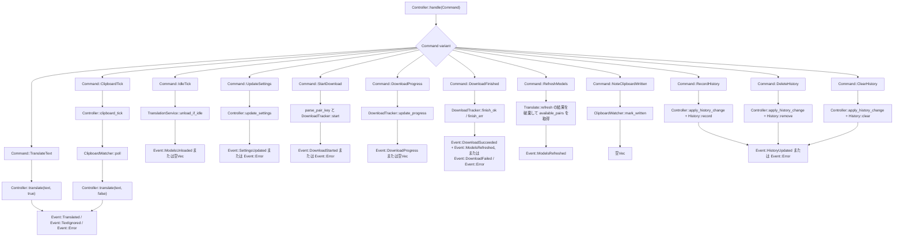
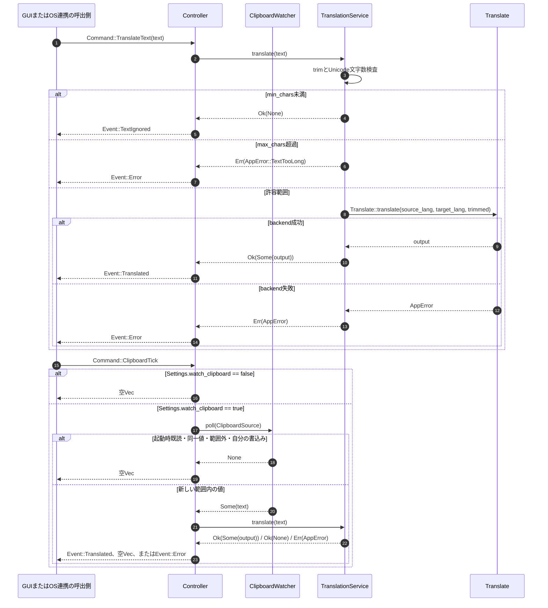
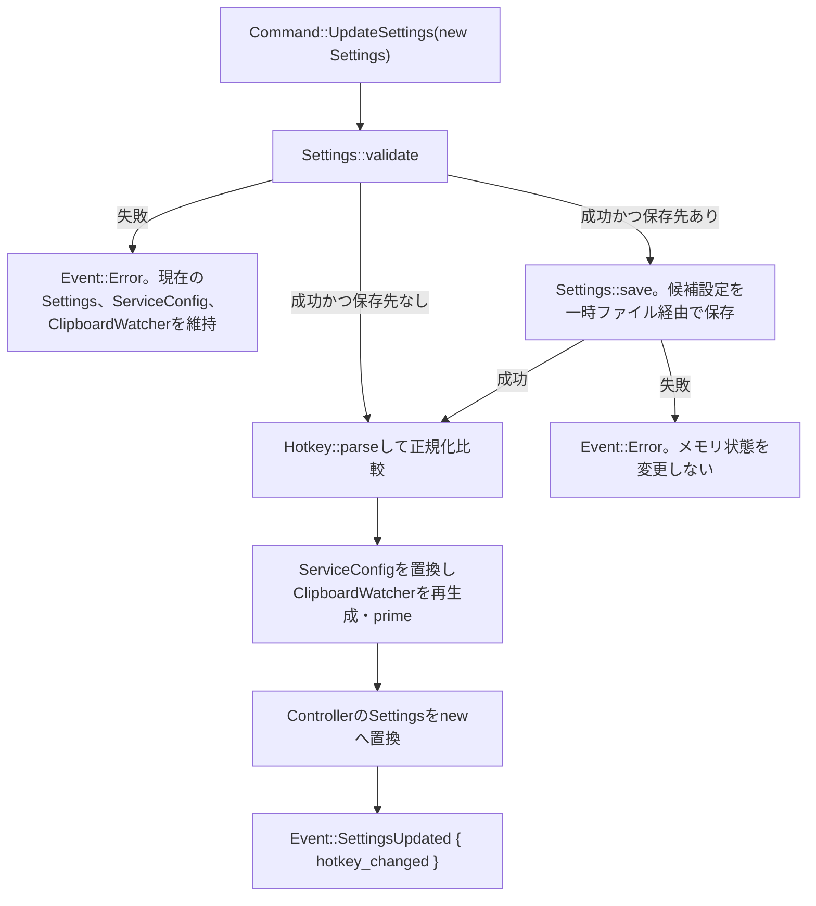
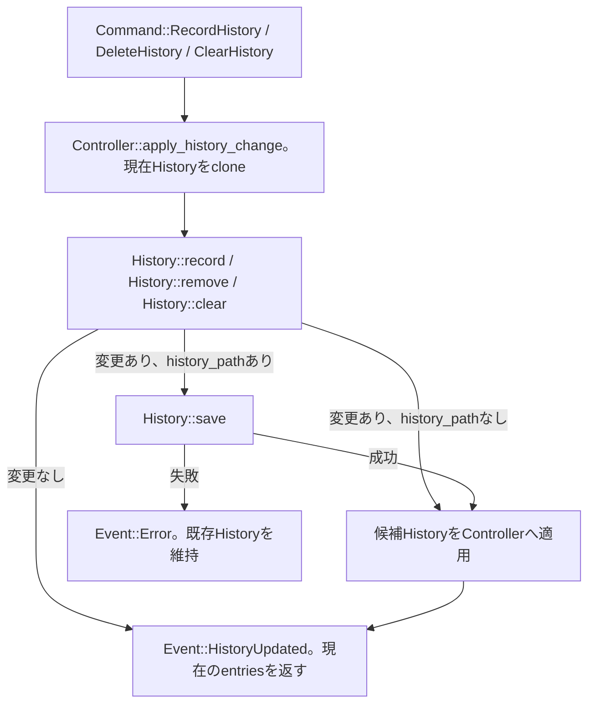

# 詳細設計書（機能・モジュール制御仕様）
**tray-translate appクレート: 常駐アプリ制御、翻訳、状態管理の契約**

---

## 1. 概要とSSOT境界

### 1.1 モジュールの目的

本書は `crates/app` が提供する常駐アプリ制御の詳細仕様を定義する。`Controller` は画面・トレイ・ホットキー・実クリップボードの実装を直接持たず、呼出側から `Command` を受け、処理結果を `Vec<Event>` として返す。GUIの翻訳ワーカーはこのインターフェースを1本のワーカー内で直列に呼び出す。

対象は次の9機能である。

- `Controller::handle` による `Command` の直列処理と `Event` の生成
- `TranslationService` と `Translate` を介した手動翻訳
- `ClipboardWatcher` と `ClipboardSource` を介したクリップボード監視
- `Clock` を介したアイドル時のモデル解放
- `Settings` の検証・保存・適用とホットキー変更通知
- `DownloadTracker` によるモデル取得状態の管理
- `History` による履歴の記録・削除・保存
- `Hotkey::parse` によるホットキー文字列の検証・正規化
- `required_packages` と `Controller::missing_packages` による不足モデル判定

`Controller` は制御層であり、画面描画、OS固有のクリップボード読み取り実装、グローバルホットキー登録、トレイ表示、ネットワークからのモデル取得そのものを担当しない。これらは呼出側または注入されたアダプターの責務である。

### 1.2 単一責任範囲 (SSOT) とデータ境界

- **本書の正本範囲**: `module_behavior`。`Controller` の呼び出し順序、`Command` / `Event` DTO、状態遷移、エラー処理、保存前後の制御契約を正本とする。
- **対象実装**: `crates/app/src/controller.rs`、`service.rs`、`clipboard.rs`、`config.rs`、`history.rs`、`hotkey.rs`、`models.rs`、`error.rs`、`paths.rs`。
- **DTOと永続化の境界**: 本書は関数間・モジュール間・ワーカー間で受け渡すDTOを定義する。設定JSON、履歴JSON、モデルパッケージの物理スキーマ、保存先、移行、原子置換、排他制御は [TT-DS-001 データ構造仕様書](./TT-DS-001_データ構造仕様書.md) を正本とし、本書では重複定義しない。
- **基本設計との関係**: システム全体の目的、クレート間の依存方向、appとGUIの責務境界は [TT-BD-001 基本設計書](./TT-BD-001_基本設計書.md) を正本とする。
- **環境品質ゲートとの関係**: 静的解析、整形、テスト、Mermaid検証の実行条件と合格基準は [TT-ENV-001 環境・開発基盤仕様書](../setup/TT-ENV-001_環境・開発基盤仕様書.md) のQG定義を参照する。本書へコマンドや合格基準を再掲しない。
- **GUIへの委譲**: 入力後の自動翻訳に対するデバウンス、古い自動翻訳結果の破棄、履歴へ確定するまでの待機、確定待ち中の結果管理はGUI側の `TT-DD-003` へ委譲する。本書は、確定した `HistoryEntry` を `Command::RecordHistory` で受け取った後の保存契約だけを定義する。
- **OS実装の境界**: `ClipboardSource`、`Translate`、`Clock` がapp側のseamである。本番アダプターはGUIまたはcoreが提供し、テストではfakeを差し込む。appはOS APIを直接呼び出さない。
- **外部公開契約**: 本書の機能はapp内部のRustインターフェースであり、外部公開APIではない。認証、バージョニング、外部互換性の契約は持たない。
- **責務の対象外**: GUIの描画・入力部品、トレイとホットキーのOS登録、実クリップボードへの書き込み、ダウンロード用HTTP通信、履歴検索、履歴削除の確認画面、自動翻訳結果の確定待ち、複数プロセス間の排他制御は本書で定義しない。
- **矛盾時の扱い**: 制御仕様は本書、永続化仕様はTT-DS-001、全体方針はTT-BD-001、品質ゲートはTT-ENV-001を更新して整合させる。文書の更新日だけで優先順位を決めない。

---

## 2. インターフェースとDTO (Data Transfer Object) 仕様

### 2.1 対象機能一覧

| 機能ID | 関数・機能名                                               | 呼び出し元                                                                                                  | 主な呼び出し先                                                                                  | 同期 / 非同期 |                冪等性                | 外部副作用                                                              | 公開範囲 |
| :----- | :--------------------------------------------------------- | :---------------------------------------------------------------------------------------------------------- | :---------------------------------------------------------------------------------------------- | :-----------: | :----------------------------------: | :---------------------------------------------------------------------- | :------: |
| F-001  | `Controller::handle`                                       | GUI翻訳ワーカー、OS連携イベントの呼出側                                                                     | `Controller::translate`、`ClipboardWatcher`、`TranslationService`、`DownloadTracker`、`History` |     同期      |        Command依存・条件付き         | バックエンド呼出し、設定・履歴ファイル保存、モデル再スキャン、Event返却 |   内部   |
| F-002  | `TranslationService::translate` を経由した手動翻訳         | `Controller::handle(Command::TranslateText)`                                                                | `TranslationService::translate`、`Translate::translate`                                         |     同期      |      バックエンド依存・条件付き      | 翻訳モデルのロードまたは使用、Event返却                                 |   内部   |
| F-003  | `ClipboardWatcher::prime` / `poll` / `mark_written`        | `Controller::new`、`Controller::update_settings`、`Command::ClipboardTick`、`Command::NoteClipboardWritten` | `ClipboardSource::read_text`、`Controller::translate`                                           |     同期      |          同じ既読値には冪等          | OSクリップボード読み取り、`last_seen`更新、Event返却                    |   内部   |
| F-004  | `TranslationService::unload_if_idle` を経由したidle unload | `Command::IdleTick`                                                                                         | `Clock::now`、`Translate::loaded_count`、`Translate::unload_all`                                |     同期      |        解放後の再実行は無操作        | 翻訳モデル解放、Event返却                                               |   内部   |
| F-005  | `Controller::update_settings`                              | `Command::UpdateSettings`                                                                                   | `Settings::validate`、`Settings::save`、`Hotkey::parse`、`ServiceConfig`、`ClipboardWatcher`    |     同期      | 同じ正規化ホットキーなら通知上は不変 | 設定ファイル置換、サービス設定・監視状態変更、Event返却                 |   内部   |
| F-006  | `DownloadTracker` の開始・進捗・完了                       | `Command::StartDownload`、`DownloadProgress`、`DownloadFinished`                                            | `parse_pair_key`、`DownloadTracker`、`Translate::refresh`                                       |     同期      |        Running中の開始は拒否         | ダウンロード状態変更、モデル再スキャン、Event返却                       |   内部   |
| F-007  | `History` の記録・削除・全消去                             | `Command::RecordHistory`、`DeleteHistory`、`ClearHistory`                                                   | `History::record`、`remove`、`clear`、`save`                                                    |     同期      |  同一キー・同一訳文の再記録は無変更  | 履歴ファイル置換、Event返却                                             |   内部   |
| F-008  | `Hotkey::parse`                                            | `Settings::validate`、`Controller::update_settings`、GUIの登録処理                                          | `Modifier::parse`、キー正規化                                                                   |     同期      |      正規化後の同値入力は同じ値      | なし。OS登録はGUI側                                                     |   内部   |
| F-009  | `required_packages` / `Controller::missing_packages`       | GUIのモデル管理画面、設定変更後の不足確認                                                                   | `parse_pair_key` で解釈されたペアキーとの比較                                                   |     同期      |      同じ入力配列・言語なら冪等      | なし。モデル一覧の取得は呼出側またはcore                                |   内部   |

### 2.2 主要関数・機能の契約

#### 機能契約（機能ID: F-001）

- **対象機能・関数名**: `Controller::handle(command: Command) -> Vec<Event>`
- **機能概要**: 1件の `Command` を現在のController状態へ適用し、画面・OS連携側へ返すイベントを順序付きで生成する。ControllerはCommandを同時並行に処理せず、呼出側が1本のワーカーで直列化する。
- **事前条件**: `Controller::new` が成功し、保持中の `Settings` が検証済みであること。`Translate`、`Clock`、`ClipboardSource` のアダプターが差し込まれていること。履歴・設定のパスは必要な場合だけ設定されていること。
- **事後条件**: Commandに対応する状態変更が完了し、成功・無視・失敗に応じた `Vec<Event>` を返す。通常の設定不正、翻訳失敗、履歴保存失敗、ダウンロード状態不整合はpanicではなく `Event::Error` へ変換する。`Command::NoteClipboardWritten` は状態だけを更新し、空のVecを返す。
- **タイムアウト / キャンセル**: ControllerにCommand単位のタイムアウト、キャンセル、自動再試行はない。翻訳のロード・推論時間は `Translate`、モデル取得の通信とキャンセルはGUI/core側の実装へ委譲する。
- **ログ・メトリクス・相関ID**: Eventに相関ID、メトリクス、監査IDのフィールドはない。失敗は `AppError` を文字列化した `Event::Error::message` またはダウンロード失敗メッセージで通知する。秘密情報を含む文字列は呼出側で除去して渡す。
- **外部公開時の互換性・認証**: 外部公開しない内部インターフェースのため、認証・外部バージョニング・後方互換契約はない。

#### 機能契約（機能ID: F-002）

- **対象機能・関数名**: `Controller::translate`、`TranslationService::translate`、`Translate::translate`
- **機能概要**: 入力を前後空白除去後のUnicode文字数で検査し、許容範囲だけを現在の言語設定で翻訳する。手動呼出しは範囲外を `Event::TextIgnored` で通知し、クリップボード呼出しは通知しない。
- **事前条件**: `ServiceConfig` の `min_chars` が1以上で `max_chars` 以下であること。翻訳バックエンドが `Translate` を実装していること。
- **事後条件**: 成功時はtrim済み原文を `Event::Translated::source` とし、バックエンド出力を `output` として返す。成功した翻訳だけが `last_used` を更新する。短すぎる入力はバックエンドへ渡さず、長すぎる入力は `AppError::TextTooLong` とする。
- **タイムアウト / キャンセル**: app側には設定しない。バックエンドが提供する処理時間に従い、キャンセルAPIはない。
- **ログ・メトリクス・相関ID**: 入力全文、相関ID、翻訳時間のログフィールドはない。エラーは `Event::Error::message` へ変換する。
- **外部公開時の互換性・認証**: 内部機能のため該当しない。

#### 機能契約（機能ID: F-003）

- **対象機能・関数名**: `ClipboardWatcher::prime`、`ClipboardWatcher::poll`、`ClipboardWatcher::mark_written`、`Controller::clipboard_tick`
- **機能概要**: `ClipboardSource` から現在のテキストを読み取り、起動時・設定更新時の既存値、直前と同じ値、アプリ自身が書き込んだ値を翻訳対象から除外する。
- **事前条件**: `ClipboardWatcher` が設定の `min_chars` / `max_chars` で生成されていること。`Controller::clipboard_tick` では `Settings::watch_clipboard` を先に確認すること。
- **事後条件**: `watch_clipboard` がfalseならクリップボードを読まず空のVecを返す。監視有効時、`poll` は新しい値だけを返し、返した文字列はControllerからF-002へ渡る。`None`を読んだ場合は `last_seen` を消去し、同じ文字列の再コピーを将来検出できる。範囲外の新しい値も `last_seen` へ記録して再通知しない。
- **タイムアウト / キャンセル**: app側のタイムアウト、キャンセル、再試行はない。定期Tickの頻度はGUI側で決める。
- **ログ・メトリクス・相関ID**: クリップボード内容をログへ出す契約はない。読み取り失敗を表す例外型はなく、`ClipboardSource::read_text` の `None` として扱う。
- **外部公開時の互換性・認証**: 外部公開しない内部機能のため該当しない。

#### 機能契約（機能ID: F-004）

- **対象機能・関数名**: `TranslationService::unload_if_idle`、`Controller::idle_tick`
- **機能概要**: 最後の成功翻訳から `idle_unload_secs` 以上経過し、バックエンドにモデルがロードされている場合だけモデルを解放する。
- **事前条件**: `Clock::now` が基準時点からの経過時間を返し、`Translate::loaded_count` と `unload_all` が実装されていること。`idle_unload_secs == 0` の場合は自動解放無効として扱う。
- **事後条件**: 解放したTickだけ `Event::ModelsUnloaded` を1件返す。解放後のTickはモデルがロードされていないため空のVecを返す。成功していない翻訳ではアイドル基準時刻を更新しない。
- **タイムアウト / キャンセル**: 解放処理のタイムアウト、キャンセル、自動再試行はない。Tickの呼出し周期はGUI側で管理する。
- **ログ・メトリクス・相関ID**: 解放回数や相関IDをEventへ含めない。失敗を返すインターフェースではなく、`unload_if_idle` は解放有無のboolだけを返す。
- **外部公開時の互換性・認証**: 外部公開しない内部機能のため該当しない。

#### 機能契約（機能ID: F-005）

- **対象機能・関数名**: `Controller::update_settings`、`Settings::validate`、`Settings::save`
- **機能概要**: 新しい `Settings` を検証し、保存先がある場合は先に保存してから、翻訳サービス設定・クリップボード監視・Controller設定を一括適用する。
- **事前条件**: 入力 `Settings` がDTOとして受け取れること。既存設定のホットキーが検証済みであること。保存先がある場合は、保存先をappが利用可能であることが望ましい。
- **事後条件**: 検証または保存が失敗した場合、既存の `Settings`、`ServiceConfig`、`ClipboardWatcher` を変更せず `Event::Error` を1件返す。成功時は `ServiceConfig` を置換し、文字数範囲を反映した新しい `ClipboardWatcher` を作成して現在のクリップボードをprimeし、`Settings` を置換する。ホットキーの正規化後の値が変わった場合だけ `hotkey_changed` をtrueにする。
- **タイムアウト / キャンセル**: 設定保存の全体タイムアウト、キャンセル、再試行はない。保存失敗時は呼出側が同じCommandを再送できる。
- **ログ・メトリクス・相関ID**: 相関ID、監査履歴、設定差分ログはない。保存エラーの文字列を `Event::Error::message` へ返す。
- **外部公開時の互換性・認証**: 外部公開しない内部機能のため該当しない。設定ファイルの物理スキーマはTT-DS-001を参照する。

#### 機能契約（機能ID: F-006）

- **対象機能・関数名**: `DownloadTracker::start`、`update_progress`、`finish_ok`、`finish_err` およびControllerのダウンロードCommand処理
- **機能概要**: ペアキー1件のダウンロード受付、進捗、成功・失敗を状態として保持し、GUIへイベントを通知する。ネットワーク処理自体はControllerの外側で実行する。
- **事前条件**: `StartDownload` のペアキーが `parse_pair_key` で `from_to` 形式として解釈できること。ダウンロード失敗メッセージは呼出側が秘密情報を除去済みであること。
- **事後条件**: 同時実行は1件だけで、開始時は `Running`、成功時は `Succeeded`、失敗時は `Failed` へ遷移する。成功時は `Event::DownloadSucceeded` の後に `Event::ModelsRefreshed` を返す。進捗はRunning中だけpairを保持して返す。
- **タイムアウト / キャンセル**: ControllerとTrackerに通信タイムアウト、キャンセル、自動再試行はない。実ダウンロードの通信制御はGUI/core側の契約に委譲する。
- **ログ・メトリクス・相関ID**: ダウンロードID、速度、経過時間はDTOにない。失敗メッセージは `Event::DownloadFailed::message` に渡すが、認証情報を含めない。
- **外部公開時の互換性・認証**: 外部公開しない内部機能のため該当しない。モデルの保存形式はTT-DS-001を参照する。

#### 機能契約（機能ID: F-007）

- **対象機能・関数名**: `Controller::apply_history_change`、`History::record`、`History::remove`、`History::clear`
- **機能概要**: `HistoryEntry` を新しい順の履歴へ適用し、変更がある場合だけ永続化し、現在の履歴を `Event::HistoryUpdated` で返す。保存処理はControllerに集約し、ワーカー1本で直列化する。
- **事前条件**: `HistoryEntry` の翻訳元・翻訳先・原文・訳文・時刻を受け取れること。履歴上限は現在設定の `history_max_entries` を使う。自動翻訳結果はGUI側で確定済みであること。
- **事後条件**: 同じ翻訳元・翻訳先・trim済み原文の既存エントリがあれば追加せず先頭へ移し、訳文と時刻を更新する。上限超過分は末尾から削除する。保存失敗時は候補Historyだけを破棄し、メモリ上の既存履歴を変更せず `Event::Error` を返す。成功または変更なしの場合は、変更の有無にかかわらず新しい順の現在履歴を `Event::HistoryUpdated` で返す。
- **タイムアウト / キャンセル**: 履歴保存の全体タイムアウト、キャンセル、自動再試行はない。保存失敗後の再記録は呼出側の再送に委ねる。
- **ログ・メトリクス・相関ID**: 履歴操作ID、監査ID、差分ログはDTOにない。原文・訳文をログへ出力しない。
- **外部公開時の互換性・認証**: 外部公開しない内部機能のため該当しない。保存フィールド・ファイル形式はTT-DS-001を参照する。自動翻訳の確定待ち時間はTT-DD-003を参照する。

#### 機能契約（機能ID: F-008）

- **対象機能・関数名**: `Hotkey::parse`
- **機能概要**: `+` 区切りの文字列から修飾キーと通常キーを解析し、修飾キーを正規化順へ並べた `Hotkey` を返す。
- **事前条件**: 入力はUTF-8文字列として受け取る。ホットキーは少なくとも1つの修飾キーと、ちょうど1つの通常キーを含む必要がある。
- **事後条件**: 成功時は修飾キーの重複がなく、`Ctrl`、`Alt`、`Shift`、`Super` の列挙順で比較・表示できる。通常キーは英数字1文字、`F1`〜`F24`、`Space`、`Enter`、`Tab`、`Escape` のいずれかへ正規化される。失敗時は `AppError::InvalidHotkey` を返す。
- **タイムアウト / キャンセル**: タイムアウト、キャンセル、再試行はない。
- **ログ・メトリクス・相関ID**: 相関IDやログ出力はない。エラーには入力文字列と失敗理由が含まれ得るため、機密情報として扱う入力をホットキーに設定しない。
- **外部公開時の互換性・認証**: 外部公開しない内部機能のため該当しない。OSへの登録と登録解除はGUI側の責務である。

#### 機能契約（機能ID: F-009）

- **対象機能・関数名**: `required_packages`、`Controller::missing_packages`
- **機能概要**: 現在の翻訳元・翻訳先と導入済みペアキーから、直接翻訳または英語pivotに必要で未導入のペアキーを決定する。
- **事前条件**: 言語コードは設定検証済みで、導入済み配列はペアキー文字列の一覧であること。導入済み配列の比較値は関数内で小文字化しないため、呼出側は保存済みペアキーの表記を維持する。
- **事後条件**: 同一言語は空配列、直接ペアが導入済みなら空配列、片側が英語なら直接ペア1件、双方が英語以外なら `from_en` と `en_to` のうち不足するものをこの順で返す。非英語同士でも直接ペアが導入済みならpivot不足を返さない。
- **タイムアウト / キャンセル**: タイムアウト、キャンセル、再試行はない。モデル一覧の再スキャンはF-006または呼出側で行う。
- **ログ・メトリクス・相関ID**: 相関ID、通信、ログ出力はない。
- **外部公開時の互換性・認証**: 外部公開しない内部機能のため該当しない。モデルパッケージの物理構造はTT-DS-001を参照する。

### 2.3 入力DTOスキーマ・パラメータ仕様

#### 2.3.1 `Command` DTO（F-001）

`Command` はGUI、OS連携、定期Tick、モデル管理スレッドからControllerへ渡す内部DTOである。Rustのenum variant自体が必須性を表すため、payloadを持つvariantの値はNULL不可とする。

| Command variant        | フィールド / データ型                               | 必須性 |       NULL可        | デフォルト値                             | バリデーションルール・入力制約                                        | 例・備考                           |
| :--------------------- | :-------------------------------------------------- | :----: | :-----------------: | :--------------------------------------- | :-------------------------------------------------------------------- | :--------------------------------- |
| `TranslateText`        | `text: String`                                      |  必須  |        不可         | なし                                     | F-002でtrim後に文字数検査。原文の空白だけは翻訳しない                 | 手動入力・選択テキスト             |
| `ClipboardTick`        | なし                                                |  必須  |      該当なし       | なし                                     | `Settings::watch_clipboard` がfalseなら読み取りを行わない             | 周期通知                           |
| `IdleTick`             | なし                                                |  必須  |      該当なし       | なし                                     | `ServiceConfig.idle_unload` と最後の成功翻訳時刻を使う                | 周期通知                           |
| `UpdateSettings`       | `settings: Settings`                                |  必須  |        不可         | なし                                     | F-005の `Settings::validate` に合格する必要がある                     | 保存先がない場合もメモリへ適用する |
| `StartDownload`        | `pair: String`                                      |  必須  |        不可         | なし                                     | `parse_pair_key` が成功する `from_to` 形式。実在言語までは検証しない  | 例: `en_ja`                        |
| `DownloadProgress`     | `downloaded_bytes: u64`、`total_bytes: Option<u64>` |  必須  | `total_bytes`のみ可 | `downloaded_bytes=0`、`total_bytes=None` | Running中だけ状態を更新。値の単調増加、合計超過、合計0は検証しない    | 不明な総量はNone                   |
| `DownloadFinished`     | `result: Result<(), String>`                        |  必須  |        不可         | なし                                     | Running中だけ完了処理。失敗メッセージは秘密情報を含まないこと         | `Ok(())`または安全化済みメッセージ |
| `RefreshModels`        | なし                                                |  必須  |      該当なし       | なし                                     | `Translate::refresh` の戻り値はControllerではEvent::Errorへ変換しない | 一覧更新通知を返す                 |
| `NoteClipboardWritten` | `text: String`                                      |  必須  |        不可         | なし                                     | `ClipboardWatcher::mark_written` へそのまま渡す                       | 実書き込み前に呼出側が送る         |
| `RecordHistory`        | `entry: HistoryEntry`                               |  必須  |        不可         | なし                                     | F-007の重複キー、空原文、上限ルールを適用                             | GUIで確定した結果だけを渡す        |
| `DeleteHistory`        | `entry: HistoryEntry`                               |  必須  |        不可         | なし                                     | 翻訳元・翻訳先・原文だけで対象を照合。訳文と時刻は照合キーでない      | 個別削除                           |
| `ClearHistory`         | なし                                                |  必須  |      該当なし       | なし                                     | 空履歴ならメモリ・ファイルを変更しない                                | 全消去                             |

#### 2.3.2 `Settings` DTO（F-005）

`Settings` はControllerの設定更新入力DTOである。保存ファイルのJSONフィールド、配置、互換性、原子書き込みはTT-DS-001を正本とする。次表はControllerが受け取ったDTOの型と検証だけを定義する。

| フィールド                | データ型 | 必須性 | NULL可 | デフォルト値        | バリデーションルール・入力制約                                     | Controllerでの適用                                 |
| :------------------------ | :------- | :----: | :----: | :------------------ | :----------------------------------------------------------------- | :------------------------------------------------- |
| `hotkey`                  | `String` |  必須  |  不可  | `Settings::default` | `Hotkey::parse` 成功。修飾キー1個以上、通常キー1個                 | `hotkey_changed` 判定に使用                        |
| `source_lang`             | `String` |  必須  |  不可  | `Settings::default` | trim後非空、実装上の長さ10以下、ASCII英数字またはハイフン。`_`不可 | `ServiceConfig.source_lang` と不足モデル判定に使用 |
| `target_lang`             | `String` |  必須  |  不可  | `Settings::default` | `source_lang` と同じ                                               | `ServiceConfig.target_lang` と不足モデル判定に使用 |
| `idle_unload_secs`        | `u64`    |  必須  |  不可  | `Settings::default` | 0は自動解放無効。その他の上限検証はない                            | `ServiceConfig.idle_unload` に変換                 |
| `watch_clipboard`         | `bool`   |  必須  |  不可  | `Settings::default` | 真偽値                                                             | `Command::ClipboardTick` の読み取りゲート          |
| `copy_result`             | `bool`   |  必須  |  不可  | `Settings::default` | 真偽値                                                             | 実クリップボードへの書き込み判断はGUI側            |
| `min_chars`               | `usize`  |  必須  |  不可  | `Settings::default` | 1以上、`max_chars` 以下                                            | ServiceConfigとClipboardWatcherへ適用              |
| `max_chars`               | `usize`  |  必須  |  不可  | `Settings::default` | `min_chars` 以上                                                   | ServiceConfigとClipboardWatcherへ適用              |
| `auto_translate`          | `bool`   |  必須  |  不可  | `Settings::default` | 真偽値                                                             | 自動翻訳の起動判断はGUI側                          |
| `auto_translate_delay_ms` | `u64`    |  必須  |  不可  | `Settings::default` | 100〜10000ミリ秒                                                   | デバウンス処理はGUI側。Controllerは値を保存する    |
| `use_tray`                | `bool`   |  必須  |  不可  | `Settings::default` | 真偽値。OS別既定値は設定生成側で決まる                             | 終了・常駐判断はGUI側                              |
| `history_max_entries`     | `usize`  |  必須  |  不可  | `Settings::default` | 0〜1000。0は履歴を記録しない                                       | 次の履歴記録時にHistoryへ渡す                      |
| `history_commit_delay_ms` | `u64`    |  必須  |  不可  | `Settings::default` | 500〜30000ミリ秒                                                   | 自動翻訳履歴の確定待ちはTT-DD-003へ委譲            |

#### 2.3.3 `HistoryEntry` DTO（F-007）

`HistoryEntry` はController、GUI、History間で受け渡す内部DTOである。物理保存時のJSONパス、`version`、ファイル配置はTT-DS-001を参照する。

| フィールド    | データ型 | 必須性 | NULL可 | デフォルト値 | バリデーションルール・入力制約                              | 例・備考                   |
| :------------ | :------- | :----: | :----: | :----------- | :---------------------------------------------------------- | :------------------------- |
| `source_lang` | `String` |  必須  |  不可  | なし         | 重複判定ではtrim後に大小文字を無視。record時にASCII小文字化 | 翻訳元言語                 |
| `target_lang` | `String` |  必須  |  不可  | なし         | `source_lang` と同じ重複判定                                | 翻訳先言語                 |
| `source`      | `String` |  必須  |  不可  | なし         | record時にtrim。空白だけは記録しない                        | 重複キーの一部             |
| `output`      | `String` |  必須  |  不可  | なし         | record時にtrimしない                                        | 訳文。重複キーには含めない |
| `used_at`     | `u64`    |  必須  |  不可  | なし         | `HistoryEntry::new` はUNIX秒を設定。重複キーには含めない    | 最終利用時刻               |

#### 2.3.4 F-003、F-004、F-006、F-008、F-009の引数

| 対象機能ID | 関数・引数                                                        | データ型                    | 必須性 / NULL可        | 入力制約・前提                                                 | OS実装とのseam               |
| :--------- | :---------------------------------------------------------------- | :-------------------------- | :--------------------- | :------------------------------------------------------------- | :--------------------------- |
| F-003      | `ClipboardWatcher::new(min_chars, max_chars)`                     | `usize`, `usize`            | 必須 / NULL不可        | Controller生成時のSettings検証後に呼ぶ                         | `ClipboardSource`            |
| F-003      | `ClipboardWatcher::prime(source)`                                 | `&mut dyn ClipboardSource`  | 必須 / NULL不可        | 現在値を既読にし、翻訳対象へ出さない                           | `ClipboardSource::read_text` |
| F-003      | `ClipboardWatcher::poll(source)`                                  | `&mut dyn ClipboardSource`  | 必須 / NULL不可        | `None`、同一値、範囲外を規定順で処理                           | `ClipboardSource::read_text` |
| F-003      | `ClipboardWatcher::mark_written(text)`                            | `&str`                      | 必須 / NULL不可        | 書き込む予定の文字列を既読化                                   | GUIの書き込み通知            |
| F-004      | `TranslationService::unload_if_idle()`                            | なし                        | 必須 / 該当なし        | `idle_unload`、`last_used`、ロード数の条件を満たす場合だけ解放 | `Clock`、`Translate`         |
| F-006      | `DownloadTracker::start(pair)`                                    | `&str`                      | 必須 / NULL不可        | Controller側で `parse_pair_key` 成功済み。Running中は拒否      | なし                         |
| F-006      | `DownloadTracker::update_progress(downloaded_bytes, total_bytes)` | `u64`, `Option<u64>`        | 必須 / totalのみNULL可 | Running中だけ更新。整合性上限は未定義                          | なし                         |
| F-006      | `DownloadTracker::finish_ok()`                                    | なし                        | 必須 / 該当なし        | Running中だけSucceededへ遷移                                   | なし                         |
| F-006      | `DownloadTracker::finish_err(message)`                            | `&str`                      | 必須 / NULL不可        | Running中だけFailedへ遷移。秘密情報を含めない                  | なし                         |
| F-008      | `Hotkey::parse(input)`                                            | `&str`                      | 必須 / NULL不可        | 修飾キー1個以上、通常キー1個、対応キーのみ                     | OS登録はGUI側                |
| F-009      | `required_packages(installed, from, to)`                          | `&[String]`, `&str`, `&str` | 必須 / NULL不可        | from/toを小文字化してdirectまたは英語pivotを判定               | なし                         |
| F-009      | `Controller::missing_packages(installed)`                         | `&[String]`                 | 必須 / NULL不可        | 現在Settingsのsource_lang/target_langを使う                    | なし                         |

### 2.4 出力DTO・戻り値仕様

#### 2.4.1 `Event` DTO（F-001）

`Event` はControllerからGUIまたはOS連携側へ返す通知DTOである。`Controller::handle` の戻り値は順序を持つ `Vec<Event>` であり、空、1件、またはダウンロード成功時の2件となる。

| Event variant       | フィールド / データ型                                               | 必須性 |       NULL可        | 正常時の意味・制約                                                         |
| :------------------ | :------------------------------------------------------------------ | :----: | :-----------------: | :------------------------------------------------------------------------- |
| `Translated`        | `source: String`、`output: String`                                  |  必須  |        不可         | 翻訳成功。`source` はtrim済み入力、`output` はTranslateの戻り値            |
| `TextIgnored`       | なし                                                                |  必須  |      該当なし       | 手動入力がmin_chars未満で、翻訳を実行しなかった。Clipboard由来では返さない |
| `ModelsUnloaded`    | なし                                                                |  必須  |      該当なし       | idle条件を満たしてモデルを解放したTickで1件だけ返す                        |
| `SettingsUpdated`   | `hotkey_changed: bool`                                              |  必須  |        不可         | 検証・保存・適用が完了した。trueならGUIはOS登録を更新する                  |
| `DownloadStarted`   | `pair: String`                                                      |  必須  |        不可         | DownloadTrackerがRunningへ遷移した                                         |
| `DownloadProgress`  | `pair: String`、`downloaded_bytes: u64`、`total_bytes: Option<u64>` |  必須  | `total_bytes`のみ可 | Running中に受理した進捗。pairはTrackerの値                                 |
| `DownloadSucceeded` | `pair: String`                                                      |  必須  |        不可         | RunningからSucceededへ遷移した                                             |
| `DownloadFailed`    | `pair: String`、`message: String`                                   |  必須  |        不可         | RunningからFailedへ遷移した。messageは安全化済みであること                 |
| `ModelsRefreshed`   | `available_pairs: Vec<String>`                                      |  必須  |        不可         | backend再スキャン後の一覧。refreshエラーでも現在取得できる一覧を返す       |
| `HistoryUpdated`    | `entries: Vec<HistoryEntry>`                                        |  必須  |        不可         | 履歴操作後の現在一覧。新しい順。変更なし・空履歴でも返す                   |
| `Error`             | `message: String`                                                   |  必須  |        不可         | 入力不正、保存失敗、翻訳失敗、状態不整合などの利用者向け失敗               |

`Command::NoteClipboardWritten` は `Event` を返さない。`Command::RefreshModels` は `Translate::refresh` のエラーを `Event::Error` に変換せず、`ModelsRefreshed` を返す。`Command::DownloadFinished(Ok(()))` は必ず `DownloadSucceeded`、`ModelsRefreshed` の順で返す。

#### 2.4.2 F-002の戻り値

| 呼出し                          | 正常時の戻り値                                 | 異常時の戻り値                                                  | Controllerでの変換                                                                                                       |
| :------------------------------ | :--------------------------------------------- | :-------------------------------------------------------------- | :----------------------------------------------------------------------------------------------------------------------- |
| `TranslationService::translate` | `Ok(Some(output))`、または短い入力の`Ok(None)` | `Err(AppError::TextTooLong)`、または`Translate`由来の`AppError` | 成功は`Event::Translated`。手動の`Ok(None)`は`Event::TextIgnored`。Clipboard由来の`Ok(None)`は空Vec。Errは`Event::Error` |
| `Controller::translate`         | `Vec<Event>`                                   | `Vec<Event>`内の`Event::Error`                                  | `report_ignored=true`が手動、`false`がClipboard                                                                          |

#### 2.4.3 F-003、F-004、F-005、F-006、F-007、F-008、F-009の戻り値

| 対象機能ID | 関数・処理                               | 正常時の戻り値                                                | 異常時の戻り値 / 状態                                                              | 再試行可否・追跡情報                     |
| :--------- | :--------------------------------------- | :------------------------------------------------------------ | :--------------------------------------------------------------------------------- | :--------------------------------------- |
| F-003      | `ClipboardWatcher::poll`                 | 新しい範囲内文字列の`Some(String)`、それ以外の`None`          | クリップボードの`None`はエラーでなく既読値消去                                     | 自動再試行なし。次のTickで再読込         |
| F-004      | `TranslationService::unload_if_idle`     | 解放したら`true`、それ以外`false`                             | 解放失敗を返す型はなく、backend実装に委譲                                          | 自動再試行なし。次回Tickで再評価         |
| F-005      | `Controller::update_settings`            | `Event::SettingsUpdated { hotkey_changed }`                   | `Event::Error`。既存設定、ServiceConfig、Watcherは不変                             | 呼出側が同じSettingsを再送可。相関IDなし |
| F-006      | ダウンロードCommand                      | Started、Progress、Succeeded、Failed、または状態不整合のError | invalid pair、二重開始、実行中でない完了はError。Tracker状態は不正操作前の値を維持 | 自動再試行なし。Failed後は新Start可      |
| F-007      | 履歴Command                              | 変更操作の結果は`HistoryUpdated { entries }`                  | 保存失敗は`Event::Error`。候補変更は破棄し、既存履歴を維持                         | 自動再試行なし。保存失敗後に再送可       |
| F-008      | `Hotkey::parse`                          | 正規化済み`Hotkey`                                            | `AppError::InvalidHotkey`                                                          | 自動再試行なし。入力修正後に再検証       |
| F-009      | `required_packages` / `missing_packages` | 不足ペアを入力順で持つ`Vec<String>`                           | エラー型はなく、不正な導入済みキーは単に一致しない                                 | 自動再試行なし。モデル一覧更新後に再計算 |

#### 2.4.4 `DownloadState` DTO

| 状態        | フィールド                                                          | 生成条件                                        | 次の処理                                      |
| :---------- | :------------------------------------------------------------------ | :---------------------------------------------- | :-------------------------------------------- |
| `Idle`      | なし                                                                | Controller生成時、またはTrackerが初期化された時 | StartDownloadを受理できる                     |
| `Running`   | `pair: String`、`downloaded_bytes: u64`、`total_bytes: Option<u64>` | 有効なStartDownloadを受理した時                 | 進捗更新、成功、失敗を受理する。別Startは拒否 |
| `Succeeded` | `pair: String`                                                      | Running中に`finish_ok`した時                    | 次のStartDownloadを受理できる                 |
| `Failed`    | `pair: String`、`message: String`                                   | Running中に`finish_err`した時                   | 次のStartDownloadを受理できる                 |

### 2.5 関数単位の追加契約

#### F-002: trim、文字数、Translate trait

- `TranslationService::translate` は `text.trim()` の結果を使い、Unicodeスカラー値の数を `chars().count()` で数える。バイト数では判定しない。
- 文字数が `min_chars` 未満ならbackendを呼ばず `Ok(None)`。文字数が `max_chars` を超えるなら `AppError::TextTooLong { len, max }`。
- 許容範囲の入力だけを `Translate::translate(source_lang, target_lang, trimmed)` へ渡す。成功時にのみ `last_used` を `Clock::now()` へ更新する。
- `Controller::handle(Command::TranslateText(text))` は `Controller::translate(&text, true)` を使う。`Controller::clipboard_tick` は `Controller::translate(&text, false)` を使う。この引数差により、手動の範囲外は `TextIgnored`、Clipboardの範囲外は無通知となる。
- `Translate` は翻訳、ロード済みモデル数の取得、全モデル解放、モデル一覧再スキャン、利用可能ペア取得を提供する。実装は `TranslationRouter`、テストはfakeを使う。

#### F-003: ClipboardWatcherの既読値

- `prime` は読み取った現在値を `last_seen` に設定し、起動時または監視有効化直後の既存内容を翻訳しない。
- `poll` は読み取り値が `None` なら `last_seen` を消去して終了する。同じ値なら終了する。新しい値は範囲判定前に `last_seen` へ保存する。
- 新しい値のtrim後文字数が範囲内なら、元の文字列を `Some` として返す。ControllerのTranslationServiceが改めてtrimしてbackendへ渡す。
- `mark_written` はアプリが書き込む予定の文字列を `last_seen` へ設定する。GUIが実書き込みに失敗してもapp側で再同期する処理はないため、呼出側は実書き込みとの順序を守る。

#### F-005: 設定適用の原子性

- `new.validate()` を最初に実行する。検証失敗時は保存も適用も行わない。
- `settings_path` がある場合は `new.save(path)` を検証後、メモリ状態の適用前に実行する。保存失敗時はメモリ状態を変更しない。
- 保存成功または保存先なしの場合だけ、旧ホットキーと新ホットキーを `Hotkey::parse` して正規化比較する。
- `ServiceConfig::from(&new)` を設定し、`ClipboardWatcher::new(new.min_chars, new.max_chars)` を作成して現在のクリップボードをprimeし、最後に `self.settings = new` とする。
- `history_max_entries` を下げても既存履歴をその場で削除しない。次回の `RecordHistory` で `History::record` が上限を適用する。`history_commit_delay_ms` はGUI側の自動翻訳確定待ちへ委譲する。

#### F-006: refreshの失敗契約

- `Command::RefreshModels` は `Translate::refresh` の戻り値を無視し、直後の `available_pairs` を使って `ModelsRefreshed` を返す。
- `DownloadFinished(Ok(()))` もTrackerをSucceededへ遷移させた後にrefreshを呼び、refresh結果をエラーEventへ変換しない。返すEventは `DownloadSucceeded`、`ModelsRefreshed` の2件である。
- この仕様ではrefresh失敗と一覧取得失敗を別Eventで表現できない。失敗を利用者へ通知する仕様へ変更する場合は、Controller、Event、テスト、関連文書を同じ変更単位で更新する。

#### F-007: 履歴の保存契約

- `apply_history_change` は現在履歴をcloneしてから変更関数を適用する。変更がない場合は保存せず、現在履歴をそのまま `HistoryUpdated` で返す。
- 変更があり保存先がある場合、候補履歴の保存成功後だけControllerの履歴を候補へ置き換える。保存先がない場合はメモリだけを候補へ置き換える。
- 保存エラー時は `Event::Error` だけを返し、`HistoryUpdated` は返さない。保存前のメモリ履歴を保持する。
- `RecordHistory` の重複キーは翻訳元、翻訳先、trim済み原文である。`DeleteHistory` では入力Entryの訳文・時刻を無視して同じキーを探す。
- 自動翻訳の確定待ち、古い結果の破棄、確定時刻の管理は本機能に含めない。GUI側が確定したEntryをRecordHistoryで送る。

---

## 3. 処理フロー・シーケンス・状態遷移ロジック (Mermaid 図)

### 3.1 処理フロー・シーケンス / 状態遷移図

- **図の正本**: 本節の図は呼出し順序と状態の可視化に使い、遷移条件と失敗時の正本は3.2の状態遷移表および4章の失敗契約と併用する。
- **対象機能ID**: F-001〜F-009

#### A. `Controller::handle` のCommand分岐



#### B. 手動翻訳とClipboard翻訳のシーケンス



手動翻訳では `Controller::translate` の `report_ignored` がtrue、Clipboard翻訳ではfalseである。したがって同じ文字数判定結果でも、手動の短い入力だけが `Event::TextIgnored` となる。

#### C. `DownloadState` の状態遷移

```mermaid
stateDiagram-v2
    [*] --> Idle
    Idle --> Running: DownloadTracker::start(pair)
    Succeeded --> Running: DownloadTracker::start(pair)
    Failed --> Running: DownloadTracker::start(pair)
    Running --> Running: DownloadTracker::update_progress(downloaded_bytes, total_bytes)
    Running --> Succeeded: DownloadTracker::finish_ok()
    Running --> Failed: DownloadTracker::finish_err(message)
    Running --> Running: 別のDownloadTracker::startは拒否
    Idle --> Idle: update_progressまたはfinishは無操作
    Succeeded --> Succeeded: finish_okまたはfinish_errは無操作
    Failed --> Failed: finish_okまたはfinish_errは無操作
```

`Controller::start_download` はTracker開始前に `parse_pair_key` を実行する。不正なペアキーは状態を変更しない。Controllerの `DownloadFinished` はRunning以外なら `Event::Error` とする。

#### D. 設定更新の適用フロー



#### E. 履歴変更と保存のフロー



### 3.2 状態遷移およびルーティングルール

- **初期状態**: `Controller::new` 成功時。検証済みSettings、未ロードまたはbackendが保持するモデル状態、`ClipboardWatcher` のprime済み既読値、`DownloadState::Idle`、空のHistory（履歴パスがあればTT-DS-001のファイルを読み込んだ値）。
- **終端状態**: 各Command処理はEvent列を返して終了する。Controller自体は常駐し、Command処理後に次のCommandを受け付ける。プロセス終了やGUIウィンドウ状態はGUI側の責務である。
- **状態不変条件**:
  - Controllerが保持するSettingsは `Settings::validate` に合格している。
  - `DownloadState::Running` は常に高々1件である。
  - Historyのentriesは新しい順で、Controller経由の変更後は設定上限を超えない。
  - 設定・履歴の保存失敗では、保存前のメモリ状態を維持する。
  - `last_used` は成功した翻訳でだけ更新される。
  - `ClipboardWatcher::last_seen` は起動時既読値、直近の読取値、またはアプリ書込通知値を表す。
- **未定義イベントの扱い**: Rust enumにないCommandは受理しない。Running以外へのDownloadProgressは無視、Running以外へのDownloadFinishedはError、設定・履歴・翻訳の通常エラーはEvent::Errorとする。refresh失敗は現実装ではErrorにせずModelsRefreshedへ進む。

| 現在の状態 / ノード  | 実行結果 / 評価フラグ                     | 次の状態 / ノード         | 遷移判定条件・閾値ルール                                                      | 副作用・ログ / メトリクス                     |
| :------------------- | :---------------------------------------- | :------------------------ | :---------------------------------------------------------------------------- | :-------------------------------------------- |
| `Controller::handle` | `Command::TranslateText`                  | 翻訳成功、無視、Error     | F-002のtrim後文字数とTranslate結果                                            | backend呼出し、Event生成                      |
| `Controller::handle` | `Command::ClipboardTick`                  | 変化なし、翻訳成功、Error | watch_clipboardがtrueで、ClipboardWatcherが新しい範囲内値を返した場合だけ翻訳 | Clipboard読み取り、`last_seen`更新            |
| `Controller::handle` | `Command::IdleTick`                       | モデル解放または維持      | idleがSome、last_usedあり、loaded_countが1以上、経過時間がidle以上            | backend.unload_all、必要時ModelsUnloaded      |
| `Controller::handle` | `Command::UpdateSettings`                 | 設定適用または旧設定維持  | validate成功、保存先があればsave成功                                          | 設定保存、ServiceConfig・Watcher更新          |
| `Controller::handle` | `Command::StartDownload`                  | Runningまたは旧状態維持   | pairが`from_to`形式で、現在Runningでない                                      | DownloadStartedまたはError                    |
| `Controller::handle` | `Command::DownloadProgress`               | Running更新または状態維持 | TrackerがRunningの場合だけbytesを置換                                         | DownloadProgressまたは空Vec                   |
| `Controller::handle` | `Command::DownloadFinished(Ok(()))`       | Succeeded                 | TrackerがRunningであること                                                    | DownloadSucceeded後にrefreshとModelsRefreshed |
| `Controller::handle` | `Command::DownloadFinished(Err(message))` | Failed                    | TrackerがRunningであること                                                    | DownloadFailed。messageは安全化済み前提       |
| `Controller::handle` | `Command::RefreshModels`                  | Controller状態を維持      | refresh結果の成否にかかわらず一覧取得へ進む                                   | ModelsRefreshed。refreshエラーは通知しない    |
| `Controller::handle` | `Command::NoteClipboardWritten`           | `last_seen`更新           | 文字列をmark_writtenへ渡す                                                    | Eventなし                                     |
| `Controller::handle` | 履歴Command                               | History更新または維持     | record/remove/clearの変更boolとsave結果                                       | HistoryUpdatedまたはError                     |
| `Hotkey::parse`      | 入力が正規化可能                          | `Hotkey`                  | modifier 1個以上、key 1個、対応キー                                           | OS登録は呼出側                                |
| `required_packages`  | 言語が同一                                | 空Vec                     | `from == to`                                                                  | 副作用なし                                    |
| `required_packages`  | 直接ペア導入済み                          | 空Vec                     | `installed`に`from_to`がある                                                  | 副作用なし                                    |
| `required_packages`  | 片側英語、直接未導入                      | 直接ペア1件               | `from == en`または`to == en`                                                  | 副作用なし                                    |
| `required_packages`  | 非英語同士、直接未導入                    | 不足pivotを0〜2件         | `from_en`、`en_to`をこの順に判定                                              | 副作用なし                                    |

### 3.3 OS連携とテストseam

| seam              | app側のInterface       | 本番Adapter                | テストAdapter        | appが依存しないもの                        |
| :---------------- | :--------------------- | :------------------------- | :------------------- | :----------------------------------------- |
| 翻訳・モデル      | `Translate`            | `TranslationRouter`        | FakeBackend          | CTranslate2の具体API、モデルファイルの配置 |
| 時刻              | `Clock`                | `SystemClock`              | FakeClock            | OSの時計APIの直接呼出し                    |
| Clipboard読み取り | `ClipboardSource`      | GUIの実Clipboardアダプター | FakeClipboard        | OSのClipboard API                          |
| 履歴・設定保存    | `Path`を受けるsave処理 | ローカルファイルシステム   | tempfileと失敗用パス | DB、FileLock、外部ストレージ               |

appのInterfaceは呼出側にCommand/Eventという小さな制御表面を提供し、翻訳、既読管理、設定適用、状態遷移、保存失敗時の保全を内部へ隠蔽する。GUIは内部フィールドを直接変更せず、Command送信とEvent受信だけを行う。

---

## 4. エラー処理・失敗契約

### 4.1 エラー分類と対処方針

appに自動再試行はない。再試行可能と記載したものも、同じCommandを呼出側が安全性を確認して再送するだけであり、Controllerが自動で繰り返すことはない。永続化の物理構造と一時ファイルの詳細はTT-DS-001を参照する。

| エラーコード / 例外型               | エラーカテゴリ         | 発生・判定基準                                                   |       再試行上限       | 再試行安全条件                            | 終端ステータス                                                       | 利用者・運用者対応                       | 副作用・データ保持契約                                            |
| :---------------------------------- | :--------------------- | :--------------------------------------------------------------- | :--------------------: | :---------------------------------------- | :------------------------------------------------------------------- | :--------------------------------------- | :---------------------------------------------------------------- |
| `AppError::InvalidHotkey`           | 入力検証               | modifier不足、key不足、key複数、重複modifier、空要素、非対応キー |       0（自動）        | 入力を修正して呼出側が再検証              | `Event::Error`または設定読込失敗                                     | ホットキー文字列を対応形式へ修正         | Controllerの既存Settingsを変更しない                              |
| `AppError::InvalidSettings`         | 設定検証               | 言語コード不正、文字数範囲逆転、min_chars=0、各範囲外            |       0（自動）        | 修正済みSettingsを呼出側が再送            | `Event::Error`                                                       | 設定値を修正                             | 保存・ServiceConfig・Watcherを変更しない                          |
| `AppError::TextTooLong`             | 翻訳入力               | trim後文字数がmax_chars超過                                      |       0（自動）        | 入力を短くして再送                        | 手動は`Event::Error`、ClipboardはClipboardWatcherが範囲外として空Vec | 入力を上限内にする                       | backendを呼ばず、last_usedを更新しない                            |
| `Translate`由来の`AppError::Core`等 | 翻訳backend            | 許容範囲入力の翻訳またはモデル利用に失敗                         |       0（自動）        | backend状態を確認後に呼出側が再送         | `Event::Error`                                                       | モデル導入・環境を確認                   | 失敗翻訳はlast_usedを更新しない。履歴へ記録しない                 |
| `AppError::Io` / `AppError::Json`   | 設定保存               | Settingsの一時書込みまたはrename、JSON生成・I/Oに失敗            |       0（自動）        | 保存先と権限を確認し再送                  | `Event::Error`                                                       | 保存先・権限・ファイル状態を確認         | 新Settingsを適用しない。既存設定ファイルを保全する契約はTT-DS-001 |
| 無効ペアキー                        | ダウンロード入力       | `parse_pair_key` がNone。区切り不足、空要素、to側に追加`_`       |       0（自動）        | `from_to`形式へ修正                       | `Event::Error`、Tracker状態は変更なし                                | ペアキーを修正またはモデル一覧を再確認   | DownloadTrackerの状態を変更しない                                 |
| `AppError::DownloadInProgress`      | ダウンロード競合       | Running中に別のStartDownload                                     |       0（自動）        | 現行ダウンロード完了後に再送              | `Event::Error`、現行Running維持                                      | 進行中のペアを待つ                       | 既存Runningのpair・進捗を保持                                     |
| 実行中でない完了通知                | ダウンロード状態不整合 | `DownloadFinished`時点でRunningでない                            |       0（自動）        | 呼出側の完了通知を破棄し状態を同期        | `Event::Error`、Tracker状態を維持                                    | 呼出側のスレッドとControllerの対応を確認 | 成功・失敗の状態変更を行わない                                    |
| ダウンロード失敗メッセージ          | モデル取得失敗         | Running中に`DownloadFinished(Err(message))`                      |       0（自動）        | ネットワーク・配布物を確認し新Start       | `DownloadState::Failed`、`Event::DownloadFailed`                     | 安全化済みmessageを表示し再取得を判断    | pairと安全化済みmessageを状態に保持                               |
| refresh失敗                         | モデル一覧更新失敗     | `Translate::refresh` がErr                                       |  0（通知再試行なし）   | 次回RefreshModelsまたは成功後に再確認     | 現実装は`ModelsRefreshed`を返し、Errorにはしない                     | 一覧が古い可能性を画面側で扱う           | Tracker成功状態は維持。refreshエラー詳細はEventに残らない         |
| `AppError::Io` / `AppError::Json`   | 履歴保存               | 候補Historyのsaveに失敗                                          |       0（自動）        | 保存先を修復してRecord/Delete/Clearを再送 | `Event::Error`、既存History維持                                      | 保存先・権限・破損を確認                 | 候補変更を破棄し、メモリ上の旧履歴を保持                          |
| 破損履歴の読み込み                  | 起動時復旧             | `History::load`がJSONまたはI/Oエラー                             | 0（起動時自動復旧1回） | 退避ファイルを確認し必要なら手動復旧      | 空Historyで起動継続                                                  | `history.json.corrupt`を確認             | 破損ファイルを退避できれば退避。退避失敗でも空Historyで継続       |
| `AppError::ConfigDirNotFound`       | パス解決               | OS標準設定ディレクトリを取得できず、環境変数もない               |       0（自動）        | `TT_CONFIG_DIR`等の環境を整えて再起動     | 起動・パス取得失敗                                                   | 設定ディレクトリを用意                   | Controller生成前のためController状態は存在しない                  |
| Clipboard `None`                    | 入力なし               | ClipboardSourceが空・テキスト以外・読み取りなしを返す            |        該当なし        | 次回Tickで再確認                          | 空Vec、last_seen消去                                                 | 利用者通知なし                           | エラーや履歴を生成しない                                          |

### 4.2 失敗時の共通契約

- `Event::Error::message` は表示用文字列であり、相関ID、再試行回数、構造化エラーコードを持たない。
- `Settings::validate`、`Hotkey::parse`、ファイルI/O、JSON変換、coreエラーは `Result` で扱い、通常入力でpanicを発生させない。panic方針はADR-005に従う。
- 設定・履歴の保存は候補を作ってから行う。候補保存に失敗した場合、Controllerの現在状態を先に変更しない。
- 履歴の読み込み失敗だけは `with_history` が `History::load_or_recover` を使い、起動を継続する。設定の読み込み失敗はapp起動側のエラーとして扱う。
- `Translate::refresh` のエラーは現実装で通知されない。これはエラーを正常化する仕様上の例外であり、refreshの失敗を表示する場合はEvent契約の変更が必要である。
- 履歴と翻訳結果は外部送信しない。平文保存され得る原文・訳文の秘匿方針、保存形式、ファイル権限はTT-DS-001を参照する。

---

## 5. 機能テスト要件

機能テスト要件は、関数契約、状態遷移、失敗契約を検証する観点を定義する。具体的な実行コマンド、CI条件、合格基準、実行証跡はTT-ENV-001およびテスト文書を正本とする。以下の対応テストケース名は、現行app実装のRustテスト関数を示し、新規境界を追加する場合は同じ機能IDへケースを追加する。

### 5.1 機能テスト要件一覧

| 要件ID | 対象機能ID | 保証すべき振る舞い・条件                                                         | 検証観点                                   | 対応テストケース                                                                                                                                                                                                                             |
| :----- | :--------- | :------------------------------------------------------------------------------- | :----------------------------------------- | :------------------------------------------------------------------------------------------------------------------------------------------------------------------------------------------------------------------------------------------- |
| TR-001 | F-001      | `Controller::handle` がCommandを1件ずつ処理し、各Event variantを正しい順序で返す | 全Command、空Vec、1件Event、成功時2件Event | `controller::download_success_flow`、`controller::refresh_models_command`、`controller::note_clipboard_written_via_command_prevents_translation`                                                                                             |
| TR-002 | F-001      | ダウンロード成功時は`DownloadSucceeded`の後に`ModelsRefreshed`を返す             | Event順序、一覧DTO                         | `controller::download_success_flow`                                                                                                                                                                                                          |
| TR-003 | F-002      | 手動翻訳はtrim済み入力をbackendへ渡し、`Translated.source`もtrim済みにする       | 正常、前後空白                             | `controller::translates_user_text`、`service::translates_trimmed_text`                                                                                                                                                                       |
| TR-004 | F-002      | min_chars未満の手動入力はbackendを呼ばず`TextIgnored`を返す                      | 下限境界、空白のみ                         | `controller::short_user_text_is_reported_as_ignored`、`service::short_or_blank_text_is_skipped`                                                                                                                                              |
| TR-005 | F-002      | max_chars超過は`TextTooLong`を`Error`へ変換し、backendを呼ばない                 | 上限境界、Unicode文字数                    | `controller::too_long_user_text_is_reported_as_error`、`service::too_long_text_is_rejected`、`service::length_is_counted_in_characters_not_bytes`                                                                                            |
| TR-006 | F-002      | 手動とClipboardで`report_ignored`の扱いを分ける                                  | 手動TextIgnored、Clipboard無通知           | `controller::short_user_text_is_reported_as_ignored`、`controller::out_of_range_clipboard_text_is_silently_ignored`                                                                                                                          |
| TR-007 | F-003      | 起動時prime済みのClipboard値を翻訳せず、新しい値は1回だけ返す                    | prime、同一値、別値                        | `controller::clipboard_content_at_startup_is_not_translated`、`controller::new_clipboard_content_is_translated_once`、`clipboard::prime_marks_existing_content_as_seen`、`clipboard::returns_new_text_once`                                  |
| TR-008 | F-003      | Clipboard監視無効時は読み取り・翻訳を行わない                                    | `watch_clipboard=false`                    | `controller::clipboard_is_ignored_when_watching_is_disabled`                                                                                                                                                                                 |
| TR-009 | F-003      | 空Clipboard、範囲外値、自分の書込みを既読扱いにする                              | None、min/max、自分の出力                  | `clipboard::empty_clipboard_returns_none`、`clipboard::text_outside_the_length_range_is_ignored`、`controller::own_clipboard_output_is_not_translated_again`、`controller::note_clipboard_written_via_command_prevents_translation`          |
| TR-010 | F-004      | idle_unload_secsの閾値未満では解放せず、閾値以上で1回だけ解放する                | 直前、閾値、解放後再Tick                   | `controller::idle_models_are_unloaded_once`、`service::unloads_only_after_idle_period`                                                                                                                                                       |
| TR-011 | F-004      | idle解放無効、初回翻訳前、翻訳失敗時は解放しない                                 | 0、last_usedなし、失敗                     | `service::never_unloads_when_idle_unload_is_disabled`、`service::does_nothing_before_first_translation`、`service::backend_failure_is_propagated`                                                                                            |
| TR-012 | F-005      | 有効Settingsを保存し、次回翻訳とWatcherへ適用する                                | 言語変更、文字数変更、prime                | `controller::settings_update_applies_to_next_translation`、`controller::settings_update_is_saved_to_the_given_path`、`controller::enabling_clipboard_watching_does_not_translate_existing_content`                                           |
| TR-013 | F-005      | 不正Settingsまたは保存失敗では設定・サービス・Watcherを変更しない                | validation、I/O失敗                        | `controller::invalid_settings_update_changes_nothing`、`controller::failed_save_does_not_apply_the_new_settings`、`config::invalid_values_are_rejected`、`config::save_failure_leaves_no_temp_file`                                          |
| TR-014 | F-005      | 正規化後に同じホットキーならfalse、異なる場合はtrueを通知する                    | modifier順、実キー変更                     | `controller::equivalent_hotkey_spelling_is_not_a_change`、`controller::hotkey_change_is_reported`、`hotkey::modifier_order_does_not_matter`                                                                                                  |
| TR-015 | F-006      | 有効ペアキーを1件だけRunningへ遷移させ、二重開始を拒否する                       | Idle、Running、再Start                     | `controller::download_progress_flow`、`controller::second_download_is_rejected_while_running`、`models::second_download_is_rejected_while_running`                                                                                           |
| TR-016 | F-006      | 進捗、成功、失敗、refreshのEventと状態を対応させる                               | 進捗DTO、状態終端、Event順序               | `controller::download_progress_flow`、`controller::download_success_flow`、`controller::download_failure_flow`、`models::download_lifecycle_success`、`models::download_lifecycle_failure`                                                   |
| TR-017 | F-006      | 無効ペア、実行中でない完了、非Running進捗を安全に処理する                        | invalid pair、状態不整合                   | `controller::invalid_pair_is_rejected_and_state_stays_idle`、`controller::finishing_without_a_running_download_is_an_error`、`models::finishing_without_running_does_nothing`                                                                |
| TR-018 | F-007      | 履歴を新しい順に記録し、同一キーを追加せず先頭へ移す                             | 順序、重複キー、訳文更新                   | `controller::recorded_history_is_returned_newest_first`、`controller::duplicate_history_is_not_added_twice`、`history::duplicate_moves_to_front_instead_of_adding`、`history::duplicate_key_ignores_case_of_language_and_surrounding_spaces` |
| TR-019 | F-007      | 上限0、上限超過、削除、全消去を適用する                                          | max、個別削除、全消去                      | `controller::history_is_not_recorded_when_the_limit_is_zero`、`controller::history_respects_the_configured_limit`、`controller::history_delete_and_clear`、`history::oldest_entries_are_dropped_beyond_the_limit`                            |
| TR-020 | F-007      | 履歴保存成功、再起動復元、保存失敗時のメモリ不変を保証する                       | 保存、復元、I/O失敗                        | `controller::history_is_saved_and_restored_across_controllers`、`controller::failed_history_save_keeps_the_previous_history`、`history::save_and_load_roundtrip`、`history::broken_file_is_moved_aside_and_history_starts_empty`             |
| TR-021 | F-007      | 変更なしの履歴操作はファイルを再書込みせず、現在一覧を返す                       | 書込み抑止、HistoryUpdated                 | `controller::unchanged_history_is_not_written_again`、`history::identical_front_entry_is_not_a_change`                                                                                                                                       |
| TR-022 | F-008      | 修飾キーと通常キーを解析し、別名・順序・大文字小文字を正規化する                 | 正常、alias、F1〜F24、表示                 | `hotkey::parses_and_normalizes`、`hotkey::accepts_aliases_for_modifiers`、`hotkey::accepts_function_keys_within_range`、`hotkey::key_can_come_first_and_spaces_are_ignored`                                                                  |
| TR-023 | F-008      | modifier不足、key不足、key複数、重複、空要素、非対応キーを拒否する               | 異常入力、InvalidHotkey                    | `hotkey::rejects_invalid_input`、`hotkey::error_is_invalid_hotkey_variant`、`config::invalid_values_are_rejected`                                                                                                                            |
| TR-024 | F-009      | 同一言語・直接導入済み・片側英語の不足ペア判定を保証する                         | direct、no-op、case conversion             | `models::no_packages_needed_for_same_language_or_installed_direct_pair`、`models::direct_package_is_required_when_one_side_is_english`、`controller::missing_packages_follow_the_language_settings`                                          |
| TR-025 | F-009      | 非英語同士は不足pivotだけを`from_en`、`en_to`の順で返し、直接ペアを優先する      | 0〜2件、順序、direct優先                   | `models::pivot_packages_are_required_for_non_english_pairs`、`models::only_missing_pivot_packages_are_reported`、`models::installed_direct_pair_is_used_instead_of_pivot`                                                                    |
| TR-026 | F-009      | 設定言語変更後の`missing_packages`が新しい言語方向を使う                         | Controller Settingsとの接続                | `controller::settings_update_applies_to_next_translation` と不足ペア境界ケースを組み合わせる                                                                                                                                                 |

追加テストで、`Command` / `Event` の全variantのDTOフィールド、`DownloadProgress.total_bytes=None`、refresh失敗をErrorへ変換しない現行契約、履歴の訳文・時刻を除く重複キーを明示的に固定する。

### 5.2 適用する品質ゲート

- **品質ゲートの正本**: [TT-ENV-001 環境・開発基盤仕様書](../setup/TT-ENV-001_環境・開発基盤仕様書.md)
- **適用するゲートID**: app単体の実装・テストは `QG-001`、`QG-002`、`QG-003` を適用する。Mermaidを含む本書は `QG-006` の対象とする。GUIとappの接続を変更する場合は、変更範囲に応じて `QG-004` と `QG-005` を追加適用する。
- 実行コマンド、CIの実行条件、合格基準、テスト結果はTT-ENV-001とテスト計画・結果報告書へ委譲し、本書へ再掲しない。

---

## 6. 作成完了チェック

- [x] `document_role`、`ssot_scope`、`status`、`owner`、`source_issue`をFrontmatterへ設定した。
- [x] 対象機能F-001〜F-009のIDを、一覧、契約、DTO、状態遷移、エラー、テスト要件へ対応付けた。
- [x] `Controller` が画面・OSからCommandを受け、Eventを返す制御層であることを定義した。
- [x] OS実装を`ClipboardSource`、`Translate`、`Clock`のseamとAdapterへ分離した。
- [x] CommandとEventの全variant、フィールド、NULL可否、制約をDTO表へ記載した。
- [x] `Controller::translate` の手動`report_ignored=true`、Clipboard`report_ignored=false`を記載した。
- [x] `Settings` 更新のvalidate、save、service/watcher適用順と失敗時の状態不変を記載した。
- [x] DownloadTrackerの単一実行、進捗、完了、refresh、状態遷移を記載した。
- [x] 履歴の重複キー、上限、保存失敗時のメモリ不変、HistoryUpdatedを記載した。
- [x] 自動翻訳の履歴確定待ちをGUI側TT-DD-003へ委譲し、Controllerの保存契約だけを記載した。
- [x] 永続化スキーマはTT-DS-001、品質ゲートはTT-ENV-001へ委譲し、物理スキーマと実行コマンドを重複記載していない。
- [x] Mermaidのノード、状態、Command、Event、Controller名を実装上の名前に合わせた。
- [x] 未置換の角括弧プレースホルダ、未確定の日付プレースホルダ、テンプレートのサンプル状態名・エラー名・閾値を残していない。
- [x] ソースコードの逐語貼付を行わず、契約を表、文章、Mermaid図で定義した。

---

## 7. 改訂履歴 (Change Log)

| 版数    | 改訂日     | 変更者              | 変更内容・変更理由 (Why)                                                                                                                          |
| :------ | :--------- | :------------------ | :------------------------------------------------------------------------------------------------------------------------------------------------ |
| Rev.1.0 | 2026-10-27 | tray-translate team | #100に基づく初版作成。app専用のController、翻訳、Clipboard、idle unload、設定、ダウンロード、履歴、ホットキー、不足モデル判定の現行契約を整理した |
