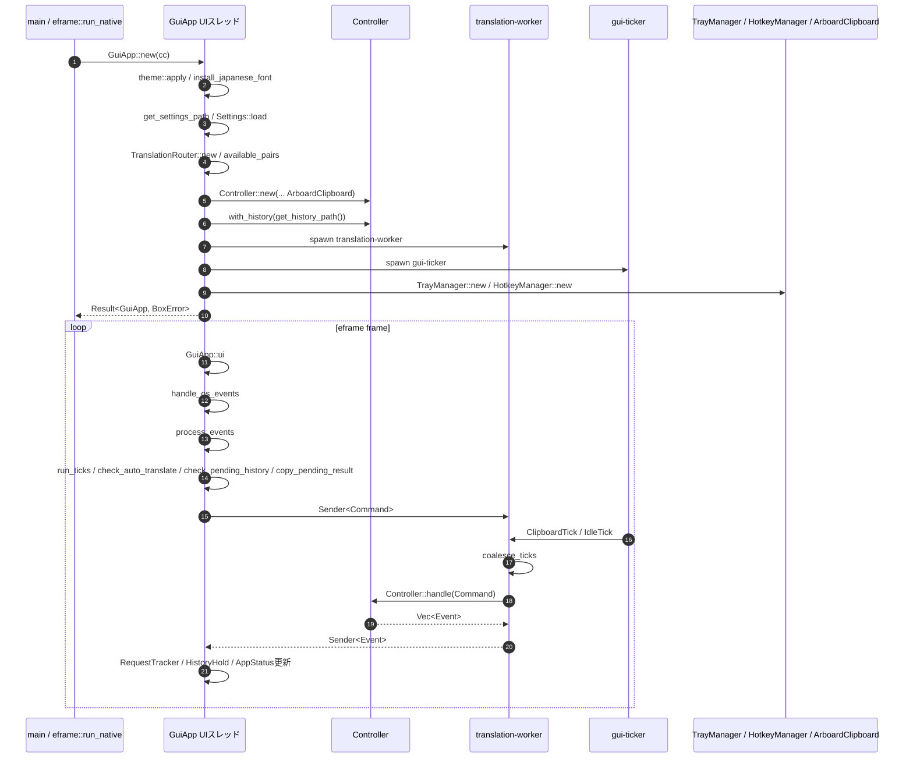
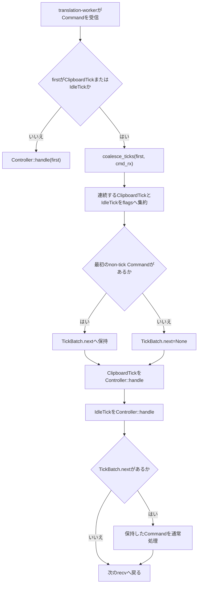
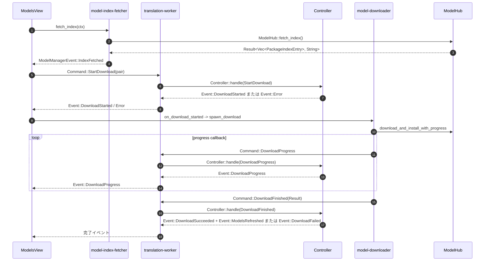

# 詳細設計書（GUI機能・モジュール制御仕様）
**tray-translate GUIの起動、非同期処理、状態反映、履歴、ライフサイクルおよびOSアダプター**

---

## 1. 概要とSSOT境界

### 1.1 モジュールの目的

本書は、`crates/gui` のGUI専用制御を対象とする。`tt-gui` のエントリポイントから生成される `GuiApp` を中心に、UIスレッド、`translation-worker`、`gui-ticker`、モデル管理スレッド、およびOSアダプター間の呼び出し順序と状態遷移を定義する。

対象機能は次のとおりである。

- **F-001** `GuiApp::new` による設定・ルーター・Controllerの初期化とスレッド構成
- **F-002** `GuiApp::process_events` による `Event` のUI状態反映
- **F-003** `RequestTracker` による翻訳要求と古い結果の破棄
- **F-004** `check_auto_translate` と入力・言語変更による自動翻訳デバウンス
- **F-005** `HistoryHold` による自動翻訳履歴の保留と確定
- **F-006** `restore_history` による履歴の画面復元
- **F-007** `lifecycle` と `GuiApp` によるトレイ常駐・終了・非表示処理
- **F-008** `ModelsView` によるモデル一覧取得、ダウンロード、進捗および拒否処理
- **F-009** `coalesce_ticks` による `ClipboardTick` / `IdleTick` の集約
- **F-010** トレイ、ホットキー、クリップボード、日本語フォントのOSアダプター境界

GUIの画面見た目、レイアウト、色、アイコンの詳細は本書の対象外とする。画面操作は、処理を起動する入力と状態更新の契約だけを記載する。

### 1.2 単一責任範囲（SSOT）とデータ境界

- **本書の正本範囲**: `module_behavior`。`GuiApp`、`RequestTracker`、`HistoryHold`、`ModelsView`、`lifecycle`、`coalesce_ticks` およびOSアダプターの呼び出し順序、状態遷移、GUI側の失敗処理を正本とする。
- **DTOとDAOの分離**: 本書はUIスレッド、ワーカー、モデル管理スレッド間で受け渡す `Command`、`Event`、`Settings`、`HistoryEntry`、`PackageIndexEntry` および補助状態の利用条件を定義する。設定JSON、履歴JSON、モデルパッケージの物理構造、原子書き込み、保存先は `TT-DS-001` を正本とする。
- **Command / Event型の分担**: `Command` / `Event` の型定義と `Controller::handle` のアプリ制御契約は [TT-DD-002 常駐アプリ制御詳細設計書](./TT-DD-002_常駐アプリ制御詳細設計書.md) を正本として参照する。本書はGUIが各型を受け取る順序、採用条件、UI状態への反映方法を定義する。
- **BDとの関係**: UIスレッド、Controllerを所有するワーカー、定期通知、モデル管理スレッド、OS依存処理の全体方針は `TT-BD-001` を正本とし、本書はGUI機能へ具体化する。
- **ADRとの関係**: 自動翻訳、古い結果の破棄、フォント、画面幅に関する判断理由は `ADR-006`、Cargo feature、スタブ、終了判断の理由は `ADR-007` を参照する。ADRは判断理由の正本であり、現在のメソッド契約は本書を正本とする。
- **品質ゲートとの関係**: GUIのclippy/testおよび本書のMermaid検証の実行条件と合格基準は `TT-ENV-001` の `QG-004`、`QG-005`、`QG-006` を参照する。本書へコマンドや合格基準を再掲しない。
- **外部公開範囲**: 対象機能はすべて内部機能であり、外部公開API、認証、外部利用者向け互換性契約は持たない。モデル一覧・モデル配布元との通信はGUI内部の明示操作から起動する処理であり、外部公開契約ではない。
- **責務の対象外**: 永続化ファイルのスキーマと保存失敗時のファイル復旧、翻訳ルーターの経路決定、Controller内部の翻訳サービス、モデルアーカイブの展開検証、画面の見た目、Gitやリリース運用は各正本文書へ委譲する。
- **未確認事項の扱い**: F-003では、`Event::TextIgnored` または `Event::Error` を受けたときに `RequestTracker.pending_queue` が残る実装上の状態を記録する。ただし、その後の結果到着順と組み合わさった実動作、要求を安全に除去する仕様、キュー上限は本書で確定しない。これらは「未確認事項」として扱い、draftのまま追跡する。
- **矛盾時の扱い**: GUIの制御契約と実装が矛盾する場合は、`module_behavior` の正本である本書を更新し、必要に応じて `TT-BD-001`、`TT-DS-001`、`TT-DD-002`、ADRを追従させる。更新日だけを根拠に正本を決めない。

---

## 2. インターフェースとDTO（Data Transfer Object）仕様

### 2.1 対象機能一覧

| 機能ID | 関数・機能名                             | 呼び出し元                                                                 | 主な呼び出し先                                                                                                                         |         同期 / 非同期          |             冪等性              | 外部副作用                                           | 公開範囲 |
| :----- | :--------------------------------------- | :------------------------------------------------------------------------- | :------------------------------------------------------------------------------------------------------------------------------------- | :----------------------------: | :-----------------------------: | :--------------------------------------------------- | :------: |
| F-001  | `GuiApp::new` 起動とスレッド構成         | `main` / `eframe::run_native` の生成クロージャ                             | `Settings::load`、`TranslationRouter::new`、`Controller::new`、`TrayManager::new`、`HotkeyManager::new`、`std::thread::Builder::spawn` |   同期（スレッド起動を伴う）   |            条件付き             | 設定・履歴読み込み、OS登録、スレッド生成             |   内部   |
| F-002  | `GuiApp::process_events` の `Event` 反映 | `GuiApp::ui`                                                               | `RequestTracker::on_translated`、`ModelsView`、`HotkeyManager::register`、GUI状態フィールド                                            |              同期              |            条件付き             | UI状態、再登録、履歴記録依頼                         |   内部   |
| F-003  | `RequestTracker` の要求追跡              | `trigger_translation`、入力・言語変更、`process_events`、`restore_history` | `RequestTracker::issue_request`、`invalidate`、`on_translated`                                                                         |              同期              |              なし               | なし                                                 |   内部   |
| F-004  | 自動翻訳デバウンス                       | `render_source_section`、言語選択処理、`GuiApp::ui`                        | `check_auto_translate`、`trigger_translation`、`Controller::handle`                                                                    |     非同期（Command経由）      |            条件付き             | `Command::UpdateSettings`、`Command::TranslateText`  |   内部   |
| F-005  | `HistoryHold` の保留・確定               | `process_events`、入力操作、`restore_history`、`GuiApp::drop`              | `HistoryHold`、`Command::RecordHistory`、`Controller::apply_history_change`                                                            |       非同期（保存依頼）       |            条件付き             | 履歴保存                                             |   内部   |
| F-006  | 履歴の画面復元                           | `render_history_section`                                                   | `restore_history`、`RequestTracker::invalidate`、`update_settings`                                                                     |   同期（設定保存依頼を除く）   |            条件付き             | `Command::UpdateSettings`、出力表示の更新            |   内部   |
| F-007  | ウィンドウライフサイクル                 | `GuiApp::ui`、`handle_os_events`、`TrayManager::poll_events`、ヘッダー操作 | `on_close_requested`、`can_hide_to_tray`、egui viewport command                                                                        |              同期              |            条件付き             | OSウィンドウ、トレイ表示、プロセス終了要求           |   内部   |
| F-008  | `ModelsView` の一覧取得・ダウンロード    | モデル管理タブ、`GuiApp::process_events`                                   | `model-index-fetcher`、`model-downloader`、`ModelHub`、`Command` / `Event`                                                             |             非同期             |            条件付き             | HTTPS通信、モデル保存、導入済み一覧更新              |   内部   |
| F-009  | tickの集約                               | `translation-worker`                                                       | `coalesce_ticks`、`Controller::handle`                                                                                                 | 同期（ワーカー内のキュー処理） | あり（同一tick種別を1回へ集約） | `ClipboardTick` / `IdleTick` の実行回数を削減        |   内部   |
| F-010  | OSアダプター境界                         | `GuiApp::new`、`handle_os_events`、`Controller::new`、`GuiApp::ui`         | `TrayManager`、`HotkeyManager`、`ArboardClipboard`、`install_japanese_font`                                                            |     同期・コールバック併用     |            条件付き             | OSイベント登録、クリップボード読み取り、フォント登録 |   内部   |

### 2.2 主要関数・機能の契約

#### 機能契約（機能ID: F-001）

- **対象機能・関数名**: `GuiApp::new(cc: &eframe::CreationContext<'_>) -> Result<GuiApp, BoxError>`
- **機能概要**: `theme::apply`、日本語フォント探索、設定読み込み、`TranslationRouter` と `Controller` の生成、履歴読み込み、`translation-worker` と `gui-ticker` の起動、トレイ・ホットキーの初期化を行い、UIが利用する初期状態を返す。
- **事前条件**: `eframe::CreationContext` と `egui::Context` が有効であること。設定パス、履歴パス、モデル保存先を解決できること。設定が存在する場合は `Settings::load` と `Settings::validate` を通過すること。
- **事後条件**: 成功時は `GuiApp` が `is_window_visible = true`、`active_tab = ActiveTab::Translate`、`RequestTracker` と `HistoryHold` が空の状態で返る。`Controller` は `translation-worker` に移され、`cmd_tx` と `event_rx` でUIと接続される。フォント・トレイ・ホットキーの任意機能が失敗しても、各機能を無効化した状態でGUIを返す。
- **失敗時契約**: 設定パス解決、設定読み込み、`TranslationRouter::new`、`Controller::new`、履歴パス解決、`translation-worker` または `gui-ticker` のスレッド生成に失敗した場合は `Err(BoxError)` を返して起動を中止する。トレイ・ホットキー初期化失敗は `eprintln!` に記録し、`None` として継続する。日本語フォント未検出は `AppStatus::Error` を初期値にして継続する。
- **タイムアウト / キャンセル**: 起動処理に個別のタイムアウトまたはキャンセルはない。初期化処理は呼び出し元の `eframe::run_native` に返るまで同期する。
- **ログ・メトリクス・相関ID**: フォント読み込み、トレイ初期化スキップ、ホットキー登録スキップは標準エラーへ出力する。GUI専用のメトリクスおよび相関IDは実装していない。
- **公開範囲**: 内部。外部公開時の互換性・認証契約は適用しない。

#### 機能契約（機能ID: F-002）

- **対象機能・関数名**: `GuiApp::process_events(ctx: &egui::Context)`
- **機能概要**: `event_rx.try_recv()` が空になるまでFIFO順に `Event` を取り出し、GUIフィールド、`AppStatus`、`ModelsView`、履歴一覧、ホットキー登録状態を更新する。
- **事前条件**: UIスレッドから呼び出され、`event_rx` が `Event` の受信チャネルであること。イベントの型とフィールドは `TT-DD-002` の `Event` 定義に従うこと。
- **事後条件**: 受信した各イベントに対して2.3および3.2の状態反映を行う。`Event::Translated` は `RequestTracker::on_translated` が採用した場合だけ入力・出力・履歴処理を行う。イベントがない場合、GUI状態は変更しない。
- **失敗時契約**: `Event::Error` は `is_translating = false`、`ModelsView::on_download_rejected()`、`AppStatus::Error` を設定する。`Event::SettingsUpdated` に伴うホットキー再登録失敗は、旧ホットキーを維持したままエラー表示とする。`hotkey` が `None` の場合は再登録処理を行わず、コード上はこの分岐で新しい状態メッセージを設定しない。受信チャネル切断時は `try_recv()` が空と同じ扱いとなり、UIフレームは継続する。
- **タイムアウト / キャンセル**: `try_recv` を使うためUIフレームを待たせない。イベント単位のタイムアウト・キャンセルはない。
- **ログ・メトリクス・相関ID**: 古い翻訳結果を破棄したときは `eprintln!` を出力する。イベントに相関IDはなく、GUI側の処理は受信順と `RequestTracker` の状態照合に依存する。
- **公開範囲**: 内部。外部公開時の互換性・認証契約は適用しない。

#### 機能契約（機能ID: F-003）

- **対象機能・関数名**: `RequestTracker::issue_request`、`RequestTracker::invalidate`、`RequestTracker::on_translated`
- **機能概要**: 翻訳要求へ単調増加するIDと要求テキストを付与し、最新要求と一致する結果だけを採用する。`pending_queue` は要求順の `(id, text, is_auto)` を保持する。
- **事前条件**: `issue_request` は翻訳を実際に要求する直前に、UIスレッドから呼ぶ。`invalidate` は入力・言語・履歴復元などで現在の要求を無効化するときに呼ぶ。`on_translated` は `Event::Translated` の受信時に呼ぶ。
- **事後条件**: `issue_request` は `next_id` を1増加させ、`active_id`、`active_text`、`pending_queue` を最新要求へ更新する。`invalidate` はIDを進めて `active_text` を空にし、既存の `pending_queue` は実装上消去しない。`on_translated` はキュー先頭を1件取り出し、ID一致かつtrim後テキスト一致の場合だけ `(true, is_auto)` を返す。不採用結果は `(false, is_auto)` を返す。キューが空のときは `active_text` とのtrim後一致を採用条件とし、`is_auto = false` を返す。
- **確定仕様**: `active_id` は最新の `issue_request` または `invalidate` が設定した値である。`active_text` は最後に発行した要求のテキストであり、`invalidate` 後は空である。古いID、テキスト不一致、無効化後の結果はGUIへ反映しない。
- **実装上の未確認事項**: `Event::TextIgnored` と `Event::Error` の処理は `process_events` から `on_translated` を呼ばないため、該当する要求が `pending_queue` に残り得る状態はコード上確認できる。しかし、イベント後に次の翻訳結果が到着した場合の組み合わせを含む実動作、キュー残留が必ず誤採用を起こすか、エラーまたは無視通知に対応する要求を除去する仕様は未確認である。本書はこの挙動を確定仕様や安全保証として扱わない。`pending_queue` の上限および `next_id` のオーバーフロー方針も未定義である。
- **タイムアウト / キャンセル**: タイムアウトはない。`invalidate` は結果をキャンセルする論理操作だが、ワーカーで進行中の翻訳処理を停止しない。
- **ログ・メトリクス・相関ID**: `RequestTracker` 自体はログ・相関IDを生成しない。古い結果の破棄時に呼び出し側が原文を標準エラーへ出力する。
- **公開範囲**: 内部。外部公開時の互換性・認証契約は適用しない。

#### 機能契約（機能ID: F-004）

- **対象機能・関数名**: `check_auto_translate`、`trigger_translation`、`render_source_section` および言語選択処理
- **機能概要**: 入力編集または翻訳元・翻訳先の変更から `pending_auto_translate` を設定し、`auto_translate_delay_ms` 経過後に自動翻訳を1件発行する。自動翻訳結果は自動コピーしない。
- **事前条件**: `auto_translate` が有効で、入力がtrim後に空でないこと。`auto_translate_delay_ms` は `Settings::validate` の検証範囲である100〜10000ミリ秒であること。言語変更時は候補から選択された言語または入れ替え後の言語を使う。
- **事後条件**: 入力編集時は保留中の自動履歴を破棄し、`RequestTracker::invalidate` を呼ぶ。自動翻訳が有効かつ入力が空でない場合は現在時刻をデバウンス開始時刻として保存する。言語変更・入れ替え時は設定更新、追跡無効化、デバウンス開始を行う。期限到達時は `trigger_translation(true)` が `Command::UpdateSettings` と `Command::TranslateText` を送る。`Event::Translated` で `is_auto = true` の結果は `to_copy` に設定しない。
- **失敗時契約**: `auto_translate` が無効、入力が空、または入力が空白だけの場合、保留タイマーを解除し翻訳を送らない。`cmd_tx.send` に失敗した場合、GUIは送信エラーを個別表示せず、次のUI処理を継続する。
- **タイムアウト / キャンセル**: デバウンス中は `egui::Context::request_repaint_after` で次回判定を予約する。入力・言語変更、履歴復元、設定無効化で保留タイマーを解除できる。翻訳開始後のワーカー処理をキャンセルする契約はない。
- **ログ・メトリクス・相関ID**: デバウンスIDは持たず、`RequestTracker` の `active_id` が要求の識別に使われる。相関IDをログ出力しない。
- **公開範囲**: 内部。外部公開時の互換性・認証契約は適用しない。

#### 機能契約（機能ID: F-005）

- **対象機能・関数名**: `HistoryHold::hold`、`discard`、`take`、`take_if_due`、`remaining` と `GuiApp::hold_history`、`commit_pending_history`
- **機能概要**: 自動翻訳の採用結果を最大1件だけ保留し、入力途中の結果を履歴へ直ちに記録しない。設定された待機時間後、または別操作・終了時に `Command::RecordHistory(HistoryEntry)` を送る。
- **事前条件**: 採用された自動翻訳結果から `HistoryEntry::new` が生成されていること。`history_commit_delay_ms` は `Settings::validate` の検証範囲である500〜30000ミリ秒であること。
- **事後条件**: `hold` は新しいエントリと `Instant` を保持し、旧エントリがあれば呼び出し側へ返す。呼び出し側は旧エントリを即時 `RecordHistory` する。`take_if_due` は経過時間がdelay以上のときだけエントリを返し、`check_pending_history` が保存依頼を送る。`discard` は編集時に保留を履歴へ送らず破棄する。
- **別操作・終了時の契約**: 手動翻訳、履歴復元、入力クリアは `commit_pending_history` を先に呼ぶ。`GuiApp::drop` は保留を取り出し、`Command::RecordHistory` を送って最大2秒間、`HistoryUpdated`、`Error` またはチャネル切断を待つ。強制終了やプロセス異常終了時の保存は保証しない。
- **失敗時契約**: `RecordHistory` の送信失敗はGUI側で再試行しない。Controllerの保存失敗は `Event::Error` となるが、取り出し済みの `HistoryHold` を自動的に戻す契約はない。
- **タイムアウト / キャンセル**: 通常時はタイムアウトなしで `request_repaint_after` を利用する。終了時だけ最大2秒の受信待ちを行う。保留のキャンセルは入力編集時の `discard` とする。
- **ログ・メトリクス・相関ID**: 履歴依頼に相関IDはない。保存結果は `HistoryUpdated` または `Error` の受信で判断する。
- **公開範囲**: 内部。履歴JSONの物理保存契約は `TT-DS-001` に委譲する。

#### 機能契約（機能ID: F-006）

- **対象機能・関数名**: `GuiApp::restore_history`、`render_history_section`
- **機能概要**: 選択した `HistoryEntry` の翻訳元言語、翻訳先言語、原文、訳文を画面状態へ戻し、再翻訳せずに現在の入力を置き換える。
- **事前条件**: 履歴一覧から1件の `HistoryEntry` が選択され、UIスレッドで復元処理が実行されること。
- **事後条件**: 保留中の自動履歴を先に `RecordHistory` し、`source_lang`、`target_lang`、`input`、`output` を選択エントリで置き換える。`RequestTracker::invalidate`、`pending_auto_translate = None`、`is_translating = false` を設定し、`update_settings` を送る。`Command::TranslateText` は送らない。
- **失敗時契約**: `UpdateSettings` の検証・保存に失敗した場合はControllerから `Event::Error` が返る。画面に復元した値を元へ戻す契約はなく、次のイベント処理でエラー状態を表示する。
- **タイムアウト / キャンセル**: 復元自体は同期処理でタイムアウトしない。設定更新と保留履歴の保存依頼はワーカーが非同期に処理する。復元操作を取り消すUI契約はない。
- **ログ・メトリクス・相関ID**: 復元に相関IDはない。成功時は `AppStatus::Info` を設定する。
- **公開範囲**: 内部。外部公開時の互換性・認証契約は適用しない。

#### 機能契約（機能ID: F-007）

- **対象機能・関数名**: `on_close_requested`、`can_hide_to_tray`、`GuiApp::handle_os_events`、`GuiApp::ui`
- **機能概要**: `use_tray`、`tray_active`、`is_quitting` の3値から `CloseAction::HideToTray` または `CloseAction::Quit` を決め、ヘッダー終了、トレイ操作、ホットキー、非表示状態を処理する。
- **事前条件**: UIフレームからOSイベントを処理できること。`tray_active` は `self.tray.is_some()` と一致すること。終了操作では `is_quitting = true` が設定されること。
- **事後条件**: `use_tray && tray_active && !is_quitting` のときだけ閉じる要求を `CancelClose` し、`Visible(false)` と `is_window_visible = false` を設定する。それ以外の閉じる要求は `Quit` として通す。ヘッダーの終了とトレイのQuitは `is_quitting = true` なので、トレイ有効時も終了する。`is_window_visible = false` のフレームでも、`GuiApp::ui` の先頭処理、イベント受信、tick、自動翻訳判定、履歴確定、コピー処理は実行し、`CentralPanel` の描画だけを省略する。
- **失敗時契約**: トレイが設定で無効、初期化失敗、またはfeature無効の場合、閉じる要求は終了とする。トレイが利用できない環境で戻れない非表示状態を作らない。
- **タイムアウト / キャンセル**: viewport commandにタイムアウトはない。`HideToTray` は `CancelClose` による閉じる要求のキャンセルであり、プロセス終了処理をキャンセルするAPIではない。
- **ログ・メトリクス・相関ID**: lifecycle純粋関数はログ・OSアクセス・相関IDを持たない。トレイ・ホットキー初期化エラーは `GuiApp::new` 側で標準エラーへ記録する。
- **公開範囲**: 内部。外部公開時の互換性・認証契約は適用しない。

#### 機能契約（機能ID: F-008）

- **対象機能・関数名**: `ModelsView::fetch_index`、`request_download`、`on_download_started`、`spawn_download`、`clear_download`
- **機能概要**: モデル管理画面の明示操作で公式モデルインデックスを取得し、`Controller` が受理したパッケージだけをダウンロードスレッドで導入する。進捗・完了は `Command` 経由でControllerへ送り、返された `Event` をGUIへ反映する。
- **事前条件**: インデックス取得時は `is_fetching_index = false` であること。ダウンロード要求時は `active_download_pair` と `pending_download` がともに空であること。`PackageIndexEntry` の `from_code` と `to_code` からペアキーが構成できること。
- **事後条件**: インデックス取得は `model-index-fetcher` を起動し、結果を画面専用の `ModelManagerEvent::IndexFetched` へ送る。ダウンロード要求は先に `Command::StartDownload(pair)` を送り、送信成功後に `pending_download` を保持する。`Event::DownloadStarted` のpairが保留エントリと一致したときだけ `model-downloader` を起動し、`active_download_pair` と進捗を初期化する。進捗は `Command::DownloadProgress`、完了は `Command::DownloadFinished` で送る。成功時はControllerが `DownloadSucceeded` と `ModelsRefreshed` を返す。
- **失敗時契約**: Controllerが開始を拒否して `Event::Error` を返した場合、`process_events` が `on_download_rejected` を呼び、`pending_download` を消去する。ダウンロード失敗は `DownloadFailed` で進捗を消去し、エラー状態を表示する。保留エントリと開始イベントのpairが不一致の場合、`on_download_started` はダウンロードを起動せずに戻るが、別のエラーイベントを生成しない。
- **タイムアウト / キャンセル**: インデックス取得とダウンロードにGUI側のキャンセル機能はない。通信のタイムアウト・HTTPS条件・アーカイブ検証は `crates/core` と `TT-ENV-001` の契約へ委譲する。開始要求の同時実行は `ModelsView` と `DownloadTracker` の双方で1件に制限する。
- **ログ・メトリクス・相関ID**: `ModelManagerEvent` と `Command` に相関IDはない。取得失敗は画面の `index_error`、ダウンロード失敗は `Event::DownloadFailed.message` と `AppStatus::Error` で表す。
- **公開範囲**: 内部。モデル配布元との通信はGUIの内部操作であり、外部公開APIではない。

#### 機能契約（機能ID: F-009）

- **対象機能・関数名**: `coalesce_ticks(first: &Command, rx: &Receiver<Command>) -> TickBatch`
- **機能概要**: `translation-worker` が最初に受け取ったtickと、直後にチャネルへ積まれた連続tickを `TickBatch` に集約し、tick以外の最初のCommandを `next` として保持する。
- **事前条件**: `first` が `Command::ClipboardTick` または `Command::IdleTick` であること。`rx` は同じCommandチャネルの受信端であること。
- **事後条件**: `clipboard` は最初のCommandまたは連続して取り出したCommandに `ClipboardTick` が含まれる場合にtrue、`idle` は `IdleTick` が含まれる場合にtrueとなる。連続tickが終わった時点で最初の非tickCommandを取り出して `next` に保持する。`next` より後ろのCommandはチャネルに残す。ワーカーは `ClipboardTick`、`IdleTick` の順にControllerへ1回ずつ渡し、`next` があればその後に通常処理する。
- **失敗時契約**: `first` がtick以外で呼ばれる契約はない。受信チャネルが切断または空の場合は、取り出せたtickだけでBatchを返す。tickの送信元が `gui-ticker` と `GuiApp::run_ticks` の2つであることによる重複は、集約可能な範囲で1回にまとめる。
- **タイムアウト / キャンセル**: `try_recv` のため待機しない。集約済みtickを個別に取り消す機能はなく、集約結果は直ちにControllerへ渡す。
- **ログ・メトリクス・相関ID**: 集約件数のログ・メトリクス・相関IDはない。
- **公開範囲**: 内部。外部公開時の互換性・認証契約は適用しない。

#### 機能契約（機能ID: F-010）

- **対象機能・関数名**: `TrayManager`、`HotkeyManager`、`ArboardClipboard`、`install_japanese_font`、`missing_font_message`
- **機能概要**: OSまたは外部ライブラリに依存する処理をGUI内のアダプターへ閉じ込め、featureまたはOSごとの差を `GuiApp` の共通呼び出しから隠す。
- **事前条件**: `main.rs` の `cfg(feature = "tray")` / `cfg(feature = "hotkey")` により、通常実装または同一APIのスタブが選択される。クリップボード読み取りは `Controller::new` に `Box<dyn ClipboardSource>` として渡される。
- **事後条件**: `TrayManager::new` 成功時はアイコンとイベントコールバックを保持し、`poll_events` は `TrayAction` を返す。`HotkeyManager::new` 成功時は初期キーを登録し、`poll_pressed` は現在キーのPressedイベントだけを検出する。`ArboardClipboard::read_text` は遅延初期化したクリップボードからテキストを返す。`install_japanese_font` は読めた最初のOSフォントをeguiへ登録し、パスを返す。
- **失敗時契約**: `tray` feature無効時の `TrayManager::new`、`hotkey` feature無効時の `HotkeyManager::new` は常にエラーを返す。実装の初期化失敗も同じく `GuiApp::new` で無効化して継続する。クリップボード初期化・読み取り失敗は `None` として扱う。フォント候補を全て読み込めない場合は `None` と案内文を返し、GUIは継続する。
- **タイムアウト / キャンセル**: OSイベントポーリングに個別タイムアウトはない。`HotkeyManager::register` は新しいキーの登録失敗時に旧キーの復元を試みる。トレイ・ホットキー登録の解除や再試行をGUIが自動実行する契約はない。
- **ログ・メトリクス・相関ID**: アダプターは相関IDを生成しない。初期化失敗とフォント未検出は呼び出し元の標準エラーまたは `AppStatus` で通知する。
- **公開範囲**: 内部。外部公開時の互換性・認証契約は適用しない。

### 2.3 入力DTO・パラメータ仕様

`Command` と `Event` の型そのものは `TT-DD-002` を正本とする。本節はGUIが実際に受け渡すフィールド、必須性、GUI側の入力制約だけを定義する。Rustの値型は `Option` として定義されているものを除きNULLを取らない。

#### F-001、F-004、F-005、F-006のGUI状態入力

| パラメータ名 / フィールド           | データ型        | 必須性 | NULL可 | デフォルト値 | バリデーションルール・入力制約                                              | 例・備考                 |
| :---------------------------------- | :-------------- | :----: | :----: | :----------- | :-------------------------------------------------------------------------- | :----------------------- |
| `CreationContext::egui_ctx`         | `egui::Context` |  必須  |  不可  | なし         | `GuiApp::new` が受け取る有効なeguiコンテキスト                              | 起動時に使用             |
| `Settings::source_lang`             | `String`        |  必須  |  不可  | `en`         | `Settings::validate` の言語コード規則。GUIの設定送信時はtrim後ASCII小文字化 | 翻訳元言語               |
| `Settings::target_lang`             | `String`        |  必須  |  不可  | `ja`         | `Settings::validate` の言語コード規則。GUIの設定送信時はtrim後ASCII小文字化 | 翻訳先言語               |
| `Settings::auto_translate`          | `bool`          |  必須  |  不可  | `false`      | 真偽値                                                                      | 入力後の自動翻訳を有効化 |
| `Settings::auto_translate_delay_ms` | `u64`           |  必須  |  不可  | `800`        | 100〜10000ミリ秒。最終検証はController                                      | デバウンス待機時間       |
| `Settings::history_commit_delay_ms` | `u64`           |  必須  |  不可  | `3000`       | 500〜30000ミリ秒。最終検証はController                                      | 自動履歴の確定待機時間   |
| `HistoryEntry::source_lang`         | `String`        |  必須  |  不可  | なし         | 履歴に保存された文字列をそのまま復元                                        | 復元時に現在設定へ代入   |
| `HistoryEntry::target_lang`         | `String`        |  必須  |  不可  | なし         | 履歴に保存された文字列をそのまま復元                                        | 復元時に現在設定へ代入   |
| `HistoryEntry::source`              | `String`        |  必須  |  不可  | なし         | 空文字も型上は受け取れる。履歴記録の採否はDS/app側の契約                    | 入力欄へ復元             |
| `HistoryEntry::output`              | `String`        |  必須  |  不可  | なし         | 型上の文字列                                                                | 出力欄へ復元             |
| `HistoryEntry::used_at`             | `u64`           |  必須  |  不可  | なし         | GUIは値を判定せず保持する                                                   | 永続化の意味はTT-DS-001  |

#### F-002の `Event` 入力

| イベント                   | 入力フィールド                            | データ型                       | 必須性 / NULL可                 | GUI側の入力条件                                           |
| :------------------------- | :---------------------------------------- | :----------------------------- | :------------------------------ | :-------------------------------------------------------- |
| `Event::Translated`        | `source`, `output`                        | `String`, `String`             | 必須 / 不可                     | `RequestTracker` の採用判定を通過した結果だけUIへ反映     |
| `Event::TextIgnored`       | なし                                      | なし                           | 該当なし                        | Controllerがユーザー要求の文字数範囲外を通知した場合      |
| `Event::ModelsUnloaded`    | なし                                      | なし                           | 該当なし                        | Controllerがアイドル解放を実行した場合                    |
| `Event::SettingsUpdated`   | `hotkey_changed`                          | `bool`                         | 必須 / 不可                     | trueかつ `HotkeyManager` が利用可能な場合に再登録を試みる |
| `Event::DownloadStarted`   | `pair`                                    | `String`                       | 必須 / 不可                     | `pending_download` のペアと一致した場合だけスレッドを起動 |
| `Event::DownloadProgress`  | `pair`, `downloaded_bytes`, `total_bytes` | `String`, `u64`, `Option<u64>` | pair/bytes必須、totalのみNULL可 | totalがある場合は比率計算、ない場合は受信量表示用         |
| `Event::DownloadSucceeded` | `pair`                                    | `String`                       | 必須 / 不可                     | `ModelsView::clear_download` を実行                       |
| `Event::DownloadFailed`    | `pair`, `message`                         | `String`, `String`             | 必須 / 不可                     | `ModelsView::clear_download` とエラー表示                 |
| `Event::ModelsRefreshed`   | `available_pairs`                         | `Vec<String>`                  | 必須 / 不可                     | 空配列も有効。`installed` を全置換                        |
| `Event::HistoryUpdated`    | `entries`                                 | `Vec<HistoryEntry>`            | 必須 / 不可                     | 空配列も有効。`history` を全置換                          |
| `Event::Error`             | `message`                                 | `String`                       | 必須 / 不可                     | エラー表示とモデル取得待機の解除に使用                    |

#### F-003、F-009の状態・Command入力

| パラメータ名 / フィールド               | データ型   |  必須性  |  NULL可  | デフォルト値     | バリデーションルール・入力制約                     | 例・備考                               |
| :-------------------------------------- | :--------- | :------: | :------: | :--------------- | :------------------------------------------------- | :------------------------------------- |
| `RequestTracker::issue_request.text`    | `String`   |   必須   |   不可   | なし             | `trigger_translation` はtrim後空文字なら発行しない | 実際の送信テキストはtrim前のGUI入力    |
| `RequestTracker::issue_request.is_auto` | `bool`     |   必須   |   不可   | `false`          | 手動はfalse、自動はtrue                            | 履歴保留と自動コピー抑止に使用         |
| `RequestTracker::on_translated.source`  | `&str`     |   必須   |   不可   | なし             | trim後に要求テキストと比較                         | `Event::Translated.source` 由来        |
| `Command::ClipboardTick`                | なし       | 該当なし | 該当なし | なし             | tick集約対象                                       | クリップボード監視をController側で判定 |
| `Command::IdleTick`                     | なし       | 該当なし | 該当なし | なし             | tick集約対象                                       | モデルアイドル解放をController側で判定 |
| `Command::TranslateText`                | `String`   |   必須   |   不可   | なし             | `trigger_translation` はtrim後空文字を送らない     | `Controller::handle` が翻訳する        |
| `Command::UpdateSettings`               | `Settings` |   必須   |   不可   | `Settings`既定値 | `Settings::validate` をControllerが再検証          | GUIは各フィールドを組み立てる          |

#### F-008のモデル管理入力

| パラメータ名 / フィールド            | データ型                    |  必須性  |   NULL可    | デフォルト値 | バリデーションルール・入力制約                                       | 例・備考                     |
| :----------------------------------- | :-------------------------- | :------: | :---------: | :----------- | :------------------------------------------------------------------- | :--------------------------- |
| `PackageIndexEntry::package_version` | `String`                    |   必須   |    不可     | なし         | `PackageIndexEntry` のインデックス値                                 | 一覧表示する版               |
| `PackageIndexEntry::argos_version`   | `String`                    |   必須   |    不可     | なし         | `PackageIndexEntry` のインデックス値                                 | Argos互換版                  |
| `PackageIndexEntry::from_name`       | `String`                    |   必須   |    不可     | なし         | `PackageIndexEntry` のインデックス値                                 | 翻訳元言語名                 |
| `PackageIndexEntry::from_code`       | `String`                    |   必須   |    不可     | なし         | `PackageIndexEntry` のインデックス値                                 | ペアキーの前半               |
| `PackageIndexEntry::to_code`         | `String`                    |   必須   |    不可     | なし         | `PackageIndexEntry` のインデックス値                                 | ペアキーの後半               |
| `PackageIndexEntry::to_name`         | `String`                    |   必須   |    不可     | なし         | `PackageIndexEntry` のインデックス値                                 | 翻訳先言語名                 |
| `PackageIndexEntry::links`           | `Vec<String>`               | 条件付き |    不可     | `[]`         | `ModelHub::download_url()` がHTTPSリンクを選択。GUIはURLを解釈しない | インデックスJSONのリンク配列 |
| `PackageIndexEntry::description`     | `Option<String>`            |   任意   |     可      | `None`       | GUIの制御契約では判定しない                                          | インデックス由来の説明文     |
| `PackageIndexEntry`                  | 構造体                      |   必須   |    不可     | なし         | 一覧取得結果の要素                                                   | `ModelHub`の型正本を参照     |
| `ModelsView::pending_download`       | `Option<PackageIndexEntry>` | 条件付き |     可      | `None`       | active/pendingが同時に複数にならない                                 | Controller受理待ち           |
| `Command::StartDownload`             | `String`                    |   必須   |    不可     | なし         | `from_code_to_code` のペアキーを作る                                 | Controllerが形式を検証       |
| `Command::DownloadProgress`          | `u64`, `Option<u64>`        |   必須   | totalのみ可 | `0` / `None` | downloadedは受信量、totalは不明を許容                                | model-downloaderから送信     |
| `Command::DownloadFinished`          | `Result<(), String>`        |   必須   |    不可     | なし         | 成功は`Ok(())`、失敗はメッセージ                                     | ControllerがEventへ変換      |

`PackageIndexEntry` のインデックス構造とモデルアーカイブの保存・検証はGUIのDTO利用範囲を超えるため、`crates/core` および `TT-DS-001` の定義を正本とする。GUIは一覧表示に使う `from_code`、`to_code`、名称、版、エントリ全体を受け渡す。

#### F-007、F-010のOS入力

| パラメータ名 / フィールド     | データ型                                |  必須性  |          NULL可           | デフォルト値               | バリデーションルール・入力制約                     | 例・備考                   |
| :---------------------------- | :-------------------------------------- | :------: | :-----------------------: | :------------------------- | :------------------------------------------------- | :------------------------- |
| `use_tray`                    | `bool`                                  |   必須   |           不可            | Linuxはfalse、その他はtrue | `Settings`由来                                     | トレイ常駐を許可するか     |
| `tray_active`                 | `bool`                                  |   必須   |           不可            | `false`                    | `self.tray.is_some()` と一致                       | 初期化成功時のみtrue       |
| `is_quitting`                 | `bool`                                  |   必須   |           不可            | `false`                    | ヘッダー終了またはTrayAction::Quitでtrue           | CloseAction判定に使用      |
| `TrayAction`                  | `TrayAction::Show` / `TrayAction::Quit` | 条件付き | `poll_events` は `Option` | `None`                     | トレイイベントキューの値                           | QuitはShowより優先して返す |
| `initial_hotkey_str`          | `&str`                                  |   必須   |           不可            | `Ctrl+Alt+T`               | `Hotkey::parse` とOSコード変換                     | HotkeyManager::newへ渡す   |
| `ArboardClipboard::read_text` | なし                                    | 該当なし |        戻り値は可         | なし                       | OSクリップボードのテキスト読み取りに失敗したらNone | Controllerが監視契機で呼ぶ |
| `install_japanese_font`       | `egui::Context`                         |   必須   |           不可            | なし                       | OS候補を順に読み、空ファイルは不採用               | フォント未検出はNone       |

### 2.4 出力DTO・戻り値仕様

#### F-001の起動結果

- **正常時の戻り値DTO**: `GuiApp`。UI状態、`Sender<Command>`、`Receiver<Event>`、OSアダプター、モデル管理状態、履歴保留状態を保持する。`Controller`本体は`translation-worker`が所有するため、`GuiApp`から直接参照しない。
- **異常時の戻り値**: `BoxError`。設定、ルーター、Controller、履歴パス、必須スレッド生成の失敗時に返る。
- **再試行可否**: プロセス再起動による再試行は可能。設定ファイルが不正な場合は設定の修正または削除が必要。トレイ・ホットキー・フォントの任意失敗は起動を継続するため、起動全体の再試行を行わない。
- **相関ID・監査情報**: 生成しない。

#### F-002のUI状態反映結果

| 入力Event                            | 更新するGUI状態                                                                  | 追加のCommand / 副作用                                                        | 正常時の意味                               |
| :----------------------------------- | :------------------------------------------------------------------------------- | :---------------------------------------------------------------------------- | :----------------------------------------- |
| `Translated { source, output }`      | `is_translating = false`、`input`、`output`、`status`、履歴保留または履歴記録    | 手動かつ`copy_result`有効なら`to_copy`へ出力を設定。自動は`HistoryHold`へ保持 | 採用された翻訳結果を表示                   |
| `TextIgnored`                        | `is_translating = false`、`status = Info`                                        | なし                                                                          | 文字数範囲外のため翻訳しなかったことを表示 |
| `ModelsUnloaded`                     | `status = Info`                                                                  | なし                                                                          | アイドル解放を表示                         |
| `SettingsUpdated { hotkey_changed }` | `status`、必要ならHotkeyManager                                                  | `hotkey_changed`かつ`HotkeyManager`がSomeの時に`HotkeyManager::register`      | 設定保存結果を表示                         |
| `DownloadStarted { pair }`           | `ModelsView`のactive/pending、`status = Busy`                                    | pair一致時に`model-downloader`起動                                            | ダウンロード開始を表示                     |
| `DownloadProgress`                   | `ModelsView.download_progress`、`status = Busy`                                  | なし                                                                          | 進捗を表示                                 |
| `DownloadSucceeded`                  | `ModelsView`の進捗状態をクリア、`status = Info`                                  | なし                                                                          | ダウンロード完了を表示                     |
| `DownloadFailed`                     | `ModelsView`の進捗状態をクリア、`status = Error`                                 | なし                                                                          | ダウンロード失敗を表示                     |
| `ModelsRefreshed`                    | `installed`を受信配列へ置換                                                      | なし                                                                          | 導入済みペアを更新                         |
| `HistoryUpdated`                     | `history`を受信配列へ置換                                                        | なし                                                                          | 履歴一覧を更新                             |
| `Error`                              | `is_translating = false`、`status = Error`、`ModelsView.pending_download = None` | `ModelsView::on_download_rejected`                                            | エラーを表示し、ダウンロード開始待ちを解除 |

#### F-003の追跡結果

| 関数                            | 戻り値         | 正常時の意味                                                    |
| :------------------------------ | :------------- | :-------------------------------------------------------------- |
| `RequestTracker::issue_request` | `u64`          | 更新後の`active_id`。要求を`pending_queue`へ追加済み            |
| `RequestTracker::invalidate`    | `()`           | 最新IDを進め、`active_text`を空にして過去結果を不採用化         |
| `RequestTracker::on_translated` | `(bool, bool)` | 第1要素は採用可否、第2要素はキューから取り出した要求の`is_auto` |
| `RequestTracker::active_text`   | `&str`         | 最後に発行した要求テキスト                                      |
| `RequestTracker::active_id`     | `u64`          | 最新の有効ID                                                    |
| `RequestTracker::pending_count` | `usize`        | キューに残る要求件数                                            |

`on_translated` がfalseを返した結果は `GuiApp::process_events` が入力・出力・履歴へ反映しない。`pending_queue` の残留をエラーまたはTextIgnoredでどのように扱うかは、F-003の未確認事項であり、出力の安全性を保証する契約ではない。

#### F-004、F-005、F-006の出力

| 機能                             | 戻り値 / 送信DTO                                                      | 正常時の意味                                                                 |
| :------------------------------- | :-------------------------------------------------------------------- | :--------------------------------------------------------------------------- |
| F-004 `trigger_translation`      | `Command::UpdateSettings(Settings)`、`Command::TranslateText(String)` | 現在の設定を保存依頼し、手動または自動翻訳をControllerへ要求                 |
| F-004 `copy_pending_result`      | `Command::NoteClipboardWritten(String)`、eguiのクリップボード書き込み | 手動翻訳結果だけをコピーし、Controllerのクリップボード監視に自己出力を既読化 |
| F-005 `HistoryHold::hold`        | `Option<HistoryEntry>`                                                | 置換された旧エントリ。存在すれば呼び出し側が即時記録                         |
| F-005 `HistoryHold::take_if_due` | `Option<HistoryEntry>`                                                | delay到達時の保留エントリ。未到達または空ならNone                            |
| F-005 `commit_history`           | `Command::RecordHistory(HistoryEntry)`                                | Controllerワーカーへ履歴記録を依頼                                           |
| F-006 `restore_history`          | `Command::UpdateSettings(Settings)`                                   | 復元した言語設定を保存依頼。翻訳Commandは送信しない                          |

#### F-007、F-008、F-009、F-010の出力

| 機能                                | 戻り値 / 出力DTO                                                          | 正常時の意味                                               |
| :---------------------------------- | :------------------------------------------------------------------------ | :--------------------------------------------------------- |
| F-007 `on_close_requested`          | `CloseAction::HideToTray` / `CloseAction::Quit`                           | 3つのboolから閉じる要求の扱いを決める                      |
| F-007 `can_hide_to_tray`            | `bool`                                                                    | `use_tray && tray_active` のときヘッダーの非表示操作を許可 |
| F-008 `fetch_index`                 | `ModelManagerEvent::IndexFetched(Result<Vec<PackageIndexEntry>, String>)` | 画面専用チャネルへ一覧取得結果を通知                       |
| F-008 `spawn_download`              | `Command::DownloadProgress`、`Command::DownloadFinished`                  | ダウンロードの進捗・終了をControllerへ通知                 |
| F-009 `coalesce_ticks`              | `TickBatch { clipboard, idle, next }`                                     | tickフラグと最初のnon-tick Commandを保持                   |
| F-010 `TrayManager::poll_events`    | `Option<TrayAction>`                                                      | トレイイベントを1フレーム分まとめて返す。Quitがあれば優先  |
| F-010 `HotkeyManager::poll_pressed` | `bool`                                                                    | 現在登録中のホットキーがPressedされたかを返す              |
| F-010 `ArboardClipboard::read_text` | `Option<String>`                                                          | テキストが読み取れたときだけSome                           |
| F-010 `install_japanese_font`       | `Option<String>`                                                          | 登録したフォントパス、または未検出時None                   |

再試行は各関数が自動的には行わない。ユーザー操作による再要求、プロセス再起動、設定修正が必要な場合は4章の失敗契約に従う。

---

## 3. 処理フロー・シーケンス・状態遷移ロジック（Mermaid図）

### 3.1 処理フロー・シーケンス / 状態遷移図

- **図の正本**: 3.1のシーケンス図・状態遷移図・フロー図と3.2の状態遷移表を併用する。図は呼び出し経路を、表は判定条件と副作用を正本とする。
- **対象機能ID**: F-001〜F-010

#### A. `GuiApp::new` と `GuiApp::ui` のスレッド間シーケンス



#### B. `RequestTracker` と自動翻訳の状態遷移

```mermaid
stateDiagram-v2
    [*] --> TrackerEmpty
    TrackerEmpty: RequestTracker::new
    TrackerEmpty: active_id=0, active_text="", pending_queue=empty

    TrackerEmpty --> RequestPending: RequestTracker::issue_request
    RequestPending: active_idとactive_textを更新
    RequestPending: pending_queueへ(id, text, is_auto)を追加

    RequestPending --> RequestInvalidated: RequestTracker::invalidate
    RequestInvalidated: active_idを進める
    RequestInvalidated: active_text=""
    RequestInvalidated: pending_queueは実装上保持

    RequestPending --> TranslationAccepted: on_translated(source)が一致
    RequestPending --> TranslationDiscarded: on_translated(source)がIDまたはtext不一致
    RequestInvalidated --> TranslationDiscarded: 古い結果または不一致

    TranslationAccepted --> TrackerEmpty: キュー先頭を取り出しUI反映
    TranslationDiscarded --> TrackerEmpty: キュー先頭を取り出しUI反映なし

    TrackerEmpty --> DebouncePending: input changed / language change
    DebouncePending: pending_auto_translate=Some(Instant)
    DebouncePending --> RequestPending: check_auto_translate後にtrigger_translation(true)
    DebouncePending --> TrackerEmpty: auto_translate=falseまたは入力空
```

`RequestInvalidated` から `TranslationDiscarded` への遷移は、最新IDまたはtrim後テキストの一致条件に基づく確定仕様である。`TextIgnored` / `Error` によって `pending_queue` が残った場合に、後続イベントがどの経路を通るかは未確認事項であり、図はその先の誤採用を表現しない。

#### C. ライフサイクル状態遷移

```mermaid
stateDiagram-v2
    [*] --> WindowVisible
    WindowVisible: is_window_visible=true

    WindowVisible --> WindowHidden: CloseAction::HideToTray
    WindowHidden: is_window_visible=false
    WindowHidden --> WindowVisible: TrayAction::ShowまたはHotkeyManager::poll_pressed=true

    WindowVisible --> Closing: CloseAction::Quit
    WindowHidden --> Closing: TrayAction::Quit
    Closing: is_quitting=trueまたはトレイ無効時の終了
    Closing --> [*]: eframeのClose要求を通す

    WindowVisible --> WindowVisible: Headerの終了以外のUI操作
    WindowHidden --> WindowHidden: GuiApp::uiの処理は継続、CentralPanelは描画しない
```

`CloseAction::HideToTray` は `use_tray && tray_active && !is_quitting` の場合だけである。ホットキーは表示・最前面化だけを行い、翻訳を起動しない。

#### D. tick集約フロー



#### E. `ModelsView` の一覧取得・ダウンロードシーケンス



### 3.2 状態遷移およびルーティングルール

#### GUIフレームとControllerワーカー

- **初期状態**: `main` の `eframe::run_native` が `GuiApp::new` を呼ぶ前。`GuiApp`、Controller、チャネル、スレッドは未生成である。
- **稼働状態**: `GuiApp::new` が成功し、UIスレッド、`translation-worker`、`gui-ticker`、任意のOSアダプターが生成済みである。
- **終端状態**: `GuiApp` のDrop、UIのClose要求の完了、またはCommandチャネルの切断である。GUIはスレッドのJoinHandleを保持せず、明示的なjoin契約を持たない。
- **状態不変条件**: Controllerの状態を直接GUIから変更しない。GUIからControllerへは `Command`、ControllerからGUIへは `Event` を使う。UIスレッドはControllerのメソッドを直接呼ばない。
- **未定義イベントの扱い**: `Event` の既存全variantはRustのmatchで処理する。新しいvariantを追加した場合はコンパイル時にGUI側の更新を要求する。受信チャネル切断時は新規イベントなしとしてUIフレームを継続する。

| 現在の状態 / ノード  | 実行結果 / 評価フラグ   | 次の状態 / ノード     | 遷移判定条件・閾値ルール                                             | 副作用・ログ / メトリクス           |
| :------------------- | :---------------------- | :-------------------- | :------------------------------------------------------------------- | :---------------------------------- |
| `main`               | `GuiApp::new`成功       | `eframe::App::ui`稼働 | 必須初期化と必須スレッド生成が成功                                   | UI・worker・tickerの生成            |
| `main`               | `GuiApp::new`失敗       | 起動終了              | 設定、router、Controller、履歴パス、必須thread spawnのいずれかが失敗 | `eframe::run_native`へエラー返却    |
| `GuiApp::ui`         | `Event`あり             | `process_events`      | `event_rx.try_recv()`がイベントを返す間                              | AppStatus、履歴、ModelsView等を更新 |
| `GuiApp::ui`         | `Event`なし             | `run_ticks`以降       | `try_recv()`が空                                                     | UIをブロックしない                  |
| `translation-worker` | 最初のCommandがtick     | `coalesce_ticks`      | `ClipboardTick`または`IdleTick`                                      | 連続tickを集約                      |
| `translation-worker` | 最初のCommandがnon-tick | `Controller::handle`  | tick以外のCommand                                                    | Commandを順序どおり処理             |
| `Controller::handle` | `Vec<Event>`あり        | `event_tx`            | イベントごとに送信                                                   | UIへrepaint要求                     |
| `Controller::handle` | `event_tx.send`失敗     | worker終了            | UI側受信端が切断                                                     | `translation-worker`がreturn        |

#### F-002 `Event` の反映ルール

| 現在の状態 / 入力Event  | 実行結果 / 評価フラグ      | 次の状態 / ノード                    | 遷移判定条件・閾値ルール                      | 副作用・ログ / メトリクス                                       |
| :---------------------- | :------------------------- | :----------------------------------- | :-------------------------------------------- | :-------------------------------------------------------------- |
| `is_translating=true`   | `Event::Translated`採用    | `is_translating=false`、`output`更新 | `RequestTracker::on_translated` がaccept=true | 自動はHistoryHold、手動はRecordHistory、手動copy設定時はto_copy |
| 任意のGUI状態           | `Event::Translated`不採用  | GUI入力・出力を維持                  | ID不一致またはtrim後source不一致              | 古いsourceを標準エラーへ出力                                    |
| `is_translating=true`   | `Event::TextIgnored`       | `is_translating=false`、Info         | Controllerが範囲外と判定                      | pending queueの扱いは未確認事項                                 |
| 任意のGUI状態           | `Event::ModelsUnloaded`    | Info                                 | Controllerがアイドル解放した場合              | 解放メッセージを表示                                            |
| 任意のGUI状態           | `Event::SettingsUpdated`   | InfoまたはError                      | `hotkey_changed`とHotkeyManager有無で分岐     | Someならregister、失敗なら旧キー維持。Noneなら再登録なし        |
| `pending_download=Some` | `Event::DownloadStarted`   | `active_download_pair=Some`          | pairが保留エントリと一致                      | model-downloaderを起動                                          |
| ダウンロード中          | `Event::DownloadProgress`  | ダウンロード中                       | totalはSome/Noneを許容                        | progressとBusyを更新                                            |
| ダウンロード中          | `Event::DownloadSucceeded` | ダウンロードなし                     | 完了イベントを受信                            | progress消去、Info                                              |
| ダウンロード中          | `Event::DownloadFailed`    | ダウンロードなし                     | 失敗イベントを受信                            | progress消去、Error                                             |
| 任意のGUI状態           | `Event::ModelsRefreshed`   | `installed`更新                      | 配列を全置換                                  | モデル候補を次フレームから更新                                  |
| 任意のGUI状態           | `Event::HistoryUpdated`    | `history`更新                        | 配列を全置換                                  | 履歴件数・一覧を更新                                            |
| 任意のGUI状態           | `Event::Error`             | Error                                | エラーメッセージを受信                        | is_translating解除、pending_download解除                        |

#### F-003 `RequestTracker` の状態遷移

| 現在の状態 / ノード | 実行結果 / 評価フラグ                 | 次の状態 / ノード              | 遷移判定条件・閾値ルール                       | 副作用・ログ / メトリクス       |
| :------------------ | :------------------------------------ | :----------------------------- | :--------------------------------------------- | :------------------------------ |
| `pending_queue`空   | `issue_request(text,is_auto)`         | キュー1件以上                  | `next_id`を1増加し、最新id/textを末尾追加      | 返却値は新active_id             |
| 要求あり            | `invalidate()`                        | active text空、id更新          | 入力・言語変更、復元、手動操作前など           | キューは消去しない              |
| キュー先頭あり      | `on_translated(source)`一致           | キュー先頭を削除、accept=true  | `id == active_id` かつtrim後text一致           | is_autoを呼び出し側へ返す       |
| キュー先頭あり      | `on_translated(source)`不一致         | キュー先頭を削除、accept=false | ID不一致またはtrim後text不一致                 | `process_events`は結果を破棄    |
| キュー空            | `on_translated(source)`               | active text照合                | trim後active_textと一致した場合だけaccept=true | is_auto=false                   |
| 任意                | `Event::TextIgnored` / `Event::Error` | 未確認                         | `process_events`はon_translatedを呼ばない      | queue残留後の挙動は仕様化しない |

#### F-004 自動翻訳デバウンスの状態遷移

| 現在の状態 / ノード | 実行結果 / 評価フラグ  | 次の状態 / ノード                                | 遷移判定条件・閾値ルール                | 副作用・ログ / メトリクス                        |
| :------------------ | :--------------------- | :----------------------------------------------- | :-------------------------------------- | :----------------------------------------------- |
| 入力確定            | `TextEdit::changed`    | `pending_auto_translate=Some(Instant)`またはNone | auto有効かつtrim後入力非空のみ開始      | HistoryHoldをdiscard、RequestTrackerをinvalidate |
| 言語設定確定        | ComboBox変更またはswap | `pending_auto_translate=Some(Instant)`またはNone | auto有効かつ入力非空のみ開始            | UpdateSettings、RequestTrackerをinvalidate       |
| デバウンス中        | `check_auto_translate` | `trigger_translation(true)`                      | 経過時間が`auto_translate_delay_ms`以上 | Timer解除、UpdateSettings、TranslateText         |
| デバウンス中        | auto無効または入力空   | タイマーなし                                     | `!auto_translate`またはtrim後空文字     | 翻訳Commandを送らない                            |
| 自動翻訳中          | `Event::Translated`    | HistoryHold                                      | RequestTrackerが採用しis_auto=true      | 自動copyなし                                     |

#### F-005 履歴保留の状態遷移

| 現在の状態 / ノード | 実行結果 / 評価フラグ            | 次の状態 / ノード | 遷移判定条件・閾値ルール | 副作用・ログ / メトリクス |
| :------------------ | :------------------------------- | :---------------- | :----------------------- | :------------------------ |
| `HistoryHold`空     | `hold(entry, now)`               | entryを1件保留    | 常に受理                 | 保存依頼なし              |
| entry保留中         | 新しい`hold`                     | 新entryを保留     | 旧entryを返す            | 旧entryをRecordHistory    |
| entry保留中         | `take_if_due(now, delay)`未到達  | 保留継続          | 経過時間がdelay未満      | repaint_after(remaining)  |
| entry保留中         | `take_if_due`到達                | Hold空            | 経過時間がdelay以上      | RecordHistory             |
| entry保留中         | `discard`                        | Hold空            | 入力編集時               | 履歴へ保存しない          |
| entry保留中         | 手動翻訳、復元、入力クリア、Drop | Hold空            | 別操作または終了         | RecordHistory             |

#### F-006履歴復元の状態遷移

| 現在の状態 / ノード | 実行結果 / 評価フラグ    | 次の状態 / ノード       | 遷移判定条件・閾値ルール         | 副作用・ログ / メトリクス  |
| :------------------ | :----------------------- | :---------------------- | :------------------------------- | :------------------------- |
| 履歴一覧            | entry選択                | pending履歴確定         | 保留entryがあれば先にtake        | RecordHistory              |
| pending履歴確定後   | `restore_history(entry)` | 言語・input・output復元 | source/target/input/outputを代入 | RequestTracker::invalidate |
| 復元状態            | 自動翻訳判定             | デバウンスなし          | `pending_auto_translate=None`    | 再翻訳Commandを送らない    |
| 復元状態            | settings反映             | 更新通知待ち            | `update_settings`実行            | Command::UpdateSettings    |

#### F-007 lifecycleの状態遷移

| `use_tray` | `tray_active` | `is_quitting` | `on_close_requested` | UI/OS処理                   |
| :--------: | :-----------: | :-----------: | :------------------- | :-------------------------- |
|   false    |     false     |     false     | `Quit`               | Close要求を通す             |
|   false    |     false     |     true      | `Quit`               | Close要求を通す             |
|   false    |     true      |     false     | `Quit`               | 設定でトレイを使わない      |
|   false    |     true      |     true      | `Quit`               | 設定でトレイを使わない      |
|    true    |     false     |     false     | `Quit`               | トレイ初期化失敗またはstub  |
|    true    |     false     |     true      | `Quit`               | トレイ初期化失敗またはstub  |
|    true    |     true      |     false     | `HideToTray`         | CancelClose、Visible(false) |
|    true    |     true      |     true      | `Quit`               | 終了操作を優先              |

#### F-008モデル管理の状態遷移

| 現在の状態 / ノード | 実行結果 / 評価フラグ             | 次の状態 / ノード  | 遷移判定条件・閾値ルール  | 副作用・ログ / メトリクス                |
| :------------------ | :-------------------------------- | :----------------- | :------------------------ | :--------------------------------------- |
| index未取得         | 取得操作                          | index取得中        | `is_fetching_index=false` | model-index-fetcher生成、通信開始        |
| index取得中         | `IndexFetched(Ok(entries))`       | index表示可能      | 結果受信                  | index_entries更新、エラー消去            |
| index取得中         | `IndexFetched(Err(message))`      | index未取得        | 取得失敗                  | is_fetching_index=false、index_error設定 |
| ダウンロードなし    | `request_download(entry)`送信成功 | Controller受理待ち | active/pendingなし        | StartDownload、pending_download設定      |
| Controller受理待ち  | `DownloadStarted(pair)`一致       | ダウンロード中     | 保留entryとpair一致       | model-downloader生成                     |
| Controller受理待ち  | `Event::Error`                    | ダウンロードなし   | Controller拒否            | pending_download消去、Error              |
| ダウンロード中      | `DownloadFinished(Ok)`            | 完了・一覧更新     | ModelHub導入成功          | Succeeded、ModelsRefreshed               |
| ダウンロード中      | `DownloadFinished(Err)`           | ダウンロードなし   | ModelHub導入失敗          | Failed、progress消去、Error              |

#### F-009 tickのルーティング

| 現在の状態 / ノード      | 実行結果 / 評価フラグ | 次の状態 / ノード | 遷移判定条件・閾値ルール   | 副作用・ログ / メトリクス   |
| :----------------------- | :-------------------- | :---------------- | :------------------------- | :-------------------------- |
| `translation-worker`受信 | first=`ClipboardTick` | TickBatch         | `coalesce_ticks`開始       | clipboard=true              |
| `translation-worker`受信 | first=`IdleTick`      | TickBatch         | `coalesce_ticks`開始       | idle=true                   |
| TickBatch収集中          | 後続tick              | TickBatch         | 連続してtry_recvできる間   | 同種flagをtrueに維持        |
| TickBatch収集中          | non-tick              | `next`保持        | 最初のnon-tickで集約を停止 | 後続Commandはチャネルに残す |
| TickBatch完成            | flags処理             | Controller        | Clipboard、Idleの順に処理  | 各Eventをevent_txへ送信     |
| TickBatch完成            | `next=Some(command)`  | 通常Command処理   | tick処理後                 | 順序を維持                  |

#### F-010 OSアダプターのルーティング

| 現在の状態 / ノード | 実行結果 / 評価フラグ                        | 次の状態 / ノード | 遷移判定条件・閾値ルール      | 副作用・ログ / メトリクス      |
| :------------------ | :------------------------------------------- | :---------------- | :---------------------------- | :----------------------------- |
| 起動                | `tray` feature有効かつ`TrayManager::new`成功 | tray active       | `use_tray=true`の場合に初期化 | アイコン・イベントハンドラ保持 |
| 起動                | `tray` feature無効または初期化失敗           | tray inactive     | `TrayManager::new`がErr       | 標準エラー、通常ウィンドウ継続 |
| 起動                | `hotkey` feature有効かつ登録成功             | hotkey active     | `HotkeyManager::new`成功      | OS押下イベントをrepaintへ接続  |
| 起動                | `hotkey` feature無効または登録失敗           | hotkey inactive   | `HotkeyManager::new`がErr     | 標準エラー、通常ウィンドウ継続 |
| Controller生成      | `ArboardClipboard::read_text`成功            | clipboard value   | 遅延初期化後にテキスト取得    | Controllerの監視処理へ返す     |
| Controller生成      | clipboard初期化・読み取り失敗                | clipboardなし     | `Option`がNone                | 監視tickでは翻訳イベントなし   |
| 起動                | `install_japanese_font`成功                  | font installed    | readableな候補が存在          | eguiへフォント登録             |
| 起動                | `install_japanese_font`がNone                | font missing      | 全候補が失敗または空          | Error status、GUI継続          |

---

## 4. エラー処理・失敗契約

### 4.1 エラー分類と対処方針

GUIでは独自のエラーコード列挙を持たず、起動時は `BoxError`、稼働中は `Event::Error { message }`、画面内状態は `AppStatus::Error` で通知する。エラーメッセージの内容と永続化失敗の詳細は呼び出し元の正本文書に従う。

| エラーコード / 例外型                                  | エラーカテゴリ       | 発生・判定基準                                                 |      再試行上限       | 再試行安全条件                                   | 終端ステータス                  | 利用者・運用者対応                            | 副作用・データ保持契約                                                               |
| :----------------------------------------------------- | :------------------- | :------------------------------------------------------------- | :-------------------: | :----------------------------------------------- | :------------------------------ | :-------------------------------------------- | :----------------------------------------------------------------------------------- |
| `BoxError` from `get_settings_path` / `Settings::load` | 起動・設定           | パス解決失敗、JSON読込失敗、設定検証失敗                       |         なし          | パスまたは設定を修正後にプロセス再起動           | 起動失敗                        | 設定ファイルと保存先を確認する                | `GuiApp`は生成されない。既存設定はGUIから変更しない                                  |
| `BoxError` from `TranslationRouter::new`               | 起動・モデル         | 翻訳ルーター生成失敗                                           |         なし          | モデル・実行環境を修復後に再起動                 | 起動失敗                        | 実行環境とモデル配置を確認する                | GUI状態は生成されない                                                                |
| `BoxError` from `Controller::new` / `with_history`     | 起動・Controller     | 設定検証、クリップボード境界、履歴パス解決の失敗               |         なし          | 原因修正後に再起動                               | 起動失敗                        | 保存先・設定を確認する                        | 履歴ファイルの物理復旧はTT-DS-001                                                    |
| thread spawn `Err`                                     | 起動・並行処理       | `translation-worker`または`gui-ticker`を生成できない           |         なし          | OS資源回復後に再起動                             | 起動失敗                        | OS資源を確認する                              | Controllerを所有するGUIは返さない                                                    |
| `TrayManager::new` / `HotkeyManager::new` のErr        | 任意OS機能           | feature無効、OS登録またはアイコン生成失敗                      |         なし          | feature・OS環境を修正して再起動                  | GUI継続、機能無効               | 通常ウィンドウで操作する                      | `tray`/`hotkey`はNone。閉じる操作はQuit側                                            |
| `install_japanese_font` のNone                         | 表示補助             | OS候補を全て読めない、空ファイルのみ                           |         なし          | フォント導入後に再起動                           | GUI継続、Error表示              | OSへ日本語フォントを導入する                  | フォントは同梱・通信せず、他の処理は継続                                             |
| `Event::Error`                                         | Controller処理       | 翻訳、設定、履歴、ダウンロード等の処理失敗                     |         なし          | 同じ操作が安全な場合だけユーザーが再実行         | Error表示                       | messageを確認して入力・設定・保存先を修正する | `is_translating=false`、pending downloadは解除。履歴保存失敗時の復元はController契約 |
| `Event::TextIgnored`                                   | 入力範囲             | 手動翻訳入力が文字数範囲外                                     |         なし          | 入力を範囲内にして再実行                         | Info表示                        | 入力長を修正する                              | 翻訳・履歴記録は行わない。pending queueの後処理は未確認                              |
| `Event::Translated` 不採用                             | 古い結果             | `active_id`不一致またはtrim後source不一致                      |         なし          | 再要求は自動で行わない                           | GUI状態維持                     | 必要なら現在の入力を再翻訳する                | 出力、コピー、履歴を変更しない                                                       |
| `HotkeyManager::register` のErr                        | OS登録               | 設定更新後の新しいキーが解析・登録できない                     |         なし          | 有効なキーを設定して再保存                       | Error表示、旧キー維持           | 旧キーで操作を続け、設定を修正する            | 旧ホットキー復元を試みる。GUI設定値の保存結果はControllerの更新結果に従う            |
| `ModelManagerEvent::IndexFetched(Err)`                 | モデル一覧通信       | `ModelHub::fetch_index` が失敗                                 | ユーザー操作ごとに1回 | 通信・URL・環境を確認後、取得ボタンで再試行      | index未取得、Error表示領域      | 通信条件を確認する                            | `is_fetching_index=false`、既存index_entriesは保持                                   |
| `model-index-fetcher` spawn失敗                        | モデル一覧並行処理   | スレッド生成のErrを取得できない                                |         なし          | プロセス再起動が必要                             | 実装上は取得中フラグが残り得る  | 再起動する                                    | `spawn(...).ok()`によりエラー通知はなく、回復契約は未定義                            |
| `Event::Error` during `StartDownload`                  | ダウンロード開始拒否 | Controllerのペア形式不正または同時実行中                       | ユーザー操作ごとに1回 | 正しいpair、または現行ダウンロード完了後に再実行 | Error表示、待機解除             | pairまたは進行中の操作を確認する              | `pending_download=None`。ダウンロードスレッドは起動しない                            |
| `Event::DownloadFailed`                                | ダウンロード実行     | `ModelHub::download_and_install_with_progress` がErr           | ユーザー操作ごとに1回 | 通信・保存先修正後に再取得                       | Error表示、Idle相当             | エラー内容とモデル保存先を確認する            | `clear_download`。既存モデルの保存保全は`TT-DS-001`                                  |
| `DownloadStarted` pair不一致                           | 非同期順序・整合性   | 保留entryのpairと通知pairが一致しない                          |         なし          | 自動再試行しない                                 | active download未開始           | 操作を再実行する                              | pending entryはtake済み。別エラー通知は生成しない                                    |
| `RecordHistory`送信失敗または保存失敗                  | 履歴記録             | チャネル切断、保存エラー、履歴制約                             |         なし          | 保存先を修正後に次の採用結果を記録する           | Error表示または送信失敗を無表示 | 履歴保存先を確認する                          | `HistoryHold`はtake後に戻らない。DSの保存契約に従う                                  |
| `GuiApp::drop` の2秒待機満了                           | 終了時履歴           | `HistoryUpdated` / `Error` / チャネル切断を2秒以内に受信しない |         なし          | 強制せず、次回起動時に確認する                   | プロセス終了                    | 必要なら次回翻訳を再記録する                  | 最後の保留entryの保存完了は保証しない                                                |
| `ArboardClipboard::read_text` のNone                   | クリップボード       | 初期化または読み取りに失敗、テキスト以外                       |       tickごと        | 次のtickで自動再試行                             | GUI継続、イベントなし           | クリップボードを確認する                      | 翻訳、履歴、状態表示を変更しない                                                     |

### 4.2 未確認事項と確定仕様の分離

次の事項は、現行コードから読み取れる状態と、まだ決められていない動作を分けて管理する。

| 識別子      | 現行コードから確定している事実                                                                     | 未確認・未確定の内容                                                                                   | 取り扱い                                                   |
| :---------- | :------------------------------------------------------------------------------------------------- | :----------------------------------------------------------------------------------------------------- | :--------------------------------------------------------- |
| UNK-F003-01 | `RequestTracker::invalidate` は`active_id`と`active_text`を更新するが、`pending_queue`を消去しない | `Event::TextIgnored`または`Event::Error`後に残った要求と後続結果の到着順が、どの入力を採用・破棄するか | 本書の確定仕様に含めず、再現確認と要求追跡契約の決定を待つ |
| UNK-F003-02 | `Event` にrequest IDや相関IDがない                                                                 | 結果到着順が要求発行順でない環境での一意な要求対応付け                                                 | `TT-DD-002`または後続ADRで決定する                         |
| UNK-F003-03 | `pending_queue` の上限と`next_id`のオーバーフロー処理はコード上定義されていない                    | 長時間連続入力時の資源上限とID循環方針                                                                 | 実装変更前に仕様を決める                                   |
| UNK-F008-01 | `model-index-fetcher` のspawn結果は`.ok()`で破棄される                                             | thread生成失敗時に取得中状態を解除・通知するか                                                         | GUIエラー契約の追補対象                                    |
| UNK-F010-01 | OSアダプターの初期化失敗は通常GUIを継続する                                                        | 初期化後にOSがトレイを表示しない場合の実機保証範囲                                                     | ADR-007のLinux保証範囲に従い、実機試験で確認する           |

---

## 5. 機能テスト要件

本節はGUIの制御契約に対する機能テスト要件を定義する。テストケースの実装、実行結果、画面証跡は `docs/test/` のテスト計画・結果報告書を正本とする。下表の `GUI-TC-*` はテスト計画へ引き継ぐ対応ケースIDであり、本書作成時点の実行結果を表さない。

### 5.1 機能テスト要件一覧

| 要件ID | 対象機能ID          | 保証すべき振る舞い・条件                                                                                              | 検証観点                       | 対応テストケース |
| :----- | :------------------ | :-------------------------------------------------------------------------------------------------------------------- | :----------------------------- | :--------------- |
| TR-001 | F-001               | 必須初期化成功時にGuiApp、translation-worker、gui-tickerが生成され、設定・履歴・導入済みペアが初期状態へ反映される    | 正常、初期値、スレッド起動     | GUI-TC-001       |
| TR-002 | F-001、F-010        | トレイ、ホットキー、フォントの初期化失敗が起動全体を失敗させず、規定の無効状態またはError表示で継続する               | 異常、feature無効、OS境界      | GUI-TC-002       |
| TR-003 | F-002               | 全Event variantが表定義どおりに状態更新、履歴処理、モデル状態更新、Error表示を行う                                    | 正常、異常、FIFO               | GUI-TC-003       |
| TR-004 | F-003               | 最新IDかつtrim後テキスト一致の翻訳結果だけを採用し、invalidate後、ID不一致、テキスト不一致の結果を破棄する            | 正常、境界、古い結果           | GUI-TC-004       |
| TR-005 | F-004               | 入力編集・言語変更・入れ替えがデバウンスを再設定し、auto_translate無効・空入力では翻訳を送らず、自動結果をcopyしない  | 境界、デバウンス、外部副作用   | GUI-TC-005       |
| TR-006 | F-005               | HistoryHoldが最大1件を保持し、置換された旧結果、delay到達、別操作、終了時にRecordHistoryを送信し、編集時はdiscardする | 正常、時間境界、終了、保存依頼 | GUI-TC-006       |
| TR-007 | F-006               | 履歴復元がsource/target/input/outputを設定し、RequestTrackerとpending debounceを無効化し、TranslateTextを送らない     | 正常、再翻訳抑止               | GUI-TC-007       |
| TR-008 | F-007               | `use_tray`、`tray_active`、`is_quitting` の8通りを正しく判定し、HideToTray時もUI処理を継続し、終了操作はQuitになる    | 全組合せ、ライフサイクル       | GUI-TC-008       |
| TR-009 | F-008               | インデックス取得、Controller受理待ち、pair一致時のdownload thread、進捗、成功・失敗、拒否を正しく遷移させる           | 非同期、同時実行1件、異常      | GUI-TC-009       |
| TR-010 | F-009               | 連続するClipboardTick / IdleTickを各1回へ集約し、最初のnon-tick Commandを保持し、後続Commandの順序を変えない          | FIFO、集約、境界               | GUI-TC-010       |
| TR-011 | F-010               | tray/hotkey通常実装とstubが共通APIを満たし、ArboardClipboardのNone処理、フォント候補探索を確認する                    | feature差、OS境界、失敗        | GUI-TC-011       |
| TR-012 | F-002、F-005、F-008 | Controllerからの保存・設定・ダウンロードエラーがError状態、待機解除、既存GUI状態保持の契約に従う                      | 異常、データ保持、再試行       | GUI-TC-012       |

#### F-003未確認事項の検証扱い

`UNK-F003-01`〜`UNK-F003-03` は現時点で確定仕様の受入要件にしない。再現テストを行う場合は `GUI-INV-003-01`〜`GUI-INV-003-03` を調査ケースIDとして使用し、結果から直ちに採用・破棄の合格基準を作らない。要求ID、キュー除去方針、到着順保証を決定した後に、必要な `TR` を追加する。

### 5.2 適用する品質ゲート

- **品質ゲートの正本**: [TT-ENV-001 環境・開発基盤仕様書](../setup/TT-ENV-001_環境・開発基盤仕様書.md) の4.4。
- **適用するゲートID**: `QG-004`、`QG-005`、`QG-006`。
- `QG-004` はGUI通常feature（`tray`、`hotkey`）のclippy/test、`QG-005` はfeature無効構成のclippy/test、`QG-006` は本書に含むMermaidの構文・render検証を対象とする。実行コマンド、合格基準、テストケースの実行結果は `TT-ENV-001` とテスト計画・結果報告書へ委譲する。

---

## 6. 作成完了チェック

- [x] `document_role`、`ssot_scope`、`status`、`owner`をFrontmatterへ設定した。
- [x] `source_issue`、document_number、author、owner、作成日、更新日を指定値で設定した。
- [x] F-001〜F-010の機能IDと、契約・DTO・状態遷移・機能テスト要件を対応付けた。
- [x] 呼び出し元・呼び出し先、同期方式、冪等性、外部副作用、公開範囲を記載した。
- [x] 外部公開機能がないことを明記し、外部公開の互換性・認証契約を適用していない。
- [x] 事前条件、事後条件、タイムアウト、キャンセル、ログ・相関IDを機能契約へ記載した。
- [x] GUI間の入力・出力DTO、NULL可否、制約、異常時形式を記載し、Command/Eventの型正本をTT-DD-002へ委譲した。
- [x] 初期状態、稼働状態、終端状態、未定義イベント、状態不変条件を記載した。
- [x] `use_tray`、`tray_active`、`is_quitting` の全組合せと、非表示時のUI処理を記載した。
- [x] F-003のError/TextIgnored後のpending queueについて、確定仕様と未確認事項を分離した。
- [x] エラー分類、再試行安全条件、利用者対応、データ保持契約を記載した。
- [x] 機能テスト要件ごとに検証観点と対応テストケースIDを記載した。
- [x] 品質ゲートはTT-ENV-001のQG-004、QG-005、QG-006を参照し、実行コマンドと合格基準を再掲していない。
- [x] Mermaidの状態名、イベント名、型、メソッド、スレッド名を現行実装へ対応付け、テンプレートのサンプル状態名・未置換プレースホルダ・日付プレースホルダを残していない。
- [x] GUIのlayout、color、iconの見た目詳細を対象外とし、処理契約だけを記載した。

---

## 7. 改訂履歴（Change Log）

| 版数    | 改訂日     | 変更者              | 変更内容・変更理由（Why）                                                                                            |
| :------ | :--------- | :------------------ | :------------------------------------------------------------------------------------------------------------------- |
| Rev.1.0 | 2026-10-27 | tray-translate team | Issue #100に基づくGUI専用詳細設計書を新規作成。現行実装の制御契約を整理し、F-003の未確認事項を確定仕様から分離した。 |
