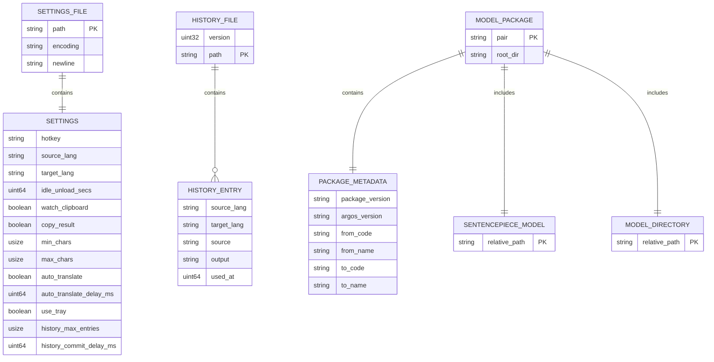

# データ構造仕様書（スキーマ・永続化・状態定義）
**tray-translate: 設定、翻訳履歴、Argos 言語モデルパッケージの保存契約**

---

## 1. 概要とデータ管理方針

### 1.1 管理対象データの目的

本書は、tray-translate がローカルファイルシステムへ保存する次のデータを定義する。

- **設定**: 翻訳言語、ホットキー、クリップボード監視、自動翻訳、履歴保持などの `Settings`。
- **翻訳履歴**: 採用された翻訳結果を新しい順に保持する `History` と `HistoryEntry`。
- **言語モデルパッケージ**: Argos 形式の `.argosmodel` を展開して導入した `ModelPackage` と、その `PackageMetadata`。

データ形式と時刻の基準は次のとおりである。

| 管理対象         | 保存形式・文字コード・改行                                                      | 時刻の基準                       | スキーマの正本                                        | 機密性・個人情報分類                                             |
| :--------------- | :------------------------------------------------------------------------------ | :------------------------------- | :---------------------------------------------------- | :--------------------------------------------------------------- |
| 設定             | UTF-8 の JSON。`serde_json` の pretty 出力に LF の末尾改行を付ける。            | 時刻フィールドなし               | 本書の設定フィールド表と `Settings` の保存契約        | 平文。ホットキー、言語、動作設定を含む。暗号化・マスキングなし   |
| 履歴             | UTF-8 の JSON。`version` と `entries` を pretty 出力し、LF の末尾改行を付ける。 | `used_at` は UNIX 秒。           | 本書の履歴フィールド表と `HistoryEntry` の保存契約    | 平文。原文・訳文にクリップボード由来の機密情報が含まれ得る       |
| モデルパッケージ | 展開済みのディレクトリとバイナリ。導入前は `.argosmodel` ZIP。                  | パッケージ固有の時刻は保存しない | 本書のパッケージ構造表と `PackageMetadata` の保存契約 | ローカルのモデルファイル。チェックサム・署名の保存や検証はしない |

履歴の原文と訳文は平文で保存される。クリップボード監視を有効にする場合、パスワード、トークン、個人情報などを含むテキストが履歴へ記録される可能性を利用者へ注意喚起する。実装は履歴の暗号化、秘匿値の自動除外、アクセス権の追加設定を行わない。

設定ファイルには独立したフォーマットバージョンフィールドを持たない。履歴は保存時に `version: 1` を持つが、現実装の読み込み処理はこの値を検証しない。モデルの `package_version` と `argos_version` はパッケージメタデータの文字列であり、アプリの保存形式バージョンとは別である。

### 1.2 データ境界（DAO / 永続化ストレージ正本）

- **本書の正本範囲**: `persistent_data`。ファイルシステムへ物理保存される設定、履歴、モデルパッケージのスキーマ、状態、配置、互換性、保存失敗時の契約を定義する。
- **DAOの責務**: `crates/app` の設定・履歴保存処理と `crates/core` のモデルパッケージ保存処理が、本書の永続化契約を実装する。
- **DTOとの使い分け**: メモリ上のモジュール間パッシング、`Command`、`Event`、`Controller` の入出力契約は詳細設計書（DD）の正本とする。
- **BDとの関係**: システム全体の責務、依存方向、翻訳機能の境界は [TT-BD-001 基本設計書](./TT-BD-001_基本設計書.md) を参照する。
- **DDとの関係**: app の `Command` / `Event` / `Controller`、履歴コミットの呼び出し順序、画面との状態遷移は [TT-DD-002 常駐アプリ制御詳細設計書](./TT-DD-002_常駐アプリ制御詳細設計書.md) を正本とする。本書はその制御フローや関数シグネチャを定義しない。
- **他文書との関係**: 環境、運用、テスト、ADR、レビュー文書はそれぞれの `ssot_scope` を正本とし、本書の保存仕様を上書きしない。
- **責務の対象外**: 翻訳モデルの学習・配布、外部モデルインデックスの通信、GUI の表示、履歴の検索、履歴削除の確認画面、複数プロセスの同時書き込み制御は本書で詳細化しない。モデル導入先の保存形式と安全回路だけを本書で定義する。
- **矛盾時の扱い**: 文書の更新日ではなく、`persistent_data` の正本である本書を更新し、BD、DD、環境仕様書、テスト文書を追従させる。

### 1.3 ファイル配置および階層構造

| データ種別         | 相対パス / 命名規則                                                                                                                                 | 保持内容                                 | 所有者・アクセス権                                                                 | 保持・バックアップ・復旧                                                                                                   |
| :----------------- | :-------------------------------------------------------------------------------------------------------------------------------------------------- | :--------------------------------------- | :--------------------------------------------------------------------------------- | :------------------------------------------------------------------------------------------------------------------------- |
| 設定ファイル       | `TT_CONFIG_DIR/settings.json`。`TT_CONFIG_DIR` が未設定または空白なら `dirs::config_dir()/tray-translate/settings.json`                             | `Settings` の全フィールド                | アプリを実行する OS ユーザー。OS の既定 ACL を使用し、アプリ固有の権限変更はしない | 利用者が削除または上書きするまで保持。アプリのバックアップはない。保存失敗時は対象ファイルを維持し、一時ファイルを削除する |
| 設定一時ファイル   | `settings.json.tmp`                                                                                                                                 | 次回保存する設定 JSON の全量             | 設定ファイルと同じディレクトリおよび OS ユーザー                                   | 保存成功時または書き込み・rename 失敗時に削除を試みる。プロセス強制終了後の残留清掃は自動契約に含めない                    |
| 履歴ファイル       | `TT_CONFIG_DIR/history.json`。設定ファイルと同じディレクトリに置く。環境変数が未設定または空白なら `dirs::config_dir()/tray-translate/history.json` | `version` と `HistoryEntry` の配列       | アプリを実行する OS ユーザー。OS の既定 ACL を使用し、アプリ固有の権限変更はしない | 利用者が個別削除・全消去またはファイル削除を行うまで保持。アプリのバックアップはない                                       |
| 破損履歴退避       | `history.json.corrupt`                                                                                                                              | 読み込めなかった履歴ファイルの元内容     | 履歴ファイルと同じディレクトリおよび OS ユーザー                                   | `load_or_recover` が rename する。自動削除・世代管理・暗号化はしない。rename に失敗しても空の履歴で起動を続ける            |
| 履歴一時ファイル   | `history.json.tmp`                                                                                                                                  | 次回保存する履歴 JSON の全量             | 履歴ファイルと同じディレクトリおよび OS ユーザー                                   | 保存成功時または書き込み・rename 失敗時に削除を試みる。プロセス強制終了後の残留清掃は自動契約に含めない                    |
| モデル保存先       | `TT_MODEL_DIR/<pair>/`。`TT_MODEL_DIR` が未設定または空白なら `dirs::data_dir()/tray-translate/packages/<pair>/`                                    | 導入済みモデルパッケージ                 | アプリを実行する OS ユーザー。OS の既定 ACL を使用し、アプリ固有の権限変更はしない | 同じ `<pair>` の導入時に既存ディレクトリを削除して置換する。モデルのバックアップ・ロールバックはない                       |
| モデル展開ステージ | `<model_dir>/.tmp_pkg_*`                                                                                                                            | `.argosmodel` を検証するための一時展開物 | モデル保存先と同じディレクトリおよび OS ユーザー                                   | `tempfile` の一時ディレクトリを使用する。処理失敗時は一時ディレクトリの削除を試み、成功時は rename で導入先へ移す          |
| 排他制御ファイル   | 作成しない                                                                                                                                          | ロック情報を保存しない                   | 該当なし                                                                           | FileLock、stale lock 回収、複数プロセスの書き込み調停は未実装であり、対象外とする                                          |

設定・履歴の保存先を決める環境変数は、値が空白だけでない場合に優先する。値が空白だけの場合は OS 標準ディレクトリへフォールバックする。OS 標準の設定ディレクトリまたはデータディレクトリを取得できない場合、対応するパス解決はエラーになる。

---

## 2. データ構造およびスキーマ定義（Mermaid データモデル図）

### 2.1 エンティティ関係・データモデル構造（Mermaid ER図）

次の図は、保存されるファイル、論理データ、モデルパッケージの関係を示す。`SETTINGS` と `HISTORY_ENTRY` は JSON の論理データ、`MODEL_PACKAGE` は展開済みディレクトリである。

ER図の `SETTINGS_FILE`、`HISTORY_FILE`、`MODEL_PACKAGE`、`PACKAGE_METADATA`、`HISTORY_ENTRY`、`SENTENCEPIECE_MODEL`、`MODEL_DIRECTORY` は、2.2 のフィールド表および配置表で同じ保存契約を定義する。`SETTINGS_FILE` は常に1個の `SETTINGS` JSONオブジェクトを保持し、`HISTORY_FILE` は0個以上の `HISTORY_ENTRY` を保持する。1個の `MODEL_PACKAGE` は1個の metadata、1個の `sentencepiece.model`、1個の `model/` ディレクトリを必要とする。

### 2.2 データモデル・フィールド仕様

#### 2.2.1 設定ファイル（`settings.json`）

`Settings` は `#[serde(default)]` でデシリアライズされる。JSON入力で欠落したフィールドは対応する既定値で補完され、未知キーは拒否されない。`null` は各フィールドの型に変換できないため受理しない。読み込み済みの値と保存前の値は `Settings::validate` で検証する。言語コードは検証時に前後空白を除外するが、設定値自体を trim して保存する正規化は行わない。

| JSONパス / フィールド名     | データ型 | 必須性                     | NULL可 | デフォルト値                          | 許容値・制約条件                                                                                                      | 互換性・移行メモ                                                       |
| :-------------------------- | :------- | :------------------------- | :----- | :------------------------------------ | :-------------------------------------------------------------------------------------------------------------------- | :--------------------------------------------------------------------- |
| `$.hotkey`                  | 文字列   | 論理必須。入力JSONの欠落可 | 不可   | `Ctrl+Alt+T`                          | `Hotkey::parse` が成功する文字列                                                                                      | 欠落時は既定値で補完。検証失敗は設定エラー                             |
| `$.source_lang`             | 文字列   | 論理必須。入力JSONの欠落可 | 不可   | `en`                                  | trim後に非空、実装の `len()` で長さ10以下、ASCII英数字または `-` のみ。trim後の文字列に `_`、空白、その他の文字は不可 | 欠落時は既定値で補完。trim後の値を検証するが、値の保存時正規化はしない |
| `$.target_lang`             | 文字列   | 論理必須。入力JSONの欠落可 | 不可   | `ja`                                  | trim後に非空、実装の `len()` で長さ10以下、ASCII英数字または `-` のみ。trim後の文字列に `_`、空白、その他の文字は不可 | 欠落時は既定値で補完。trim後の値を検証するが、値の保存時正規化はしない |
| `$.idle_unload_secs`        | `u64`    | 論理必須。入力JSONの欠落可 | 不可   | `300`                                 | `Settings::validate` による範囲検証なし。`0` はモデルを解放しない                                                     | 欠落時は既定値で補完。将来の上限追加は互換性に影響する                 |
| `$.watch_clipboard`         | 真偽値   | 論理必須。入力JSONの欠落可 | 不可   | `false`                               | 真偽値のみ                                                                                                            | 欠落時は既定値で補完                                                   |
| `$.copy_result`             | 真偽値   | 論理必須。入力JSONの欠落可 | 不可   | `true`                                | 真偽値のみ                                                                                                            | 欠落時は既定値で補完                                                   |
| `$.min_chars`               | `usize`  | 論理必須。入力JSONの欠落可 | 不可   | `1`                                   | 1以上、かつ `max_chars` 以下                                                                                          | 欠落時は既定値で補完。検証失敗は設定エラー                             |
| `$.max_chars`               | `usize`  | 論理必須。入力JSONの欠落可 | 不可   | `5000`                                | `min_chars` 以上。独立した上限値は定義しない                                                                          | 欠落時は既定値で補完。検証失敗は設定エラー                             |
| `$.auto_translate`          | 真偽値   | 論理必須。入力JSONの欠落可 | 不可   | `false`                               | 真偽値のみ                                                                                                            | 欠落時は既定値で補完                                                   |
| `$.auto_translate_delay_ms` | `u64`    | 論理必須。入力JSONの欠落可 | 不可   | `800`                                 | `100..=10000` ミリ秒                                                                                                  | 欠落時は既定値で補完。範囲外は設定エラー                               |
| `$.use_tray`                | 真偽値   | 論理必須。入力JSONの欠落可 | 不可   | Linux は `false`、Linux 以外は `true` | 真偽値のみ。明示値は OS 既定値を上書きする                                                                            | 欠落時は実行OSに応じた既定値で補完                                     |
| `$.history_max_entries`     | `usize`  | 論理必須。入力JSONの欠落可 | 不可   | `200`                                 | `0..=1000`。`0` は履歴を記録しない                                                                                    | 欠落時は既定値で補完。範囲外は設定エラー                               |
| `$.history_commit_delay_ms` | `u64`    | 論理必須。入力JSONの欠落可 | 不可   | `3000`                                | `500..=30000` ミリ秒                                                                                                  | 欠落時は既定値で補完。範囲外は設定エラー                               |

設定ファイルが存在しない場合、`Settings::load` はファイルを作らず `Settings::default` を返す。存在する設定の JSON 構文エラー、型エラー、または `Settings::validate` の失敗はエラーとして返す。保存は検証成功後だけ行う。

#### 2.2.2 履歴ファイル（`history.json`）

履歴の保存形式は次の2フィールドを持つ JSON オブジェクトである。

| JSONパス / フィールド名    | データ型                           | 必須性                         | NULL可                                       | デフォルト値 | 許容値・制約条件                                                                    | 互換性・移行メモ                                                                       |
| :------------------------- | :--------------------------------- | :----------------------------- | :------------------------------------------- | :----------- | :---------------------------------------------------------------------------------- | :------------------------------------------------------------------------------------- |
| `$.version`                | 保存時は `u32`。読み込み時は未使用 | 保存時必須。読み込み時は任意   | 保存時は不可。読み込み時は任意のJSON値を無視 | 保存値は `1` | 現実装の読み込み処理は値を参照・検証しない                                          | フォーマット識別のため保存するが、明示的な移行はない。未知の値も読み込み時に拒否しない |
| `$.entries`                | 配列                               | 保存時必須。読み込み時の欠落可 | 不可                                         | `[]`         | 要素は `HistoryEntry`。保存時は全件を書き出す                                       | 欠落時は空配列。未知のJSONキーは拒否しない                                             |
| `$.entries[*].source_lang` | 文字列                             | 要素ごとに必須                 | 不可                                         | なし         | 記録時は前後空白を除き ASCII 小文字化。重複キーの言語比較は大文字小文字を区別しない | 読み込み時に値の正規化・意味検証は行わない                                             |
| `$.entries[*].target_lang` | 文字列                             | 要素ごとに必須                 | 不可                                         | なし         | `source_lang` と同じ正規化・重複判定規則                                            | 読み込み時に値の正規化・意味検証は行わない                                             |
| `$.entries[*].source`      | 文字列                             | 要素ごとに必須                 | 不可                                         | なし         | 記録時は前後空白を除き、空白だけの原文は記録しない。重複キーは trim 後の原文一致    | 読み込み時に空白原文を除外しない                                                       |
| `$.entries[*].output`      | 文字列                             | 要素ごとに必須                 | 不可                                         | なし         | 訳文を保存する。記録時に出力文字列の trim は行わない                                | 読み込み時に内容の意味検証は行わない                                                   |
| `$.entries[*].used_at`     | `u64`                              | 要素ごとに必須                 | 不可                                         | なし         | UNIX 秒。`HistoryEntry::new` は現在時刻を設定する                                   | 保存形式の時刻精度は秒。タイムゾーン文字列は保存しない                                 |

履歴の配列は先頭が最新である。`History::record` は `history_max_entries == 0` または空白原文の場合、履歴を変更しない。同じ翻訳元、翻訳先、trim後の原文を持つエントリが既にある場合は追加せず、既存エントリを削除して先頭へ移動し、訳文と `used_at` を新しい値へ更新する。既に先頭にあり訳文も同じ場合だけ変更なしとし、呼び出し側は保存を行わない。上限を超えたエントリは `truncate` で末尾から削除する。

個別削除は重複キーに一致する1件を削除し、全消去は全エントリを削除する。これらはメモリ上の一覧を変更する操作であり、永続化を行う場合は `history.json` 全体を一時ファイルから置き換える。読み込み時は保存された配列順を維持し、設定変更後の上限による既存履歴の削減は、次回の記録時に適用する。

#### 2.2.3 モデルパッケージのメタデータ（`metadata.json`）

導入済みモデルは `<model_dir>/<pair>/` をルートとし、ルート直下の `metadata.json` を読み込む。`PackageMetadata` の6フィールドは文字列で、欠落時の既定値はない。未知のJSONキーは serde_json の既定動作により拒否しない。

| JSONパス / フィールド名 | データ型 | 必須性 | NULL可 | デフォルト値 | 許容値・制約条件           | 互換性・移行メモ                                      |
| :---------------------- | :------- | :----- | :----- | :----------- | :------------------------- | :---------------------------------------------------- |
| `$.package_version`     | 文字列   | 必須   | 不可   | なし         | metadata JSON の文字列     | 欠落・型不一致はメタデータエラー                      |
| `$.argos_version`       | 文字列   | 必須   | 不可   | なし         | metadata JSON の文字列     | 欠落・型不一致はメタデータエラー                      |
| `$.from_code`           | 文字列   | 必須   | 不可   | なし         | 翻訳元言語コードとして保存 | 欠落・型不一致はメタデータエラー。`pair` の構成に使用 |
| `$.from_name`           | 文字列   | 必須   | 不可   | なし         | 翻訳元言語名として保存     | 欠落・型不一致はメタデータエラー                      |
| `$.to_code`             | 文字列   | 必須   | 不可   | なし         | 翻訳先言語コードとして保存 | 欠落・型不一致はメタデータエラー。`pair` の構成に使用 |
| `$.to_name`             | 文字列   | 必須   | 不可   | なし         | 翻訳先言語名として保存     | 欠落・型不一致はメタデータエラー                      |

#### 2.2.4 モデルパッケージの物理構造

| エンティティ / 物理項目             | データ型   | 必須性     | NULL可 | デフォルト値 | 許容値・制約条件                                                                           | 互換性・移行メモ                                                  |
| :---------------------------------- | :--------- | :--------- | :----- | :----------- | :----------------------------------------------------------------------------------------- | :---------------------------------------------------------------- |
| `SETTINGS_FILE.path`                | パス文字列 | 必須       | 不可   | なし         | 設定ディレクトリ直下の `settings.json`                                                     | `TT_CONFIG_DIR` または OS 標準設定ディレクトリから解決            |
| `SETTINGS_FILE.encoding`            | 文字列     | 必須       | 不可   | `UTF-8`      | BOMなし                                                                                    | 保存処理は UTF-8 の JSON 文字列を生成する                         |
| `SETTINGS_FILE.newline`             | 文字列     | 必須       | 不可   | `LF`         | JSON本文の末尾に改行1つ                                                                    | 保存時に `serde_json` 出力へ LF を追加する                        |
| `HISTORY_FILE.path`                 | パス文字列 | 必須       | 不可   | なし         | 設定ファイルと同じディレクトリ直下の `history.json`                                        | `TT_CONFIG_DIR` または OS 標準設定ディレクトリから解決            |
| `HISTORY_FILE.version`              | `u32`      | 保存時必須 | 不可   | `1`          | 現行保存値は1                                                                              | 読み込み処理では値を検証しない                                    |
| `MODEL_PACKAGE.pair`                | 文字列     | 必須       | 不可   | なし         | 通常は `<from_code>_<to_code>`。アーカイブのトップディレクトリ名がある場合はその名前を使用 | 言語コードの区切りは `_`。設定の言語コード自体に `_` は許可しない |
| `MODEL_PACKAGE.root_dir`            | パス       | 必須       | 不可   | なし         | `<model_dir>/<pair>/`                                                                      | 同じペアの再導入時は既存ディレクトリを削除して置換                |
| `SENTENCEPIECE_MODEL.relative_path` | 相対パス   | 必須       | 不可   | なし         | `sentencepiece.model` がパッケージ直下に存在する                                           | 欠落時はモデルパッケージエラー                                    |
| `MODEL_DIRECTORY.relative_path`     | 相対パス   | 必須       | 不可   | なし         | `model/` がパッケージ直下に存在する                                                        | 欠落時はモデルパッケージエラー。内部ファイル一覧は保存しない      |

モデル一覧や導入済みペアのレジストリを別ファイルへ保存する実装はない。利用時に保存先を走査・解決し、`ModelPackage` を開いてメタデータと必須構造を確認する。

---

## 3. 永続化・原子置換契約・排他制御

### 3.1 原子的書き込み契約（Atomic Write Contract）

#### 設定と履歴

設定と履歴の保存は、対象ファイルと同じディレクトリの一時ファイルを経由する。

1. 設定は `Settings::validate` を実行する。検証に失敗した場合、保存先も一時ファイルも変更しない。履歴は呼び出し側が変更有無を確認してから保存する。
2. 保存先の親ディレクトリを作成する。
3. `serde_json` の pretty JSON を全量生成し、末尾に LF を1つ付ける。
4. `settings.json.tmp` または `history.json.tmp` へ全量を書き出す。
5. 一時ファイルを保存先へ `fs::rename` して置き換える。
6. 書き込みまたは rename が失敗した場合、一時ファイルを削除する。削除自体の失敗は元の保存エラーを置き換えない。

一時ファイルと正本は同一ディレクトリに置くため、置換は同一ファイルシステム内で行われる。保存処理は `fsync` または同等のディスク同期を行わない。したがって、rename 成功後の電源断まで含む永続性は保証しない。アプリは世代バックアップやロールバック用コピーも作成しない。

#### モデルパッケージ

`.argosmodel` は次の順序で導入する。

1. `target_dir` を作成し、同じディレクトリ内に `.tmp_pkg_*` の一時ディレクトリを作成する。
2. ZIP のエントリ数を1000以下、宣言された展開後サイズの合計を2 GiB以下に制限する。
3. 各エントリを `enclosed_name` で検証し、Zip Slip と判定されるパスを拒否してステージへ展開する。アーカイブにトップディレクトリがある場合はそれを剥がしてパッケージ直下を構成する。
4. ステージ上の `metadata.json` を読み込み、`PackageMetadata` を検証する。パッケージは `sentencepiece.model` と `model/` を必須とする `ModelPackage` の構造契約を満たす必要がある。
5. 導入先 `<model_dir>/<pair>/` が存在する場合は `remove_dir_all` で削除し、ステージディレクトリを `fs::rename` して確定する。
6. 導入後に `ModelPackage::open` で metadata と必須構造を確認する。既存ディレクトリを削除した後にこの確認へ失敗した場合、旧モデルへ戻すバックアップやロールバックはない。

ステージは対象ディレクトリと同じファイルシステム上に置くため、最後の rename は高速な同一ディレクトリ階層内の置換である。ただし、既存宛先を先に削除するため、既存モデルを保全したままの原子スワップではない。チェックサムまたは署名検証は行わない。

### 3.2 排他制御仕様（FileLock）

| 項目                    | 現行仕様                                                                                                |
| :---------------------- | :------------------------------------------------------------------------------------------------------ |
| ロック対象ファイル      | なし。`settings.json`、`history.json`、モデル導入先に対するロックファイルを作成しない                   |
| ロック識別情報          | 保存しない。プロセスID、ホスト名、取得時刻も記録しない                                                  |
| ロック獲得待ち方針      | 待機・タイムアウト・キューイングを行わない                                                              |
| 取得失敗時の処理        | FileLock取得処理自体がない。通常のファイルI/Oまたは rename の OS エラーを呼び出し側へ返す               |
| stale lock の判定・回収 | 対象外。回収処理を持たない                                                                              |
| 正常終了時の解放        | 対象となるロックがない                                                                                  |
| 異常終了・強制終了時    | OS のファイルハンドル解放に任せる。残留した `.tmp` または `.tmp_pkg_*` の一般的な起動時清掃は実装しない |
| 多重起動・同時書き込み  | 防止しない。複数プロセスによる同一ファイルまたは同一モデルペアの同時書き込みは対象外                    |

FileLock と多重起動防止は未対応の制約である。複数プロセスが同時に保存した場合の最終内容、rename順序、モデル置換の結果は保証しない。

---

## 4. データライフサイクルと互換性保全

### 4.1 フォーマット移行と互換性ルール

| 移行元バージョン            | 移行先バージョン             | 実行契機                   | 変換内容・保持する旧フィールド                                                        | ロールバック可否・方法                                 | 失敗時の扱い                                                                    |
| :-------------------------- | :--------------------------- | :------------------------- | :------------------------------------------------------------------------------------ | :----------------------------------------------------- | :------------------------------------------------------------------------------ |
| 設定ファイルの項目欠落      | 現行 `Settings`              | `settings.json` の読み込み | `#[serde(default)]` により欠落フィールドを既定値で補完。未知キーは保持せず無視する    | 明示的な移行・バックアップなし                         | JSON構文・型・設定値検証の失敗をエラーとして返す                                |
| 設定ファイルの現行形式      | 現行 `Settings`              | 読み込み・保存             | 専用の `version` はなく、全フィールドを現在の構造へデシリアライズする                 | 保存前の旧ファイルをアプリは退避しない                 | 保存前検証に失敗した場合は書き込まない                                          |
| 履歴ファイルの `version: 1` | 現行 `History`               | `history.json` の読み込み  | `entries` を読み込む。読み込み用構造体は `version` を参照せず、未知キーも拒否しない   | 明示的な format migration、変換履歴、ロールバックなし  | JSONを読めない場合は `.json.corrupt` へ rename を試み、空の履歴で起動する       |
| 履歴ファイルの破損          | 空の `History`               | `load_or_recover`          | 元ファイルを `history.json.corrupt` へ退避する                                        | 退避ファイルを利用者が手動確認できる。自動復元はしない | 退避 rename に失敗しても警告後に空の履歴で起動する                              |
| 導入済みモデルパッケージ    | 同じ `<pair>` の新パッケージ | `.argosmodel` の導入       | 一時展開、ZIP安全検証、metadata・必須構造の確認後、既存ディレクトリを削除して置換する | 旧ディレクトリのバックアップ・ロールバックなし         | 展開・検証・rename のエラーを返す。既存削除後の最終検証失敗は旧モデルへ戻せない |

設定に新しいフィールドを追加する場合は、既存ファイルの欠落時に安全な既定値を `Settings::default` と検証へ追加する。履歴の追加フィールドは、現行の serde_json の未知キー無視により読み込み時のエラーにはならないが、明示的な移行や既存エントリの変換は実装しない。フォーマットの意味を変更する場合は、本書、実装、テストを同じ変更単位で更新する。

`version` の値を使った履歴の分岐、設定の段階的移行、モデルのchecksum・署名検証は未対応である。履歴の将来形式を確実に解釈するには、読み込み時のバージョン検証と移行処理を別途追加する必要がある。

### 4.2 データライフサイクルと保全上の注意

- **設定**: 起動時にファイルがなければ既定値をメモリへ展開する。明示的に保存するときだけ `settings.json` を生成または置換する。設定値の検証に失敗したファイルは自動修復しない。
- **履歴**: 翻訳結果の記録時に重複判定、先頭移動、上限適用を行う。`history_max_entries` が0なら記録しない。保存は配列全件の書き直しで、個別レコードの追記形式ではない。
- **履歴の削除**: 個別削除と全消去は一覧から対象を除く操作である。永続化時は空または削減後の配列全体を `history.json` へ保存する。
- **履歴の秘匿**: `history.json` と `history.json.corrupt` は平文であり、クリップボード監視の入力がそのまま原文として残る場合がある。機密情報を扱う利用者は監視・履歴記録の設定とファイル権限を確認する必要がある。
- **モデル**: モデル一覧はファイルとして保存しない。導入時の同名ペア置換で旧ディレクトリを削除するため、別バックアップがなければ旧モデルを復元できない。
- **クリーンアップ**: 正常な設定・履歴保存では一時ファイルを削除する。異常終了後に残る可能性のある一時ファイルを、次回起動時に自動探索して削除する契約はない。

### 4.3 現行実装の制約

| 制約                           | 影響                                                               | 現行の扱い                                                                  |
| :----------------------------- | :----------------------------------------------------------------- | :-------------------------------------------------------------------------- |
| FileLock未実装                 | 同一ファイル・同一モデルペアへの複数プロセス書き込みを調停できない | 複数プロセス同時書き込みを対象外とし、ロック情報を保存しない                |
| 明示的なformat migration未実装 | 将来の履歴バージョンや意味変更を自動変換できない                   | `version: 1` は保存するが読み込み時に検証せず、必要時は本書と実装を更新する |
| fsync未実装                    | rename成功後の電源断・ストレージ障害に対する耐久性を保証できない   | 同一ディレクトリのtmp→renameだけを行い、バックアップは作成しない            |
| モデルのchecksum・署名検証なし | 配布物の真正性・完全性をアプリが検証しない                         | ZIP構造、Zip Slip、エントリ数、展開サイズだけを検証する                     |
| 履歴の平文保存                 | クリップボード由来の機密情報がファイルに残る可能性がある           | 利用者へ注意を促し、暗号化・自動マスキングは行わない                        |
| モデル置換のロールバックなし   | 既存パッケージ削除後の失敗から旧モデルへ戻せない                   | `.tmp_pkg_*` で途中展開を分離するが、旧ディレクトリのバックアップは作らない |

---

## 5. 作成完了チェック

- [x] `document_number`、`source_issue`、`document_role`、`ssot_scope`、`status`、`owner`をFrontmatterへ設定した。
- [x] 設定、履歴、モデルパッケージを単一DSの管理対象として定義した。
- [x] 管理対象、JSON形式、文字コード、改行、時刻基準、スキーマの正本形式、平文保存の注意を記入した。
- [x] 全エンティティを実データ名のER図とフィールド仕様の双方に定義し、関係とカーディナリティを一致させた。
- [x] 必須性、NULL可否、既定値、列挙・範囲、一意性、サイズ上限、未知キーの扱いを記入した。
- [x] 設定、履歴、破損退避、一時ファイル、モデル、展開ステージのパス、権限、保持、バックアップ・復旧を記入した。
- [x] 設定・履歴のtmp→rename、モデルの一時展開→検証→削除・rename、失敗時の一時ファイル処理を記入した。
- [x] fsync未実装、FileLock未実装、多重起動防止なし、モデルchecksum・署名検証なしを制約として記録した。
- [x] 設定の既定値補完、履歴 `version: 1` の読み込み実態、破損時の `.json.corrupt` 退避、明示的な移行未実装を記入した。
- [x] `TT-DD-002` が app の `Command` / `Event` / `Controller` を定義する文書として作成され、本書は永続化構造だけを定義している。
- [x] テンプレート由来の未置換プレースホルダ、サンプルエンティティ、未確定の日付を残していない。

---

## 6. 改訂履歴（Change Log）

| 版数    | 改訂日     | 変更者              | 変更内容・変更理由 (Why)                                                                                |
| :------ | :--------- | :------------------ | :------------------------------------------------------------------------------------------------------ |
| Rev.1.0 | 2026-10-27 | tray-translate team | #101 に基づく初版作成。設定、履歴、モデルパッケージの実装済み保存契約を単一のデータ構造仕様書へ整理した |
